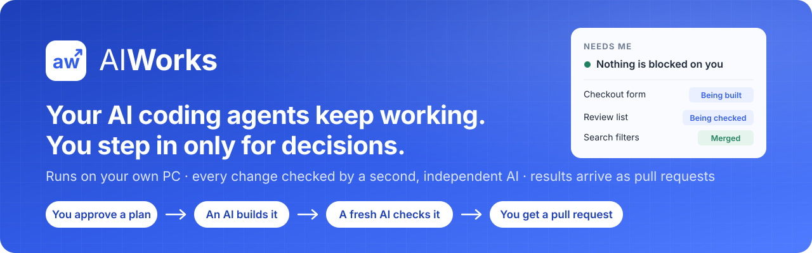
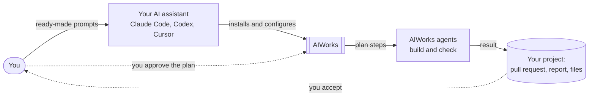
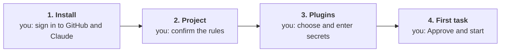
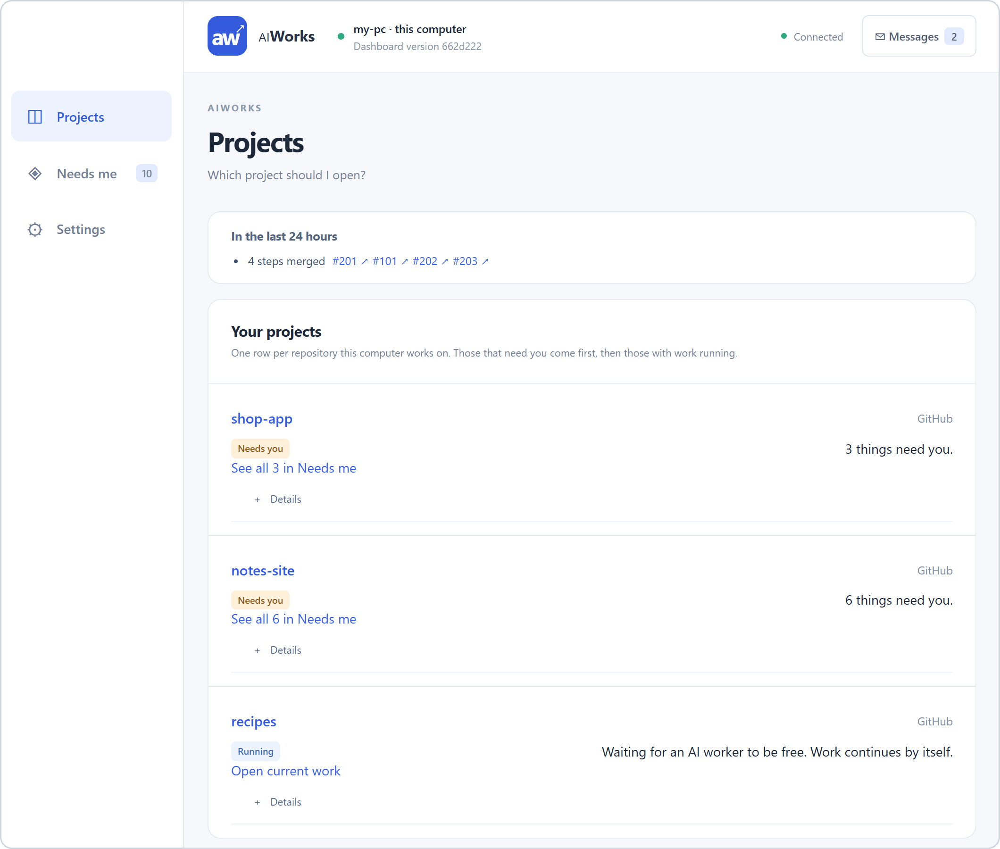
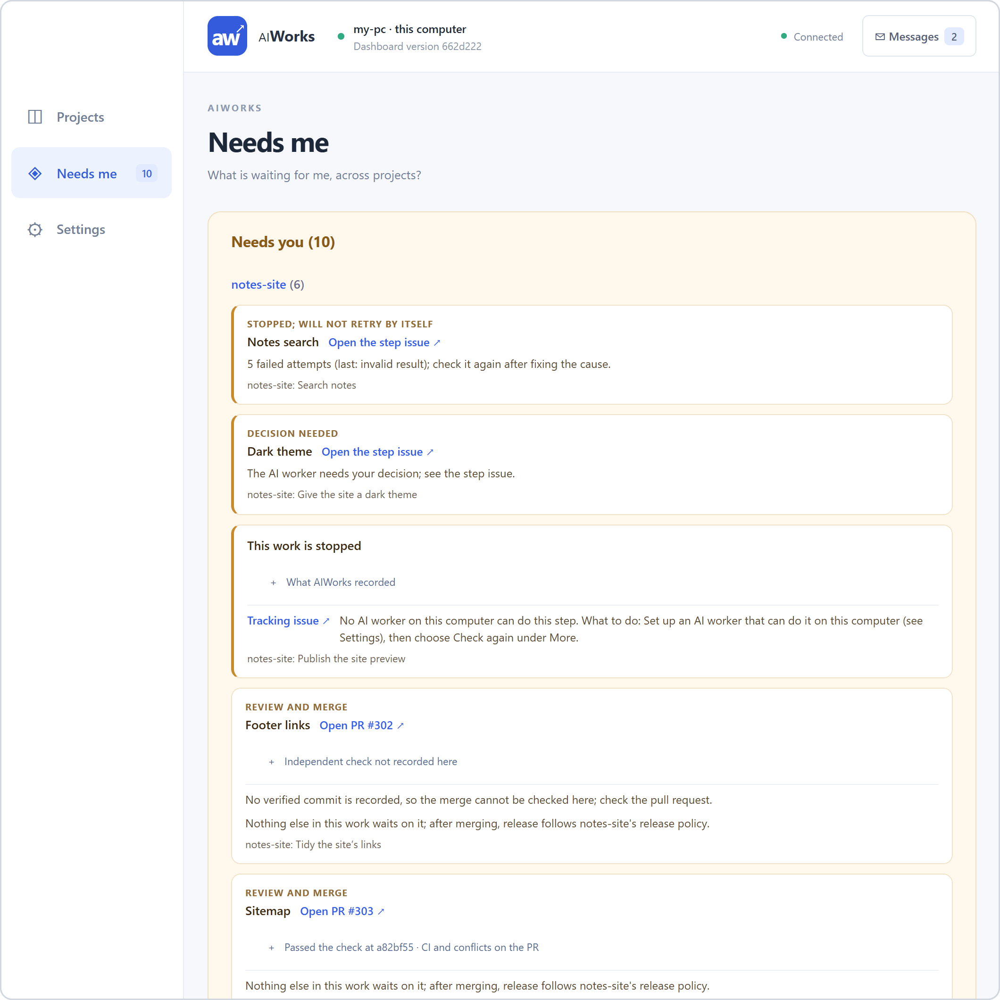
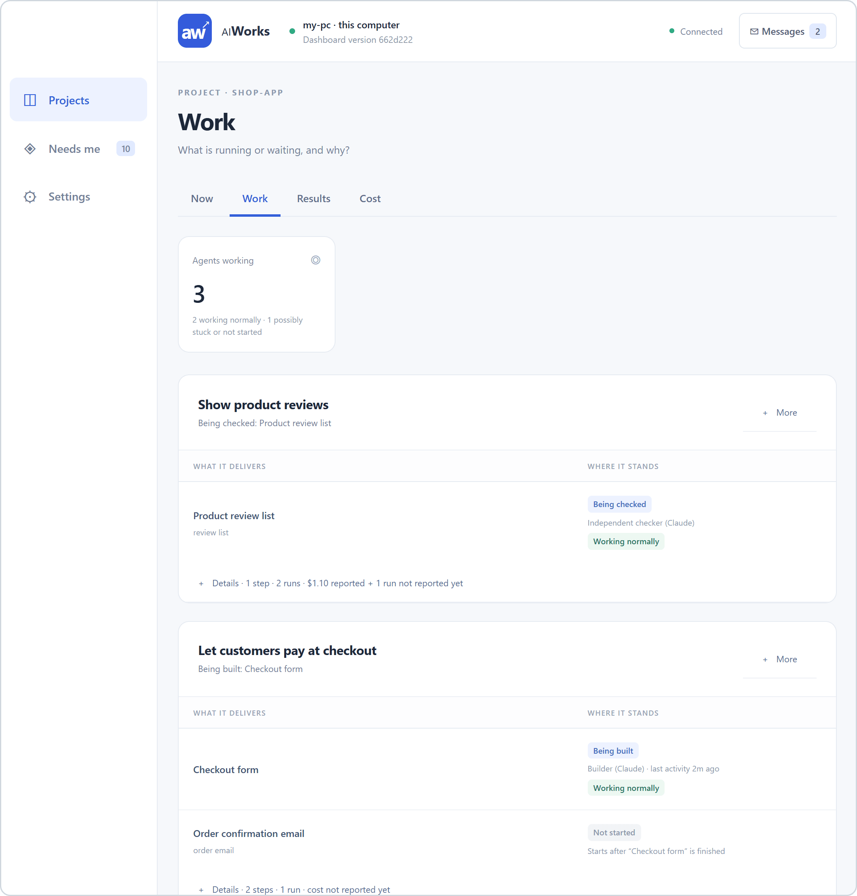
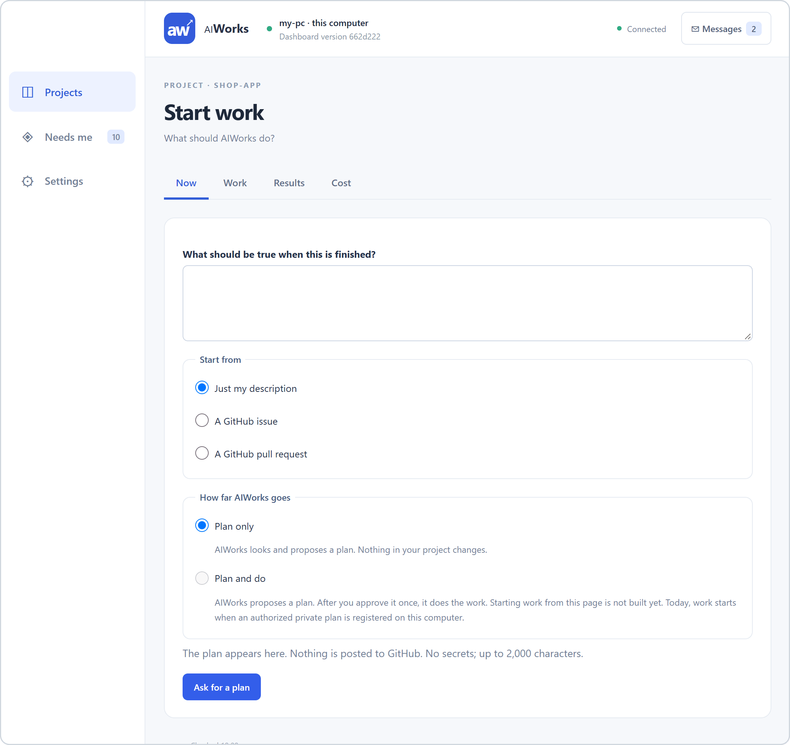

<p align="center">
  
</p>

<p align="center">
  <b>English</b> · <a href="README.ru.md">Русский</a>
</p>

<p align="center">
  
  
  
  
</p>

<p align="center">
  <a href="#what-it-is">What it is</a> ·
  <a href="#set-up-in-four-messages">Setup</a> ·
  <a href="#your-decisions">Decisions</a> ·
  <a href="#plugins">Plugins</a> ·
  <a href="#what-it-looks-like">What it looks like</a> ·
  <a href="#more">More</a>
</p>

---

## What it is

**AIWorks is a workplace for your AI agents, on your own computer.** Agents use it, not people. You set it up once through your AI assistant. After that you set goals, approve plans and accept results.



You touch the system in three places: you give prompts to your assistant, you approve a plan, and you accept the result. The agents do everything else: starting steps, checking, fixing, waiting out limits and restarting after crashes.

### What you get

| | |
| --- | --- |
| 🔁 **Work does not stall** | The next step starts as soon as the last one is done. After a crash or a reboot, AIWorks carries on where it stopped. If it hits a usage limit, it waits for the reset and continues. |
| 🔍 **Every result is checked** | A separate agent that did not do the step checks each one. If it fails the check, it goes back for another round with the findings. |
| 🙋 **You are not pestered** | **Needs you** shows only what only you can do: signing in to an account, access, payment, and the results you chose to accept yourself. |
| 🛡️ **Nothing extra** | Only approved plans run. Merge and release happen only if you turned them on for the project. Passwords and keys are never kept in the settings. |

### One AIWorks, many kinds of projects

AIWorks is not tied to one kind of work. It can be code, texts, research: any work you can describe as "done when...". Each project has its own rules: where tasks come from, how the result is checked and where it goes.

| | Where tasks come from | How it is checked | Where the result goes |
| --- | --- | --- | --- |
| **Project 1**: an app on GitHub | You write to your assistant | A checker agent runs the tests again on that exact version | A pull request with two reports |
| **Project 2**: texts in a folder on disk | The **Start work** button in the dashboard | A checker agent compares the result with the plan's criteria | Files in the project: apply or undo |
| **Project 3**: tasks from your own system | Your tracker or service submits them through the API | Plus a separate computer for full tests | A report that your system picks up itself |

Project 1 works by default. Projects without GitHub (2) and tasks through the API (3) already exist in the code and are switched on with separate [plugins](#plugins).

### What it delivered in one day

On 12–13 October 2026, AIWorks spent a day building the next version of itself. The figures are counted from this repository's history.

| | |
| --- | --- |
| **63** | finished changes in 24½ hours, each one checked by a second agent |
| **18** | of them merged between midnight and 7 a.m., while the owner slept |
| **~45 min** | typical time to build and check one step |
| **385 → 760** | automated tests: the safety net grew along with the code |

---

## Set up in four messages

You do not set up AIWorks by hand. You send your AI assistant four ready-made messages, one after another. It installs the programs, writes the settings, checks that everything works, and stops only where it needs you.

**Before you start:**

- a Windows 10 or 11 computer that you can leave switched on;
- an AI assistant that **runs commands on this computer**: Claude Code, Codex, Cursor or Gemini CLI. An ordinary chat in a browser will not do;
- a GitHub account and a Claude subscription: Claude is AIWorks' main agent, even if you set up with a different assistant;
- about an hour, of which about ten minutes is your time.



### 1. Install

```text
Install and set up AIWorks on this computer: https://github.com/netbka/aiworks
Follow docs/setup/README.md, layers 1–3.
Check what is already installed and install what is missing. Create the data folder,
config.json and the governance folder, turn on the coordinator and plan approval
by button (Plan and do), register the two background tasks
and open the dashboard.
Ask me only for sign-ins and approvals that you cannot do yourself.
Do not touch my projects. At the end, briefly: what was done, what was checked, what failed.
```

**You will be asked to:** sign in to GitHub and Claude Code through their own sign-in windows.
**You get:** a dashboard at `http://127.0.0.1:4318` that starts by itself when you sign in to Windows.

### 2. Connect a project

```text
Connect my project to AIWorks: <GitHub link or folder on disk>.
Follow docs/setup/README.md, layer 4.
Suggest the project's rules: which folders the agents must not touch, how to check
the result, and who accepts it: me or AIWorks itself.
Do not change anything in the project itself. Tell me where I confirm the rules.
```

**You will be asked to:** confirm the project's rules and choose who accepts the result.
**You get:** the project in the **Projects** list, ready for tasks. Send the same message for each new project.

### 3. Plugins (optional)

```text
Show me the AIWorks plugins from docs/plugins/README.md: what each one does, which
are already on, and what each one needs. Let me choose.
Turn on the ones I choose. For secrets, write only the reference names and tell me which
lines I must type into .env myself. Do not ask me for the values.
Then check each plugin that is on and show me the result.
```

**You will be asked to:** choose which plugins you want, and enter the secrets. You type the secrets into the `.env` file yourself, and the assistant never sees them. Windows Credential Manager, Infisical and other stores are [optional](docs/setup/README.md#where-secrets-live).
**You get:** a list of "turned on and checked".

### 4. First task

```text
Use AIWorks for the project <name>. I need: <what should be true when it is done>.
Write a short plan: the result, how we will check it, what is included, what comes next.
Do not touch the project. Tell me where I approve the plan.
```

**You will be asked to:** press **Approve and start** on the Review tab. No agent can press this button for you. If approval by button is not turned on, you tell the assistant "I approve", and it registers the plan itself.
**You get:** within an hour or two, a pull request (or a report, or files) with the builder's report and the checker's verdict.

<details>
<summary><b>Or in one message</b></summary>

```text
Set up AIWorks completely, following docs/setup/README.md from https://github.com/netbka/aiworks:
installation, the project <link or folder>, plugins <list, or "suggest some yourself">,
and a plan for the first task: <what is needed>.
Stop only for sign-ins, secrets and approvals in the dashboard.
```

</details>

> **Commands exist too**, and your assistant uses them as well. If you prefer to work by hand, every step with its commands is described in the [setup by layers](docs/setup/README.md). It is a shortcut, not a required path.

---

## Your decisions

Each layer of the system needs its own decisions. The assistant will suggest a default. Change it only if your situation is different.

| Layer | What you decide | Default |
| --- | --- | --- |
| **1. Computer and accounts** | Which computer runs AIWorks; which AI subscriptions to connect | This computer; Claude as the main agent, Codex as a backup |
| **2. Installation** | Where AIWorks keeps its data | A `.local` folder next to AIWorks |
| **3. Coordinator** | Whether you want a helper that answers in the dashboard and writes plans; whether you approve a plan with a button or by telling the assistant | On, approval by button |
| **4. Projects** | Which projects to connect; what agents must not touch; who accepts the result; whether AIWorks merges by itself | AIWorks accepts; you merge |
| **5. Plugins** | Whether you need release, external checks, tasks from other systems, notifications | All off |
| **6. Work** | Which tasks to set and how often to look | Look at **Needs you** when it suits you |

Why it is set up this way, and what to choose in each case, is in the [setup by layers](docs/setup/README.md).

## Plugins

A plugin is a capability that connects AIWorks to something outside it. Each one is off until you turn it on, and you turn it on with one message to your assistant.

| Plugin | What for | Status |
| --- | --- | --- |
| [Backup agents](docs/plugins/README.md#backup-agents) | Codex and Cursor take over when Claude hits a limit | Codex works as a checker, Cursor does not yet |
| [Multiple accounts](docs/plugins/README.md#multiple-accounts) | Work switches to another account when one hits its limit | Built, off |
| [Projects without GitHub](docs/plugins/README.md#projects-without-github) | A folder on disk or a local Git repository instead of GitHub | Built, off |
| [Automatic merge](docs/plugins/README.md#automatic-merge) | AIWorks merges checked changes itself | Built, off |
| [Release](docs/plugins/README.md#release) | After a merge, the project is released by its own instructions and checked | Built, off |
| [External check service](docs/plugins/README.md#external-check-service) | Another computer also runs the full tests | Built, off |
| [Tasks through the API](docs/plugins/README.md#tasks-through-the-api) | Your tracker or service submits tasks and picks up reports itself | Built, off |
| [Telegram alerts](docs/plugins/README.md#telegram-alerts) | A message when something is blocked | Built, not tested with a live bot |
| [Website checks in a browser](docs/plugins/README.md#website-checks-in-a-browser) | An agent opens the page and checks it with its own eyes | Built, not tested on a real project |
| [Sign-in to web systems](docs/plugins/README.md#sign-in-to-web-systems) | An agent works in the web interface of your CRM or admin panel under a separate account | Built, off |
| [Parallel work](docs/plugins/README.md#parallel-work) | Several tasks at once, with care for the computer's load | Built, off |

---

## What it looks like

Day to day, you do not type commands. You look at the dashboard on your computer and at GitHub, when it suits you.

> The screenshots show made-up projects.

**Projects** shows all projects on one page. Those that need you come first, then those with work running.

<p align="center"></p>

**Needs you** shows only what only you can do. Usage limits, pauses and AIWorks's own problems never appear here: it deals with them itself.

<p align="center"></p>

**Work** inside a project shows who is on each step now, the builder or the checker, and whether they are stuck. You can pause a step, cancel it or send the builder a hint.

<p align="center"></p>

**Start work** is a new task in words, from an issue or from a pull request. A plan appears first. Nothing in the project changes until you approve it.

<p align="center"></p>

### How to set tasks

| Way | When it fits |
| --- | --- |
| Write to your assistant in words | The main way |
| The **Start work** button in the dashboard | When the assistant is not open |
| An outside system through the [API](docs/plugins/README.md#tasks-through-the-api) | When tasks are born in a tracker, not in a person's head |

### When a task needs a sign-in to another system

Sometimes the work has to be done in the web interface of another system: fixing records in a CRM, checking screens in an admin panel. The password is never handed to the agent.

1. 🙋 You create a separate account for AIWorks with the fewest rights it needs, and type its username and password into `.env`.
2. The assistant describes in the settings what the sign-in looks like in that system: the page, the fields, the button.
3. 🙋 If the agent must change things, not only look, you allow the system's address for the project.
4. Before each run, AIWorks signs in itself in a separate browser and hands the agent a browser that is already signed in. The agent sees neither the password nor the sign-in form.

Details are in the [Sign-in to web systems plugin](docs/plugins/README.md#sign-in-to-web-systems).

## Honest limits

- **Windows only.** On other systems AIWorks deliberately does not start agents.
- **Early preview.** Tested on one installation with GitHub and Claude Code.
- **The checker lowers the risk but does not remove it.** Until you hand merging to AIWorks, the decision stays with you.
- **Tests run on your computer.** If a project's online checks run on another system, a change can pass here and fail there. The [external check service](docs/plugins/README.md#external-check-service) exists for this.

---

## More

| Document | What it covers |
| --- | --- |
| [Setup by layers](docs/setup/README.md) | Each layer: why it exists, what you decide, commands, how to check |
| [Plugins](docs/plugins/README.md) | A passport for each plugin: settings, secrets, "turn on" and "turn off" prompts |
| [How it works](docs/HOW_IT_WORKS.md) | The life of one step, safety rules, where things are kept |
| [Claude and AIWorks](docs/guides/USING_CLAUDE.md) | Claude's three roles and what to say to it |
| [Command reference](docs/guides/CLI_REFERENCE.md) | All commands |
| [When something stops](docs/guides/TROUBLESHOOTING.md) | Common stops and what to do |

---

## For contributors

### Start here

The reading list for contributors and AI agents.

1. [Product Constitution](docs/PRODUCT_CONSTITUTION.md): what AIWorks is, for whom, and how success is measured
2. [Agent rules](AGENTS.md): what agents may and may not do here
3. [Delivery Supervisor](docs/SUPERVISOR.md): the runbook — boundary, lifecycle, failures, commands, installation and upgrades
4. [Operations Dashboard](docs/OPERATIONS_DASHBOARD.md): what the owner sees and the local access boundary
5. [Decisions](docs/DECISIONS.md): accepted product boundaries
6. [Worker Context Lifecycle](docs/WORKER_CONTEXT_LIFECYCLE.md): task packets, leases and fresh sessions
7. [Development status](docs/STATUS.md), the [Project Workspace Plan](docs/PROJECT_WORKSPACE_PLAN.md) and the [designs](docs/design/): what the code does and where it is going
8. [Publication preparation](docs/PUBLICATION.md): what stays private and how public commits are checked; [Publication guards](docs/PUBLIC_GUARD.md): setting up and checking the Git and Claude Code hooks on a computer
9. [Glossary](docs/GLOSSARY.md): terms and IDs

### Repository layout

| Path | What it holds |
| --- | --- |
| `src/supervisor/` | The supervisor: CLI, controller, SQLite store, runner, Windows process containment, coordinator, owner-intervention core, browser wrapper, project release continuation |
| `src/supervisor/adapters/` | Executors for the worker CLIs, plus the Git and GitHub adapters |
| `src/dashboard/` | The dashboard: server, owner view and page |
| `src/shared/` | Shared helpers |
| `scripts/lib/worker-context.mjs` | Worker-context helpers: packet validation, context planning, lease checks |
| `registry/`, `schemas/` | Worker-context policy defaults and reusable schemas |
| `scripts/` | Plan and public-scope checks, Windows task installers and the deploy script |
| `tests/` | Supervisor, dashboard and worker-context tests, with made-up fixtures |
| `docs/` | Runbook, decisions, development status, designs and glossary |
| `.local/` | Ignored by Git: your private settings, plans, state, worktrees and governance folder |

### Validation

After changing code, schemas, fixtures or documentation, run `npm install` once and then `npm run check`. It checks that no private installation files are in the commit, validates the example plans and runs the test suite. `npm run test:affected` runs only the test files your changes can reach and `npm run test:quick` the unit and service tiers only, for a fast pass while you work; the gate is the full check.

### Contributing and license

Bug reports, documentation fixes and focused pull requests are welcome: see [Contributing](CONTRIBUTING.md) and [Security](SECURITY.md). AIWorks is released under the [MIT License](LICENSE).
