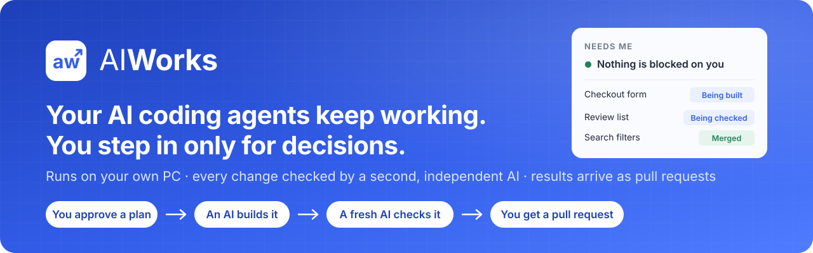
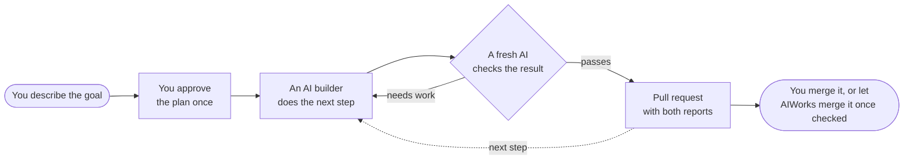
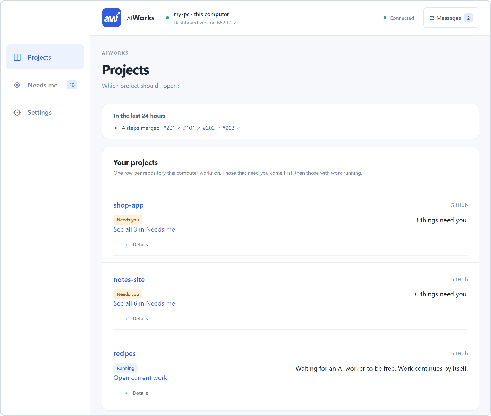
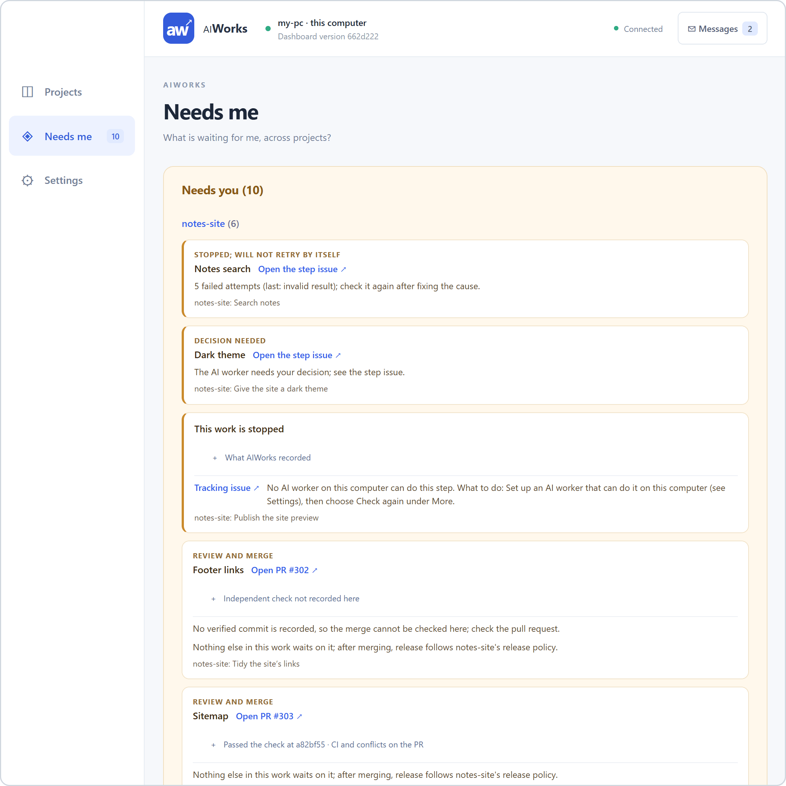
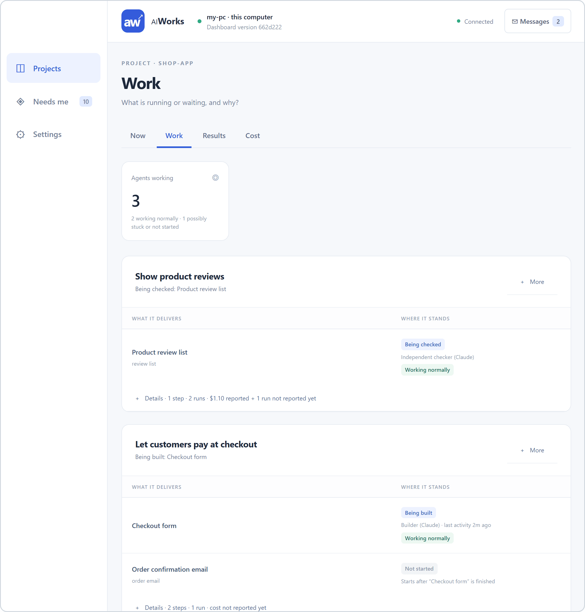
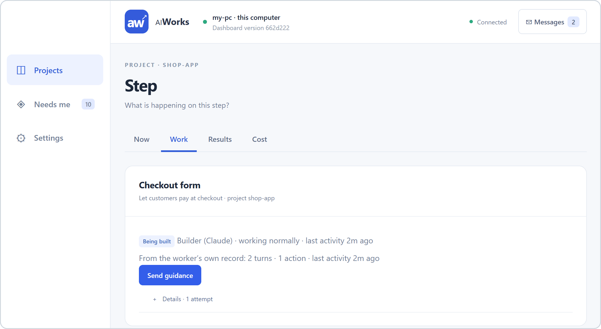
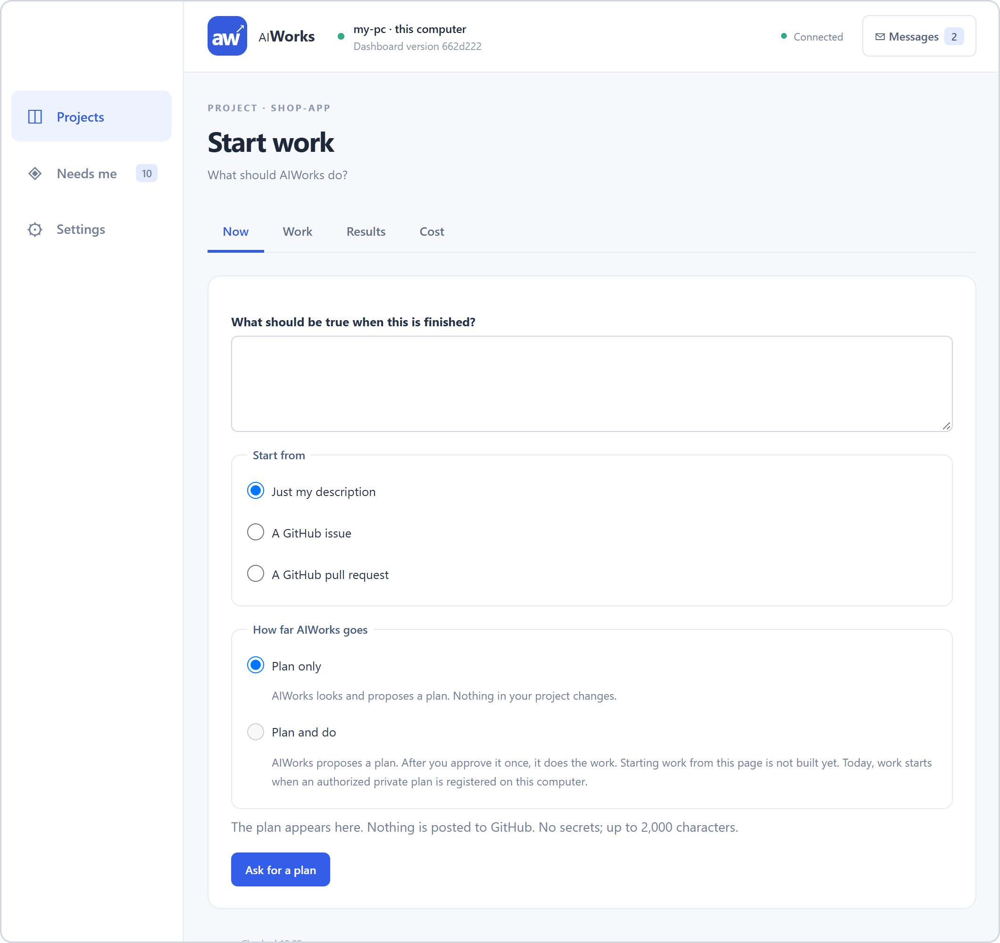

<p align="center">
  
</p>

<p align="center">
  
  
  
  
</p>

<p align="center">
  <a href="#the-problem">The problem</a> ·
  <a href="#what-aiworks-does">What it does</a> ·
  <a href="#what-it-delivered-in-one-day">Results</a> ·
  <a href="#how-you-use-it">How you use it</a> ·
  <a href="#in-production-and-on-the-roadmap">Production &amp; roadmap</a> ·
  <a href="#technical-details">Technical details</a>
</p>

---

**AIWorks is a manager for AI coding agents that runs on your own computer.** You agree on a plan once. AIWorks gives each step to an AI agent (Claude, Codex or Cursor), has a second, separate AI check the result, and delivers the finished work to GitHub as a pull request. It keeps going through crashes, restarts and usage limits, and asks you only when a real decision is needed.

## The problem

AI agents write good code. Keeping them working is a job of its own.

- **They stop.** An agent finishes one step and waits for someone to type "continue".
- **"Done" is not proof.** You still have to find out what changed and whether it actually works.
- **Limits waste hours.** An agent hits its usage limit late at night, and nothing moves until you notice in the morning.
- **Projects blur together.** With several products going, you lose track of what is finished, what is stuck and what is waiting for you.

You end up as a full-time project manager for your AI helpers instead of working on your product.

## What AIWorks does

| What you get | How it works |
| --- | --- |
| 🔁 **Keeps work moving** | Starts the next step as soon as the last one is done. Restarts itself after a crash or a reboot and carries on where it stopped. When an AI service hits its usage limit, AIWorks waits for the reset and continues, without bothering you. |
| 🔍 **Gets a second opinion on every change** | A fresh AI session that did not write the code checks each result. It runs the tests again on that exact version and looks for problems. Work that fails goes back for another round, with the findings attached. |
| 📬 **Delivers to GitHub, where you already work** | Each finished step arrives as a pull request with the builder's report and the checker's verdict inside. Reports and research arrive as comments on the step's issue. |
| 🙋 **Asks you only for real decisions** | One list, **Needs you**, shows the few things only you can do, and you settle each one right there: answer a decision, accept a checked result or send it back with what should change, or guide a step that stopped for good and let it try again. Routine waits stay AIWorks's job. |
| 🛡️ **Stays inside the lines you draw** | Runs only plans you approved. Merges a checked pull request only if you switch that on for the project. Never deploys or changes your accounts by itself. Runs on your PC, and its settings hold no passwords or keys. |



## What it delivered in one day

On 12–13 October 2026, AIWorks spent a day building the next version of itself. The figures below are counted from this repository's pull request and code history.

| Result | What happened |
| --- | --- |
| **63** | finished changes delivered as pull requests in 24½ hours. Every one was checked by a second AI before it reached the owner. |
| **18** | of those changes were merged between midnight and 7 a.m., while the owner slept. |
| **4** | separate pieces of work were moving at the same time at the peak. |
| **~45 min** | was the typical time to build and check one step. |
| **385 → 760** | automated tests: the project's safety net grew along with the code. |
| **53%** | of AIWorks' own code, about 25,000 lines, was written this way, by AIWorks. |

The owner set the goal and approved the plan once. An AI assistant session wrote the step-by-step plans and merged the checked pull requests on his behalf. He stepped in only a handful of times, for example to update the running copy of AIWorks, and two progress notes posted during the night read "nothing needs you".

### What it costs

Builds and tests run locally for every managed project. AIWorks must not use GitHub Actions or paid GitHub features such as Codespaces, paid runners or billable package/LFS storage. AI usage is allowed through subscriptions or metered APIs, subject to the existing campaign budgets and authority. See the [development policy and enforcement limits](docs/SUPERVISOR.md#1-boundary).

The AI tools report their own usage: a building run typically costs about **$5** and a checking run **$2–3**. In an earlier measurement the average came to about **$10 per delivered step**, retries and checks included. On a subscription plan this is usage counted against your plan, not an extra bill. The dashboard shows the cost of every project and step, and never shows an unknown cost as zero.

### Where the savings come from

- **Your attention.** A rough estimate: if keeping one change moving by hand takes 15 minutes of your time (prompting, re-checking, retrying after a limit, merging), the 63 changes above add up to about 16 hours of coordination that nobody had to do.
- **Hours that used to be idle.** Nights, weekends and usage-limit resets become working time.
- **Mistakes caught before you see them.** The checker sends weak work back with its findings. AIWorks also refuses a "passed" verdict when one of the checks actually failed.
- **No more piecing the story together.** One screen answers "what needs me?" across all your projects, in plain words.

## How you use it

Day to day, you don't type commands. You work in the AIWorks dashboard on your computer and in GitHub. Setup is done once ([see below](#set-it-up-with-your-ai-assistant)).

> The screenshots show made-up example projects.

### 1. See every project at a glance

**Projects** lists everything this computer works on. Projects that need you come first, then those with work running. Each row tells you in one sentence where things stand.

<p align="center"></p>

### 2. Handle only what needs you

**Needs you** collects the things only you can do, grouped by project: a decision an AI worker asked for, a checked result to review, a step that stopped and will not retry by itself. Each card says in business words what it is about and why you are needed, and you resolve it on the card: choose an option or write your answer, accept the result or request changes, or send guidance and check again. Something new to build is planned with *Plan different work* and starts only when you approve the plan. Usage limits, pauses, routine merge waits and AIWorks's own problems never count here; AIWorks lists what it is handling, so nothing stalls out of sight.

<p align="center"></p>

### 3. Follow the work, if you want to

Inside a project, four tabs answer four questions:

- **Now:** where are we?
- **Work:** what is running or waiting, and why? You see who is on each step (the builder or the checker), whether it is working normally or may be stuck, and what a waiting step is waiting for.
- **Results:** what has been delivered? Pull requests waiting for your review, merged work and reports to read.
- **Cost:** what did each step cost?

<p align="center"></p>

### 4. Steer when you need to

Open any step to see its latest result and its history. From the dashboard you can:

- **Pause** and **Resume** a piece of work;
- **Check again** after you have fixed whatever blocked it;
- **Cancel** work you no longer want;
- **Send guidance** to the builder or the checker. It reaches them on their next run, without interrupting the current one.

<p align="center"></p>

### 5. Ask for the next thing

**Start work** takes a plain description ("what should be true when this is finished?"), a GitHub issue or a pull request, and asks the planning assistant for a plan. The plan appears in the dashboard under **Messages**. Nothing is posted to GitHub, and nothing in your project changes at this stage.

<p align="center"></p>

By default, an approved plan is saved as a private file on your computer and registered there; your AI assistant can do this step for you. **Plan and do**, which starts exactly the plan you approve from the dashboard, is built and off by default (below).

### Where the results land

Everything ends up in GitHub, next to the rest of your project:

- Each piece of work has a **tracking issue**, and each step has its own issue. AIWorks posts progress notes and blockers there.
- Each code change is a **pull request** that contains the builder's report and the independent check.
- Reports and research are posted as **comments** on the step's issue.
- **AIWorks merges only if you switch it on.** By default you merge, or you hand merging of checked pull requests to an assistant you trust. You can instead let AIWorks merge them itself, one project at a time. It then merges a pull request only when the result on your main branch is exactly the version the checker approved. If main moved in the meantime, it brings the change up to date and has it checked again first. It never deploys.

## In production and on the roadmap

"In production" means built, switched on by default, and used every day to build AIWorks itself.

### ✅ In production

| Capability | What it means for you |
| --- | --- |
| End-to-end delivery | Plan, build, independent check, then a pull request or a report, with no hand-holding. |
| Three AI workers | Claude does most of the work. Codex and Cursor are fallbacks; on Windows they can do less (Codex can check but not change code, and Cursor is not supported yet). |
| Waiting out usage limits | When an AI account hits its limit, every piece of work on that account pauses until the reset, then continues. No alert. |
| Self-restart | After a crash, a sign-out or a reboot, AIWorks comes back by itself within minutes and picks up where it stopped. |
| Only work you registered | AIWorks works only on plans you registered yourself, and a plan's scope cannot change without a new, higher authorization. It refuses a second plan for a fix that is already being worked on, and runs only its own reviewed (merged) code. |
| Staying in its lane | A step that changes files outside its agreed area stops and waits for your decision. |
| Dashboard | Home, Projects and Needs you; each project with its Overview, Plan, Review and Knowledge tabs (Releases where a release is configured); Step, Settings, Messages and Diagnostics screens. |
| Controls | Pause, Resume, Check again, Cancel and Send guidance. |
| Planning assistant | Answers your messages and proposes plans, right in the dashboard. It can read your projects but never changes them, and it posts nothing to GitHub. |
| Cost tracking | Cost per project and per step, taken from each run's own record. |

### 🔧 Built, off by default

| Capability | Status |
| --- | --- |
| Merging checked pull requests | AIWorks merges a checked pull request itself, only in projects you list, and only when what lands on main is exactly what was checked. You can hold any pull request back. One setting turns it on. Merging is not deploying. |
| Conflict repair | When another merge leaves a pull request in conflict, AIWorks fixes it and checks it again. One setting turns it on. |
| Repairing an existing failed check | Optional read-only monitoring of existing GitHub check results can send a failure back for local repair. It never starts hosted checks; Actions stays disabled in every managed repository. |
| Several steps at once inside one piece of work | Built and tested. You turn it on and choose how much of the PC it may use. |
| Website checks in a real browser | Built. Needs AGY or Chrome set up on the computer, and has not been proven on a real project yet. |
| Alerts when something is blocked | Recording and grouping blockers is built and switched off, with your alert rules and quiet hours. A Telegram sender is built too: it sends only when you name your bot and chat as references into your own secret store and switch sending on, never answers or approves anything, and never sends again an alert that may already have arrived. It has been tested only against a made-up network, not a real bot. Stopped work always shows up in **Needs you**. |
| Plan and do, Add project and projects without GitHub | Built and tested on synthetic projects. You add a GitHub checkout, a local Git repository or a plain folder, confirm its rules, edit and approve a plan, and work starts from that approval. A project without GitHub gets checked results you try, Apply and Undo apply in Review; it never gets a pull request. Two settings turn it on. |
| Smarter choice of AI model per step | Every run records why its AI worker was chosen, and each step shows its models and cost. A plan can opt in to automatic choice among the models it already allows. No saving is claimed until a measured comparison has run. |
| Several AI accounts with automatic switching | Choosing a login per run and starting the worker inside that login's own home folder is built and switched off. Turning it on waits for the owner's pilot. |
| Slowing down when the PC is busy or an account is throttled | The building blocks are written and the status reports them, but they do not yet hold back new work. |
| Automatic release, opt-in per project | Built and switched off: "review only" by default, a standing grant per destination, a stop switch, one lock per destination, deploy, check and rollback through a project's own commands, and a **Releases** tab. A disposable rehearsal runs it against a synthetic project. No grant exists and nothing has been released. |
| External campaign API | Built and switched off: another system can register a campaign and read its status and verified reports over HTTP, the same contract as `cli.mjs start`/`status`, with its own bearer token instead of the dashboard's browser session, optionally on a port of its own that serves nothing else (for a tunnel) and with reports kept off GitHub. One setting turns it on, and `cli.mjs campaign-token create\|rotate <projectId>` creates or replaces that token for any AIWorks-registered project; see [docs/SUPERVISOR.md §16](docs/SUPERVISOR.md#16-external-campaign-api-off-by-default). |

### 🗺️ On the roadmap

- **Approve an outcome once**, and let AIWorks split it into steps and add steps as it learns.
- **Phone notifications** you can act on: Telegram alerts are built (above); answering from the phone needs remote access, which is not designed yet.
- **Automatic release per project**, behind independent checks and a first trial run.
- **Automatic model choice by cost and quality** for every plan, once a measured comparison supports it.
- **An AI-assisted setup guide** for newcomers: a first version is in [docs/guides](docs/guides/AI_ASSISTED_START.md).
- **Instant reaction to GitHub events**, instead of checking every minute.
- **A public demo page**, once the dashboard passes its own usability review. Its static source is in [`site/`](site/README.md): a walk through the synthetic owner journey, not yet published anywhere.

## Honest limits

- **Early preview, one setup.** AIWorks is built and used on one Windows PC with GitHub and Claude Code. On other operating systems it refuses to start workers, on purpose.
- **A checker can miss things.** A second AI makes it much less likely that a problem reaches you, not impossible. You remain the judge of what gets merged.
- **Checks run on your PC.** If your project's online tests run on another operating system, a change can pass here and fail there. This happened during the run above and is being addressed.
- **The dashboard is new.** It has just had its first usability review, and some screens still have rough edges.

---

## Technical details

Everything below is for setting up, running and changing AIWorks.

### Requirements

- Windows 10 or 11. Workers run inside Windows process containment; other platforms fail closed.
- Node.js 22.5 or newer, and Git (2.38 or newer for conflict repair).
- GitHub CLI (`gh`), signed in.
- At least one AI worker CLI, installed and signed in: Claude Code (main), Codex, or Cursor Agent.
- A local governance folder: run `npm run setup:local` for the bundled starter, then register the owner's approved projects under ignored `.local/governance`. It supplies the project registry contract and policies (`registry/projects`, `policies/catalog.json` and the project-contract schema). AIWorks only reads it, and new work must target a project registered there ([Governance checkout](docs/SUPERVISOR.md#governance-checkout)).
- Optional, for website checks: AGY or Claude with headless Chrome 149 or newer.

### Set it up with your AI assistant

Open Claude Code or Codex on the Windows PC, in a session that can run commands, and paste:

```text
Set up AIWorks on this Windows computer from <https://github.com/netbka/aiworks>.
Follow docs/guides/ASSISTANT_SETUP.md, the "Technical details"
section of its README and docs/SUPERVISOR.md.
Check what is already installed, create the data folder and config.json,
register the two background tasks and open the dashboard.
Ask me only for sign-ins or approvals you cannot do yourself.
Do not change any of my project files.
```

The assistant runs the commands below. You handle any sign-in it cannot do for you.

The [getting-started guides](docs/guides/README.md) explain the same setup step by step, then your first task, a manual installation, every command and what to do when something stops.

### How it works

| Part | Job |
| --- | --- |
| **Supervisor** | The always-on loop. It reads approved plans (campaigns), starts worker runs, records every step in a local SQLite store and publishes results through the GitHub REST API. Idle checks never call an AI model. |
| **Workers** | Headless runs of Claude Code, Codex or Cursor in an isolated Git worktree, without personal settings, hooks, MCP servers or memory. The provider order is Claude, then Codex, then Cursor. Only a provider problem (a usage limit, a failed login, an unavailable tool) moves work to the next one. |
| **Checker** | A fresh, read-only worker session on a separate checkout of the exact commit. It must echo that commit and the fingerprint of the builder's report. A failed check or a blocking finding starts a repair round. |
| **Coordinator** | A read-only planning agent that answers owner messages in the dashboard. It never registers or starts work, and posts nothing to GitHub. |
| **Dashboard** | A local web app at `http://127.0.0.1:4318`. It reads the local store and Git and makes no GitHub API calls. |
| **Background tasks** | Two Windows scheduled tasks start the supervisor and the dashboard at sign-in, and again every 5 minutes if either has stopped. |

**The life of one step:**

1. **Prepare.** The supervisor creates an isolated worktree and a task packet: the goal, the acceptance criteria, the files the step may change and the target project's rules. It records the run before launching it.
2. **Build.** The worker runs inside a Windows Job Object, with heartbeats and a time limit. For a code change, its result counts only if it is valid JSON naming a clean new commit.
3. **Check.** A different fresh session checks that exact commit, read-only, and runs the project's tests again.
4. **Repair.** A rejection sends the findings into the next packet. Repair rounds are limited only if the plan sets a limit.
5. **Publish.** The supervisor pushes exactly the checked commit and opens one pull request, or posts one report. It looks for an existing pull request or comment first, so a retry never creates a duplicate.
6. **Wait and recover.** A usage limit is recorded per AI account with its reset time (30 minutes if the reset is unknown). After a crash, the replacement supervisor adopts the running worker through its heartbeat instead of starting a second one.

**Safety rules.** These are accepted decisions, recorded in [docs/DECISIONS.md](docs/DECISIONS.md):

- The only writes outside this repository are worktrees, branches, pull requests and issue comments, for work the owner registered. Merging is off by default. The supervisor merges a pull request only under the merge gate, and only in a repository the owner lists in `config.json` (`merges.delegatedTo: "supervisor"`, decision AW-001, #138): the pull request is its own, its head is the checked commit, and what lands on the base branch is exactly the checked version. It never deploys, releases or changes provider resources.
- AIWorks runs only from its own merged code; a supervisor running unmerged code starts no new work. Plans are private files on your computer, registered explicitly, and their scope can only change with a higher authorization version.
- The dashboard listens on `127.0.0.1` only and needs the same origin plus a per-session token for every action. Text that looks like a secret is refused. The one exception is the optional external campaign API (below), off by default: a static bearer token instead, for a local system that is not a browser.
- There are no budget caps by default. A plan can set run, retry, repair and cost limits.
- A denied command, a sandbox refusal or a failed check is never routed around to another provider.
- `config.json` holds executable and repository paths, never credentials.

### Configuration

Create `.local/supervisor/config.json` with absolute paths for your machine. The names and paths below are made-up examples:

```json
{
  "governanceRoot": "C:/work/aiworks/.local/governance",
  "repositories": {
    "example-org/sampleapp": {
      "path": "C:/work/sampleapp",
      "worktreeRoot": "C:/work/aiworks/.local/worktrees/sampleapp"
    }
  },
  "commands": {
    "claude": ["C:/tools/claude.exe"],
    "codex": ["C:/tools/codex.exe"],
    "gh": ["C:/tools/gh.exe"]
  }
}
```

- `governanceRoot`: the read-only governance checkout. Without it, anything that needs it fails closed.
- `repositories`: each target repository, with its local checkout and a folder for worktrees.
- `commands`: each tool as an absolute path to a native executable, in an array. `cursor`, `agy` and `chrome` are optional ([§8](docs/SUPERVISOR.md#8-ordered-cli-execution), [§11](docs/SUPERVISOR.md#11-web-acceptance-by-the-agy-browser-worker)).
- `coordinator`: optional. Without it, owner messages are stored but nobody reads them ([§9](docs/SUPERVISOR.md#9-owner-messages-and-the-coordinator)).
- Optional, off by default: `integrationRepair`, `ciRepair`, `scheduler` and `ownerIntervention`. See [docs/SUPERVISOR.md](docs/SUPERVISOR.md).

### Commands

Write your plan as a private JSON file under `.local/campaigns/`, following the contract in `src/supervisor/campaign.mjs`. The files in `tests/fixtures/campaigns/` are made-up examples to copy from. Plans are never committed.

```sh
npm install

node src/supervisor/cli.mjs start .local/campaigns/work.json --data .local/supervisor   # register a plan
node src/supervisor/cli.mjs keep --data .local/supervisor                               # run, and restart after any exit
node src/supervisor/cli.mjs status <campaignId> --data .local/supervisor
npm run dashboard -- --data .local/supervisor
```

`AIWORKS_DATA` can stand in for `--data`. The other commands (`pause`, `cancel`, `recheck`, `stop`, `message`, `messages`, `coordinator-clear`, `baseline`) are described in [docs/SUPERVISOR.md §5](docs/SUPERVISOR.md#5-commands).

### Running in the background

```powershell
powershell -NoProfile -File scripts\supervisor\install-windows-task.ps1   -Checkout <runtime checkout> -DataDir <data dir>
powershell -NoProfile -File scripts\supervisor\install-dashboard-task.ps1 -Checkout <runtime checkout> -DataDir <data dir>
```

These register the per-user tasks **AIWorks Supervisor** and **AIWorks Dashboard**. Both start at sign-in and every 5 minutes, and do nothing if they are already running. Add `-DefinitionOnly` to see the task definition without changing anything. `cli.mjs stop` keeps the supervisor stopped until its STOP file is removed. The live copy runs from a separate checkout of a reviewed commit and changes only through the [upgrade procedure](docs/SUPERVISOR.md#upgrade).

To update it, run `npm run rebuild` from a clean checkout at the trusted commit (add `-- --root <installation root>` when the installation is elsewhere). It pauses running work, lets open runs finish and be recorded, stops and backs up, installs the trusted commit with `npm ci`, restarts, and resumes only the work it paused. Run it again after a failure and it continues where it stopped ([Rebuild](docs/SUPERVISOR.md#rebuild-the-upgrade-as-one-command)).

### Try the dashboard with made-up data

```sh
npm install
node tests/dashboard/fixtures/review-store.mjs --port 4319
```

This opens the dashboard at `http://127.0.0.1:4319` with three example projects covering every state. It refuses the live port 4318 and deletes its temporary data when you press Ctrl+C. The screenshots above come from it. The [static showcase](site/index.html) shows the [owner journey](docs/design/OWNER_JOURNEY_ACCEPTANCE.md) instead, captured from its synthetic runtime; open it straight from the checkout.

### Repository layout

| Path | What it holds |
| --- | --- |
| `src/supervisor/` | The supervisor: CLI, controller, SQLite store, runner, Windows process containment, coordinator, owner-intervention core, browser wrapper, release groundwork |
| `src/supervisor/adapters/` | Executors for the worker CLIs, plus the Git and GitHub adapters |
| `src/dashboard/` | The dashboard: server, owner view and page |
| `src/shared/` | Shared helpers |
| `scripts/lib/worker-context.mjs` | Worker-context helpers: packet validation, context planning, lease checks |
| `registry/`, `schemas/` | Worker-context policy defaults and reusable schemas |
| `scripts/` | Plan and public-scope checks, Windows task installers and the deploy script |
| `tests/` | Supervisor, dashboard and worker-context tests, with made-up fixtures |
| `docs/` | Runbook, decisions, development status, designs and glossary |
| `.local/` | Ignored by Git: your private settings, plans, state, worktrees and governance folder |

### Validation

After changing code, schemas, fixtures or documentation, run `npm install` once and then `npm run check`. It checks that no private installation files are in the commit, validates the example plans and runs the test suite. `npm run test:affected` runs only the test files your changes can reach and `npm run test:quick` the unit and service tiers only, for a fast pass while you work; the gate is the full check.

### Start here

The reading list for contributors and AI agents.

1. [Product Constitution](docs/PRODUCT_CONSTITUTION.md): what AIWorks is, for whom, and how success is measured
2. [Agent rules](AGENTS.md): what agents may and may not do here
3. [Delivery Supervisor](docs/SUPERVISOR.md): the runbook — boundary, lifecycle, failures, commands, installation and upgrades
4. [Operations Dashboard](docs/OPERATIONS_DASHBOARD.md): what the owner sees and the local access boundary
5. [Decisions](docs/DECISIONS.md): accepted product boundaries
6. [Worker Context Lifecycle](docs/WORKER_CONTEXT_LIFECYCLE.md): task packets, leases and fresh sessions
7. [Development status](docs/STATUS.md), the [Project Workspace Plan](docs/PROJECT_WORKSPACE_PLAN.md) and the [designs](docs/design/): what the code does and where it is going
8. [Publication preparation](docs/PUBLICATION.md): what stays private and how public commits are checked
9. [Glossary](docs/GLOSSARY.md): terms and IDs

### Contributing and license

Bug reports, documentation fixes and focused pull requests are welcome: see [Contributing](CONTRIBUTING.md) and [Security](SECURITY.md). AIWorks is released under the [MIT License](LICENSE).
