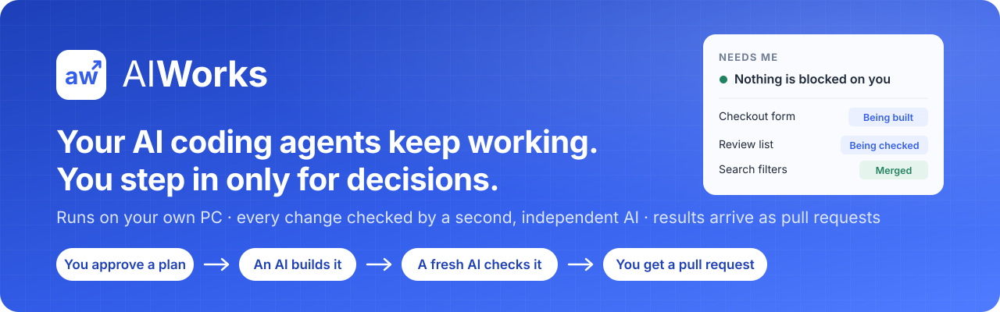
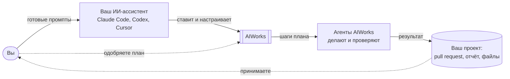
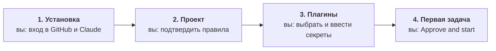
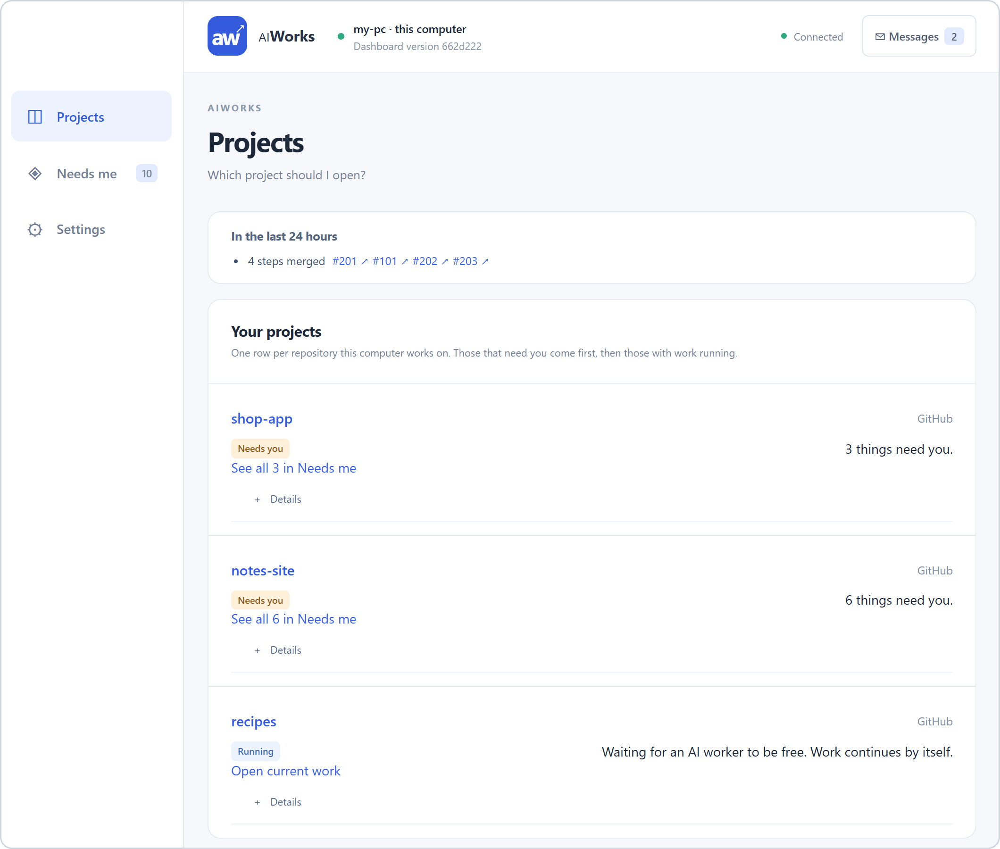
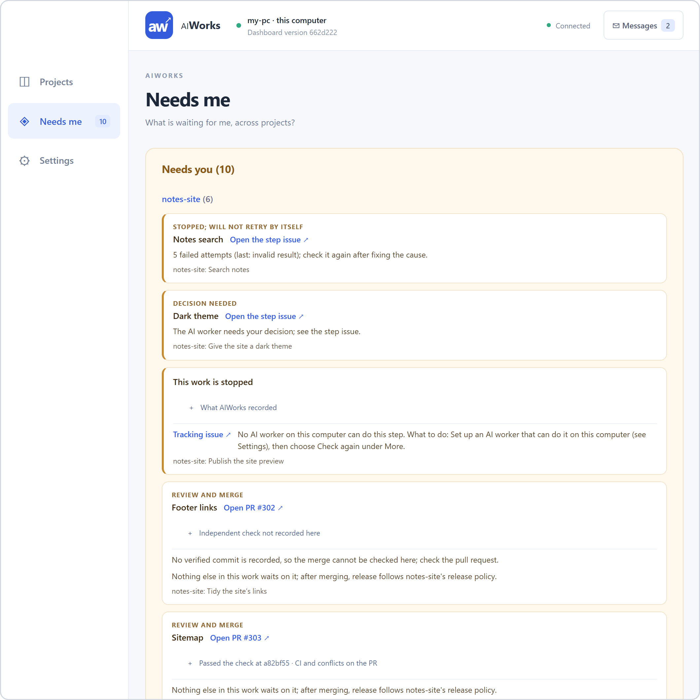
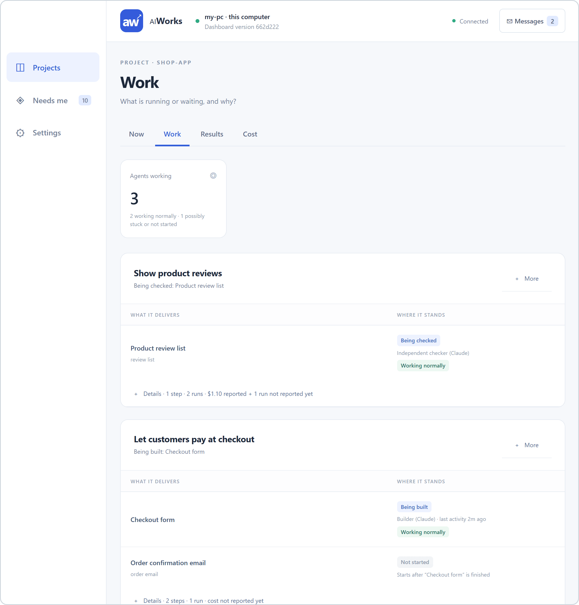
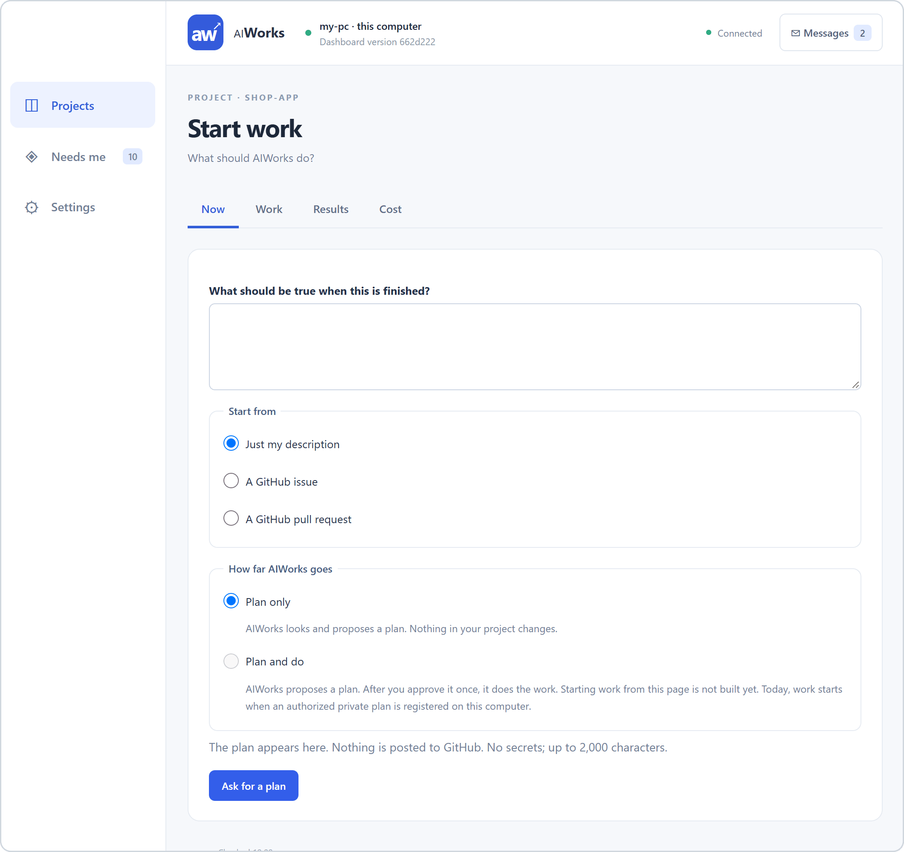

<p align="center">
  
</p>

<p align="center">
  <a href="README.md">English</a> · <b>Русский</b>
</p>

<p align="center">
  
  
  
  
</p>

<p align="center">
  <a href="#что-это">Что это</a> ·
  <a href="#настройка-за-четыре-сообщения">Настройка</a> ·
  <a href="#какие-решения-за-вами">Решения</a> ·
  <a href="#плагины">Плагины</a> ·
  <a href="#как-это-выглядит">Как выглядит</a> ·
  <a href="#подробнее">Подробнее</a>
</p>

---

## Что это

**AIWorks — рабочее место для ваших ИИ-агентов на вашем компьютере.** Им пользуются агенты, а не люди. Человек один раз настраивает его через своего ИИ-ассистента, потом ставит цели, одобряет планы и принимает результат.



Вы касаетесь системы в трёх местах: отдаёте промпты ассистенту, одобряете план, принимаете результат. Всё остальное — запуск шагов, проверка, исправления, ожидание лимитов, перезапуск после сбоев — делают агенты.

### Что вы получаете

| | |
| --- | --- |
| 🔁 **Работа не встаёт** | Следующий шаг начинается, как только закончен предыдущий. После сбоя или перезагрузки AIWorks продолжает с того же места. Упёрся в лимит — ждёт сброса и продолжает. |
| 🔍 **Каждый результат проверен** | Каждый шаг проверяет отдельный агент, который его не делал. Не прошло проверку — уходит на доработку с замечаниями. |
| 🙋 **Вас не дёргают** | В **Needs you** попадает только то, что можете сделать лишь вы: вход в аккаунт, доступ, оплата — и результаты, которые вы решили принимать сами. |
| 🛡️ **Ничего лишнего** | Выполняются только одобренные планы. Merge и выкладка — только если вы их включили для проекта. Пароли и ключи не хранятся в настройках. |

### Один AIWorks — много разных проектов

AIWorks не привязан к одному виду работы. Это может быть код, тексты, исследования — любая работа, которую можно описать как «готово, когда…». У каждого проекта свои правила: откуда приходят задачи, как проверяется результат и куда он попадает.

| | Откуда задачи | Как проверяется | Куда приходит результат |
| --- | --- | --- | --- |
| **Проект 1**: приложение на GitHub | Вы пишете своему ассистенту | Агент-проверяющий заново прогоняет тесты на этой самой версии | Pull request с двумя отчётами |
| **Проект 2**: тексты в папке на диске | Кнопка **Start work** в дашборде | Агент-проверяющий сверяет с критериями плана | Файлы в проекте: применить или откатить |
| **Проект 3**: задачи из вашей системы | Трекер или сервис ставит их через API | Плюс отдельный компьютер для полных тестов | Отчёт, который система забирает сама |

Проект 1 работает по умолчанию. Проекты без GitHub (2) и приём задач через API (3) уже есть в коде и включаются отдельными [плагинами](#плагины).

### Что получилось за один день

12–13 октября 2026 года AIWorks сутки строил следующую версию самого себя. Цифры посчитаны по истории этого репозитория.

| | |
| --- | --- |
| **63** | готовых изменения за 24½ часа, каждое проверено вторым агентом |
| **18** | из них слиты между полуночью и 7 утра, пока владелец спал |
| **~45 мин** | обычное время на то, чтобы сделать и проверить один шаг |
| **385 → 760** | автоматических тестов: страховка росла вместе с кодом |

---

## Настройка за четыре сообщения

Вы не настраиваете AIWorks руками. Вы по очереди отправляете своему ИИ-ассистенту четыре готовых сообщения. Он ставит программы, пишет настройки, проверяет, что всё работает, и останавливается только там, где нужны вы.

**До начала:**

- компьютер на Windows 10 или 11, который можно оставить включённым;
- ИИ-ассистент, который **запускает команды на этом компьютере**: Claude Code, Codex, Cursor или Gemini CLI. Обычный чат в браузере не подойдёт;
- аккаунт GitHub и подписка Claude: Claude — основной агент AIWorks, даже если настраиваете другим ассистентом;
- около часа, из которых вашего времени — минут десять.



### 1. Установка

```text
Установи и настрой AIWorks на этом компьютере: https://github.com/netbka/aiworks
Действуй по docs/setup/README.ru.md, слои 1–3.
Проверь, что уже стоит, и поставь недостающее. Создай папку данных, config.json
и папку правил, включи координатора и одобрение планов кнопкой (Plan and do),
зарегистрируй две фоновые задачи
и открой дашборд.
Проси меня только о входах в аккаунты и подтверждениях, которые не можешь сделать сам.
Мои проекты не трогай. В конце коротко: что сделано, что проверено, что не вышло.
```

**Спросят у вас:** войти в GitHub и в Claude Code через их собственные окна входа.
**Получите:** дашборд по адресу `http://127.0.0.1:4318`, который сам запускается при входе в Windows.

### 2. Подключить проект

```text
Подключи к AIWorks мой проект: <ссылка на GitHub или папка на диске>.
Действуй по docs/setup/README.ru.md, слой 4.
Предложи правила проекта: какие папки агентам трогать нельзя, чем проверять
результат, кто его принимает — я или AIWorks сам.
В самом проекте ничего не меняй. Скажи, где мне подтвердить правила.
```

**Спросят у вас:** подтвердить правила проекта и выбрать, кто принимает результат.
**Получите:** проект в списке **Projects**, готовый к задачам. Для каждого нового проекта — то же сообщение.

### 3. Плагины (по желанию)

```text
Покажи плагины AIWorks из docs/plugins/README.ru.md: что даёт каждый, какие уже
включены, что нужно для каждого. Дай мне выбрать.
Включи выбранные. Для секретов пропиши только имена-ссылки и скажи, какие строки
мне вписать в .env самому — сами значения у меня не спрашивай.
Потом проверь каждый включённый плагин и покажи результат.
```

**Спросят у вас:** какие плагины нужны и сами секреты. Секреты вы вписываете в файл `.env` сами, ассистент их не видит. Диспетчер учётных данных Windows, Infisical и другие хранилища — [по желанию](docs/setup/README.ru.md#где-хранятся-секреты).
**Получите:** список «включено и проверено».

### 4. Первая задача

```text
Используй AIWorks для проекта <имя>. Мне нужно: <что должно стать правдой, когда готово>.
Составь короткий план: результат, как проверим, что входит, что потом.
Проект не трогай. Скажи, где мне одобрить план.
```

**Спросят у вас:** нажать **Approve and start** на вкладке Review. Эту кнопку не нажмёт за вас ни один агент. Если одобрение кнопкой не включено, вы говорите ассистенту «одобряю», и он регистрирует план сам.
**Получите:** через час-другой — pull request (или отчёт, или файлы) с отчётом исполнителя и заключением проверяющего.

<details>
<summary><b>Или одним сообщением</b></summary>

```text
Настрой AIWorks целиком по docs/setup/README.ru.md из https://github.com/netbka/aiworks:
установка, проект <ссылка или папка>, плагины <список или «предложи сам»>,
и план первой задачи: <что нужно>.
Останавливайся только на входах в аккаунты, секретах и одобрениях в дашборде.
```

</details>

> **Команды тоже есть** — ими пользуется и ваш ассистент. Если удобнее делать руками, все шаги с командами расписаны в [настройке по слоям](docs/setup/README.ru.md). Это ускоритель, а не обязательный путь.

---

## Какие решения за вами

Каждый слой системы требует своих решений. Ассистент предложит вариант по умолчанию; менять его нужно, только если у вас другая ситуация.

| Слой | Что решаете вы | По умолчанию |
| --- | --- | --- |
| **1. Компьютер и аккаунты** | На каком компьютере работает AIWorks; какие ИИ-подписки подключить | Этот компьютер; Claude — основной, Codex — запасной |
| **2. Установка** | Где лежат данные AIWorks | Папка `.local` рядом с AIWorks |
| **3. Координатор** | Нужен ли помощник, который отвечает в дашборде и пишет планы; одобряете ли вы план кнопкой или словами ассистенту | Включён, одобрение кнопкой |
| **4. Проекты** | Какие проекты подключить; что агентам трогать нельзя; кто принимает результат; сливает ли AIWorks сам | Принимает AIWorks; merge делаете вы |
| **5. Плагины** | Нужны ли выкладка, внешние проверки, задачи из других систем, уведомления | Всё выключено |
| **6. Работа** | Какие задачи ставить и как часто смотреть | Смотрите в **Needs you**, когда удобно |

Почему так и что выбрать в каждом случае — в [настройке по слоям](docs/setup/README.ru.md).

## Плагины

Плагин — возможность, которая связывает AIWorks с чем-то внешним. Каждый выключен, пока вы его не включите, и включается одним сообщением ассистенту.

| Плагин | Зачем | Готовность |
| --- | --- | --- |
| [Запасные агенты](docs/plugins/README.ru.md#запасные-агенты) | Codex и Cursor подхватывают работу, когда у Claude лимит | Codex работает как проверяющий, Cursor — пока нет |
| [Несколько аккаунтов](docs/plugins/README.ru.md#несколько-аккаунтов) | Работа переключается на другой аккаунт, когда один упёрся в лимит | Построено, выключено |
| [Проекты без GitHub](docs/plugins/README.ru.md#проекты-без-github) | Папка на диске или локальный Git вместо GitHub | Построено, выключено |
| [Автоматический merge](docs/plugins/README.ru.md#автоматический-merge) | AIWorks сам сливает проверенные изменения | Построено, выключено |
| [Выкладка](docs/plugins/README.ru.md#выкладка) | После merge проект выкладывается по своей инструкции и проверяется | Построено, выключено |
| [Внешний сервис проверок](docs/plugins/README.ru.md#внешний-сервис-проверок) | Другой компьютер дополнительно прогоняет полные тесты | Построено, выключено |
| [Приём задач через API](docs/plugins/README.ru.md#приём-задач-через-api) | Ваш трекер или сервис ставит задачи и забирает отчёты сам | Построено, выключено |
| [Уведомления в Telegram](docs/plugins/README.ru.md#уведомления-в-telegram) | Сообщение, когда что-то встало | Построено, на живом боте не проверено |
| [Проверка сайтов в браузере](docs/plugins/README.ru.md#проверка-сайтов-в-браузере) | Агент открывает страницу и проверяет её глазами | Построено, на реальном проекте не проверено |
| [Вход в системы через браузер](docs/plugins/README.ru.md#вход-в-системы-через-браузер) | Агент работает в веб-интерфейсе вашей CRM или админки под отдельной учётной записью | Построено, выключено |
| [Параллельная работа](docs/plugins/README.ru.md#параллельная-работа) | Несколько задач одновременно с учётом нагрузки на компьютер | Построено, выключено |

---

## Как это выглядит

Каждый день вы не набираете команды. Вы смотрите в дашборд на своём компьютере и в GitHub — когда удобно.

> На снимках — выдуманные проекты.

**Projects** — все проекты на одной странице. Сначала те, где нужны вы, потом те, где идёт работа.

<p align="center"></p>

**Needs you** — только то, что можете сделать лишь вы. Лимиты, паузы и внутренние сбои AIWorks сюда не попадают: с ними он разбирается сам.

<p align="center"></p>

**Work** внутри проекта — кто сейчас на каждом шаге, исполнитель или проверяющий, и не застрял ли он. Шаг можно поставить на паузу, отменить или отправить исполнителю подсказку.

<p align="center"></p>

**Start work** — новая задача словами, из issue или pull request. Сначала появляется план; до вашего одобрения в проекте ничего не меняется.

<p align="center"></p>

### Как ставить задачи

| Способ | Когда удобен |
| --- | --- |
| Написать своему ассистенту словами | Основной путь |
| Кнопка **Start work** в дашборде | Когда ассистент не открыт |
| Внешняя система через [API](docs/plugins/README.ru.md#приём-задач-через-api) | Когда задачи рождаются в трекере, а не у человека |

### Если для задачи нужен вход в другую систему

Бывает, что работу надо сделать в веб-интерфейсе другой системы: поправить карточки в CRM, проверить экраны в админке. Пароль агенту при этом не передаётся.

1. 🙋 Вы заводите для AIWorks отдельную учётную запись с минимальными правами и вписываете её логин и пароль в `.env`.
2. Ассистент описывает в настройках, как в этой системе выглядит вход: страница, поля, кнопка.
3. 🙋 Если агент должен что-то менять, а не только смотреть, вы разрешаете адрес системы для проекта.
4. Перед каждым запуском AIWorks сам входит в систему в отдельном браузере и отдаёт агенту браузер, где вход уже выполнен. Агент не видит ни пароля, ни формы входа.

Подробно — в [плагине «Вход в системы через браузер»](docs/plugins/README.ru.md#вход-в-системы-через-браузер).

## Честно об ограничениях

- **Только Windows.** На других системах AIWorks намеренно не запускает агентов.
- **Ранняя версия.** Проверена на одной установке с GitHub и Claude Code.
- **Проверяющий снижает риск, но не убирает его.** Пока вы не передали merge AIWorks, решение остаётся за вами.
- **Тесты идут на вашем компьютере.** Если у проекта онлайн-проверки на другой системе, изменение может пройти здесь и не пройти там — для этого есть [внешний сервис проверок](docs/plugins/README.ru.md#внешний-сервис-проверок).

---

## Подробнее

| Документ | О чём |
| --- | --- |
| [Как мы работаем с AIWorks](https://netbka.github.io/aiworks/cases/) | Три настоящих проекта — изменения ELMA 365, финансовые заявки к 1С:УХ, маркетинговое агентство — со схемами |
| [Настройка по слоям](docs/setup/README.ru.md) | Каждый слой: зачем он, что решаете вы, команды, как проверить |
| [Плагины](docs/plugins/README.ru.md) | Паспорт каждого плагина: настройки, секреты, промпты «включи» и «выключи» |
| [Как это устроено](docs/HOW_IT_WORKS.ru.md) | Жизнь одного шага, правила безопасности, где что хранится |
| [Какой агент для чего](docs/AGENTS_COMPARISON.ru.md) | Сравнение Claude, Codex, AGY и Cursor на одинаковых задачах и что ставить на какую роль |
| [Claude и AIWorks](docs/guides/USING_CLAUDE.md) | Три роли Claude и что ему говорить (англ.) |
| [Справочник команд](docs/guides/CLI_REFERENCE.md) | Все команды (англ.) |
| [Если что-то встало](docs/guides/TROUBLESHOOTING.md) | Частые остановки и что делать (англ.) |

Для тех, кто меняет сам AIWorks, — список для чтения в [английской версии](README.md#start-here), [Contributing](CONTRIBUTING.md) и [Security](SECURITY.md). AIWorks распространяется по [лицензии MIT](LICENSE).
