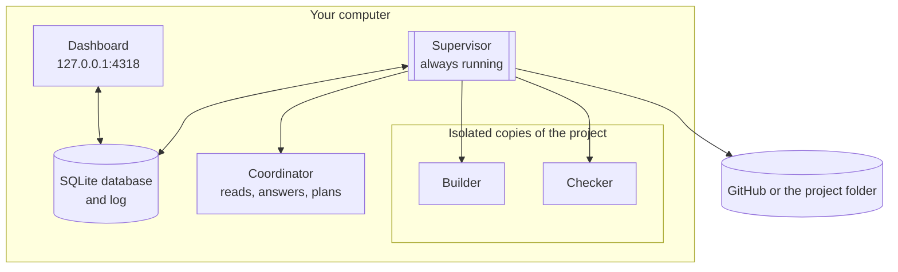
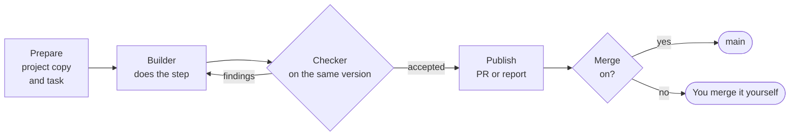

# How AIWorks works

**English** · [Русский](HOW_IT_WORKS.ru.md)

In short: AIWorks is a manager that runs all the time on your computer. It takes an approved plan and gives it to the agents one step at a time. It sends every result to an independent check, and it delivers the checked work to the place where you work. It does not invent work, and it does not go beyond the plan.

## What it is made of

| Part | What it does | What it never does |
| --- | --- | --- |
| **Supervisor** | Reads approved plans, starts agents, records every step, publishes results | Never works on a project that is not in the governance folder; never runs its own unchecked code |
| **Builder** | Does one step in a separate copy of the project | Never sees your personal settings, memory or secrets; never publishes or merges |
| **Checker** | A fresh agent that did not do this step. It checks exactly that version and runs the tests again | Never changes files |
| **Coordinator** | Answers your messages, writes plans | Never starts work, never changes projects |
| **Dashboard** | Shows what is happening and what is needed from you | Never calls GitHub; cannot be opened from the network |
| **Windows background tasks** | Start the supervisor and the dashboard when you sign in, and every 5 minutes if they have stopped | n/a |

## The life of one step

1. **Prepare.** The supervisor creates a separate copy of the project and a task: the goal, the acceptance criteria, which files may be changed and the project's rules. The run is written to the log *before* it starts.
2. **Work.** The builder works in Windows isolation, with a time limit and a heartbeat. If it touches files outside the allowed area, the step is stopped.
3. **Check.** A different, fresh agent checks exactly this version without changing anything, and runs the project's tests again.
4. **Repair.** A rejection sends the findings back to the builder. The number of rounds is limited if the plan sets a limit.
5. **Publish.** Exactly the checked version is published: one pull request or one report. Before publishing, the supervisor looks for something already published, so a retry after a crash does not make a duplicate.
6. **Next.** The next step of the plan starts right away.

## When something goes wrong

| Situation | What AIWorks does | Do you need to act |
| --- | --- | --- |
| Subscription limit | Waits for the reset (30 minutes if the time is unknown) and continues | No |
| Sign-in failure at a provider | Moves to a backup agent if there is one; otherwise waits | Only to sign in again |
| Crash or reboot of the computer | The new supervisor picks up the running agent through its heartbeat and does not start a second one | No |
| An agent is stuck | The step is delivered with its known defects, or closed as not done, with a follow-up task | No |
| An agent needs a decision | The agent proposes 2–4 options, AIWorks takes the recommended one and tells you. You can change it | Optional |
| Access denied or a failed check | Never "worked around" with another agent | No |

The principle: **the system works for the owner, not the owner for the system.** **Needs you** shows only what only you can do.

## Safety rules

- **Only what is approved.** Work runs only on plans you approved. A plan's scope does not change without a new approval with a higher version number.
- **Only allowed projects.** A project must be in your governance folder.
- **Only verified AIWorks code.** A supervisor running unmerged code starts no new work.
- **Merge and release only by your decision**, separately for each project.
- **The dashboard is local only.** It listens on `127.0.0.1`, and every action needs an origin check and a session token. Only a person at this computer can approve a plan.
- **No secrets in the settings.** `config.json` holds only paths and switches. Secrets are kept by reference in the secret store.
- **No GitHub Actions.** Builds and tests run on your computer.

## Where things are kept

| What | Where | In Git? |
| --- | --- | --- |
| AIWorks code | The source folder | Yes, public |
| The working copy that is running | `.local/runtime` | No |
| Database, log, `config.json` | `.local/supervisor` | No |
| Rules and the list of allowed projects | `.local/governance` | No |
| Your plans | `.local/campaigns` | No |
| Project copies for agents | `.local/worktrees` | No |
| Secrets | `.local/supervisor/.env`, or another store of your choice | Never |

Everything of yours stays on your computer. No plans, settings or logs reach the public repository. A separate check verifies this on every commit.

## More

- [Supervisor runbook](SUPERVISOR.md): the full technical description
- [Decisions](DECISIONS.md): why the system is built this way
- [Dashboard](OPERATIONS_DASHBOARD.md): what each screen shows
- [Worker context](WORKER_CONTEXT_LIFECYCLE.md): what an agent sees in its task
