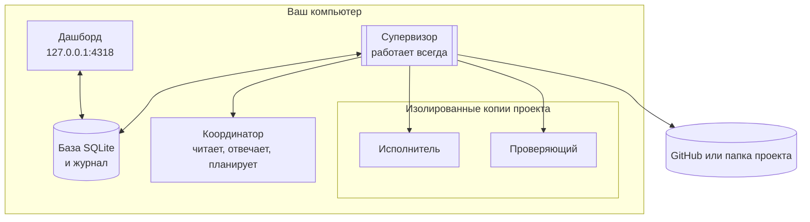
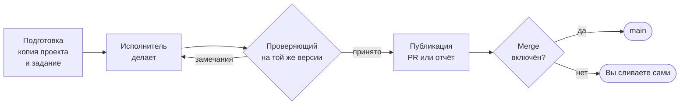

# Как устроен AIWorks

[English](HOW_IT_WORKS.md) · **Русский**

Коротко: AIWorks — постоянно работающий диспетчер на вашем компьютере. Он берёт одобренный план, по одному шагу отдаёт агентам, каждый результат отправляет на независимую проверку и отдаёт проверенное туда, где вы работаете. Он не выдумывает работу сам и не выходит за рамки плана.

## Из чего он состоит

| Часть | Что делает | Чего не делает никогда |
| --- | --- | --- |
| **Супервизор** | Читает одобренные планы, запускает агентов, записывает каждый шаг, публикует результаты | Не работает с проектом, которого нет в правилах; не запускает непроверенный код самого себя |
| **Исполнитель** | Делает один шаг в отдельной копии проекта | Не видит ваших личных настроек, памяти и секретов; не публикует и не сливает |
| **Проверяющий** | Свежий агент, который не делал этот шаг. Проверяет ровно ту версию и заново гоняет тесты | Не меняет файлы |
| **Координатор** | Отвечает на ваши сообщения, составляет планы | Не запускает работу, не меняет проекты |
| **Дашборд** | Показывает, что происходит и что нужно от вас | Не обращается к GitHub; не открывается из сети |
| **Фоновые задачи Windows** | Поднимают супервизор и дашборд при входе и каждые 5 минут, если они упали | — |

## Жизнь одного шага

1. **Подготовка.** Супервизор создаёт отдельную копию проекта и задание: цель, критерии готовности, какие файлы можно менять, правила проекта. Запуск записывается в журнал *до* старта.
2. **Работа.** Исполнитель работает в изоляции Windows, с ограничением по времени и «пульсом». Если он тронул файлы вне разрешённой области, шаг останавливается.
3. **Проверка.** Другой, свежий агент проверяет ровно эту версию, ничего не меняя, и заново прогоняет тесты проекта.
4. **Исправление.** Отказ отправляет замечания обратно исполнителю. Число кругов ограничено, если план задаёт предел.
5. **Публикация.** Публикуется ровно проверенная версия: один pull request или один отчёт. Перед публикацией супервизор ищет, не опубликовано ли уже, поэтому повтор после сбоя не создаёт дубля.
6. **Дальше.** Следующий шаг плана начинается сразу.

## Когда что-то идёт не так

| Ситуация | Что делает AIWorks | Нужны ли вы |
| --- | --- | --- |
| Лимит подписки | Ждёт сброса (если время неизвестно — 30 минут) и продолжает | Нет |
| Сбой входа у провайдера | Переходит к запасному агенту, если он есть; иначе ждёт | Только чтобы войти заново |
| Сбой или перезагрузка компьютера | Новый супервизор подхватывает работающего агента по «пульсу», второго не запускает | Нет |
| Агент застрял | Шаг сдаётся с известными недостатками или закрывается как невыполненный, с задачей на потом | Нет |
| Агенту нужно решение | Агент предлагает 2–4 варианта, AIWorks берёт рекомендованный и сообщает вам. Вы можете поменять | По желанию |
| Отказ в доступе или проваленная проверка | Никогда не «обходится» другим агентом | Нет |

Принцип: **система работает на владельца, а не владелец на систему**. В **Needs you** попадает только то, что можете сделать лишь вы.

## Правила безопасности

- **Только одобренное.** Работа идёт только по планам, которые вы одобрили. Объём плана не меняется без нового одобрения с более высоким номером версии.
- **Только разрешённые проекты.** Проект должен быть в вашей папке правил.
- **Только проверенный код самого AIWorks.** Супервизор с неслитым кодом не начинает новую работу.
- **Merge и выкладка — только по вашему решению**, отдельно для каждого проекта.
- **Дашборд только локальный.** Он слушает `127.0.0.1`, а каждое действие требует проверки источника и токена сессии. Одобрить план может только человек за этим компьютером.
- **Секретов нет в настройках.** `config.json` хранит только пути и переключатели, секреты — по ссылке в хранилище.
- **Никаких GitHub Actions.** Сборка и тесты идут на вашем компьютере.

## Где что хранится

| Что | Где | В Git? |
| --- | --- | --- |
| Код AIWorks | Папка исходников | Да, публично |
| Рабочая копия, которая запущена | `.local/runtime` | Нет |
| База, журнал, `config.json` | `.local/supervisor` | Нет |
| Правила и список разрешённых проектов | `.local/governance` | Нет |
| Ваши планы | `.local/campaigns` | Нет |
| Копии проектов для агентов | `.local/worktrees` | Нет |
| Секреты | Хранилище секретов | Никогда |

Всё ваше остаётся на вашем компьютере. В публичный репозиторий не попадают ни планы, ни настройки, ни журналы. Это проверяет отдельная проверка при каждом коммите.

## Подробнее

- [Runbook супервизора](SUPERVISOR.md) — полное техническое описание (англ.)
- [Принятые решения](DECISIONS.md) — почему система устроена именно так (англ.)
- [Дашборд](OPERATIONS_DASHBOARD.md) — что показывает каждый экран (англ.)
- [Контекст агентов](WORKER_CONTEXT_LIFECYCLE.md) — что видит агент в задании (англ.)
