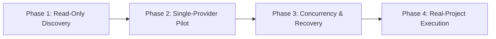

# CAAM account-selection and isolated-launch adapter

**Status:** built in source since this design, switched off ([SUPERVISOR.md section 13](../SUPERVISOR.md#13-caam-account-profiles-built-not-enabled)); not deployed by this repository, and switching it on waits for the owner's pilot. The rest of this document is the design as written: its "today", "observed" and "planned" statements describe the code at its basis revision, and [STATUS.md](../STATUS.md) holds what the source does now. Refs [#9](https://github.com/example-org/aiworks/issues/9), [#10](https://github.com/example-org/aiworks/issues/10), [#14](https://github.com/example-org/aiworks/issues/14).

**Basis:** `example-org/aiworks` at `7254b42` (main). Every "today" statement below is **observed** in repository code (`src/supervisor/accounts.mjs`, `src/supervisor/store.mjs`, `src/supervisor/controller.mjs`, `src/supervisor/adapters/executors.mjs`, `src/supervisor/runner.mjs`, `src/supervisor/windows-process.ps1`). CAAM analysis is based on **v0.1.23** (`github.com/Dicklesworthstone/coding_agent_account_manager`). Live compatibility on workstation is **unverified**. Proposed behaviour is **planned**.

**Inputs:** [PROJECT_WORKSPACE_PLAN.md §5.2](../PROJECT_WORKSPACE_PLAN.md#52-adaptive-parallelism), [ADAPTIVE_SCHEDULER.md](ADAPTIVE_SCHEDULER.md), [MODEL_ROUTING.md](MODEL_ROUTING.md), [SUPERVISOR.md](../SUPERVISOR.md), [DECISIONS.md](../DECISIONS.md) (AW-001, AW-002, AW-005, AW-008). governance provider portfolio rules apply through [AGENTS.md](../../AGENTS.md): [Owner Intervention, rate limits](https://github.com/example-org/governance/blob/main/docs/OWNER_INTERVENTION.md#rate-limits--quotas), [Continuation](https://github.com/example-org/governance/blob/main/docs/CONTINUATION.md).

---

## 1. Executive summary and architectural contract

### 1.1 The job

AIWorks runs multi-task delivery campaigns using native AI coding CLIs (Claude Code, Codex CLI). In high-volume workloads, individual provider subscription tiers (e.g. Claude Max, ChatGPT Pro) encounter rolling token, turn or rate limits.

The Coding Agent Account Manager (**CAAM**, v0.1.23) provides sub-100ms local profile swapping, credential health checking, cooldown monitoring and isolated shallow home layouts (`shallow-profile`).

This architecture integrates CAAM as AIWorks' **account-selection and isolated-launch adapter**:
- **CAAM owns:** Credential vault storage, profile health inventory, shallow profile directory materialization, and provider home path isolation.
- **AIWorks owns:** Scheduling, task dependency DAGs, run admission, retries, timeout management, Windows Job Object containment, recovery after crash/restart, and independent verification.

### 1.2 Core architectural rules

1. **AIWorks remains the sole retry and scheduling owner.**
   - Workers are **never** invoked via `caam run --algorithm round_robin`.
   - `caam run` is designed for failover-driven automatic re-execution. If wrapped around an AIWorks worker, a rate limit would cause `caam run` to repeat the command in the background, violating AIWorks' deterministic task state machine, duplicating commits/PRs, and desynchronizing the SQLite database.
   - AIWorks explicitly selects a qualified profile prior to launch, launches the native CLI in that profile's isolated environment, and handles all outcome attribution directly.
2. **Each operation retains its durable account identity.**
   - In AIWorks today (`accounts.mjs`), each executor type maps to one static label (`accountOf(config, kind)`).
   - In this design, the `operations` table in `store.mjs` durably binds the selected profile (`account_identity`) at dispatch time. An account change between ticks cannot misattribute a failure or clear another profile's cooldown.
3. **Headless execution only.**
   - CAAM's Windows PTY controller is unsupported on Windows (`internal/pty/controller_windows.go`). AIWorks workers are strictly headless and non-interactive, executing with prompt input files and structured JSON terminal output.
4. **Consumer AGY account rotation is excluded.**
   - Google consumer terms explicitly disallow wrapping `agy` or automating account rotation. Consumer AGY rotation is kept out of the initial integration. The adapter focuses initially on Claude Code and Codex CLI.
5. **Security controls and sandbox boundaries are strictly preserved.**
   - Profile switching must not restore personal settings, unreviewed MCP servers, hooks, or broader permissions.
   - Claude continues to run with `--setting-sources ""` (disabling user settings and hooks), `--strict-mcp-config`, and foreground isolation.
   - Codex continues to run with `--disable apps`, `--sandbox`, and elevated Windows containment.

---

## 2. Today's observed state and gap analysis

| Component | Current AIWorks state (`main`) | Gap with multi-account rotation |
|---|---|---|
| **Account resolution** (`accounts.mjs:13-16`) | `accountOf(config, kind)` reads `config.providerAccounts[kind]` or falls back to `kind`. One static account per CLI kind. | Multiple profiles under the same provider cannot be distinguished. All campaigns share one wait row per CLI kind. |
| **Operation records** (`store.mjs:38-44`) | `operations` table stores `executor_kind TEXT NOT NULL DEFAULT 'claude-cli'`. No account or profile column. | A running or finished operation cannot prove which provider account it ran under. Reconciling outcomes after restarts risks misattributing cooldowns. |
| **Wait tracking** (`store.mjs:48-52`) | `provider_waits(account, executor_kind, retry_at, ...)` is keyed by `(account, executor_kind)`. | Because `account` is derived from static `accountOf(config, kind)`, cooling down one profile locks out all other profiles for that executor. |
| **Capacity tracking** (`accounts.mjs:55-67`) | `capacity(scope, id, value)` stores concurrency limit per `account`. | Concurrency is learned per executor kind, not per physical subscription profile. |
| **Process launcher** (`runner.mjs`, `windows-process.ps1`) | Launches worker executable using environment specified in `spec.json` under Windows Job Object. | Needs explicit per-profile `HOME`, `USERPROFILE`, and `CODEX_HOME` overrides to ensure complete credential isolation. |

---

## 3. Detailed design: CAAM integration adapter

### 3.1 Durable operation schema (`store.mjs`)

The `operations` table is updated to include `account_identity`:

```sql
CREATE TABLE IF NOT EXISTS operations (
  id TEXT PRIMARY KEY, campaign_id TEXT NOT NULL, task_id TEXT NOT NULL, kind TEXT NOT NULL,
  seq INTEGER NOT NULL, idempotency_key TEXT NOT NULL UNIQUE, lease_generation INTEGER NOT NULL,
  state TEXT NOT NULL, session_id TEXT NOT NULL, run_dir TEXT NOT NULL, workspace TEXT NOT NULL,
  base_sha TEXT, target_sha TEXT, report_digest TEXT, packet TEXT NOT NULL, packet_digest TEXT NOT NULL,
  outcome TEXT, created_at INTEGER NOT NULL, updated_at INTEGER NOT NULL,
  executor_kind TEXT NOT NULL DEFAULT 'claude-cli',
  account_identity TEXT
);
```

#### Migration invariant
On initialization of a non-read-only `Store`, an additive migration checks `PRAGMA table_info(operations)`. If `account_identity` is absent, it executes:
```sql
ALTER TABLE operations ADD COLUMN account_identity TEXT;
```
For legacy operations recorded before the migration, `account_identity` remains `NULL`, falling back to `accountOf(config, op.executor_kind)` for backwards-compatible outcome handling.

### 3.2 The CAAM adapter module (`src/supervisor/adapters/caam.mjs`)

A dedicated adapter interacts with the local CAAM executable via deterministic CLI commands:

#### 1. Discovery and health (`caam robot status`)
AIWorks calls `caam robot status <provider>` using `execFileSync`:
- **Provider mapping:** `claude-cli` maps to `claude`; `codex-cli` maps to `codex`.
- **Parsing:** Returns `RobotOutput` containing `RobotProviderInfo`.
- **Validation:** Filters profiles:
  - Must have `health.status === "healthy"` (or non-critical warning).
  - Must not have `cooldown.active === true`.
  - Must not be expired (`expires_at` past current time).
  - Verifies tier/model eligibility if specified.

#### 2. Shallow profile provisioning (`caam shallow-profile`)
To ensure process-level isolation without global authentication swapping:
- AIWorks verifies that a shallow profile exists under the configured shallow homes directory (default `~/.caam/shallow-homes/<name>` or `%USERPROFILE%\orch-homes\<name>`).
- If missing, it invokes:
  ```bash
  caam shallow-profile create <profile_name> --from-vault <provider>/<profile_name> --json
  ```
- This creates an isolated directory tree where only the credentials file is private:
  - Claude: `.claude/.credentials.json`, `.claude.json`
  - Codex: `.codex/auth.json`, `.codex/config.toml`

#### 3. Environment isolation payload
The adapter generates the exact environment variables injected into the worker's `spec.json`:

```javascript
export function caamProfileEnv(shallowHome, provider) {
  const env = {
    HOME: shallowHome,
    USERPROFILE: shallowHome,
  };
  if (provider === 'claude') {
    // Prevent cross-session background supervisor attachment (Agent View)
    env.CLAUDE_CODE_DISABLE_AGENT_VIEW = '1';
    env.CLAUDE_CODE_DISABLE_BACKGROUND_TASKS = '1';
    env.CLAUDE_CODE_DISABLE_AUTO_MEMORY = '1';
  } else if (provider === 'codex') {
    env.CODEX_HOME = join(shallowHome, '.codex');
  }
  return env;
}
```

### 3.3 Dynamic account selection and atomic reservation (`accounts.mjs` & `controller.mjs`)

#### 1. Selection algorithm
When the scheduler prepares to dispatch a task:
1. Identify required executor kind (e.g., `claude-cli`) and model.
2. Query eligible profiles:
   - Query CAAM for active, healthy profiles for this provider.
   - Query `provider_waits` in SQLite: exclude any profile where `retry_at IS NULL` (untimed auth failure) or `retry_at > now` (cooldown active).
   - Query `capacity` in SQLite: exclude any profile where `openOnAccount(store, profile) >= accountLimit(store, profile)`.
3. If multiple profiles are eligible, select using **Round-Robin / Least Recently Used (LRU)**:
   - Sort by `last_used_at` ascending (from `operations` history).
4. If **no profile is eligible**:
   - Compute earliest `retry_at` among cooling-down profiles.
   - Record a campaign wait (`provider-cooldown` / `provider-concurrency`).
   - The scheduler does not dispatch and burns zero retries; the campaign waits until the timer expires.

#### 2. Atomic in-transaction reservation
Inside `controller.mjs`:
```javascript
this.store.tx(() => {
  // Re-verify admission predicates
  const chosenAccount = selectEligibleAccount(this.store, this.config, executor.kind, now);
  if (!chosenAccount) return null; // Wait for cooldown/capacity

  this.store.recordOperation({
    id: opId,
    campaign_id: ctx.id,
    task_id: task.task_id,
    kind,
    seq,
    idempotency_key: opId,
    lease_generation: ctx.generation,
    state: 'recorded',
    session_id: sessionId,
    run_dir: runDir,
    workspace,
    base_sha: revision,
    target_sha: targetSha,
    report_digest: reportDigest,
    packet,
    packet_digest: digest,
    outcome: null,
    created_at: now,
    updated_at: now,
    executor_kind: executor.kind,
    account_identity: chosenAccount.id
  });
});
```

### 3.4 Headless launch through Windows Job Object containment

1. `executors.prepare(...)` receives `chosenAccount`.
2. The invocation specification combines AIWorks' existing security flags with the CAAM shallow profile environment:
   - `argv`: The standard isolated command (e.g. `claude --setting-sources "" --strict-mcp-config ...`).
   - `env`: Merged environment containing `HOME: shallowHome`, `CLAUDE_CODE_DISABLE_AGENT_VIEW: 1`, etc.
3. Spec written to `<runDir>/spec.json`.
4. `runner.mjs` spawns `windows-process.ps1` in `Run` mode under a named Job Object (`KILL_ON_JOB_CLOSE`).
5. Process executes headlessly:
   - `prompt.txt` redirected to stdin.
   - `stdout.json` captured directly.
   - `stderr.log` captured directly.
6. When the process finishes or times out:
   - `drainJob` ensures all child processes in the Job Object are terminated.
   - `result.json` records completion metadata.

### 3.5 Outcome handling and isolated cooldowns

When `controller.mjs` reaps an operation:
- Retrieve `op.account_identity`.
- If outcome is `quota`:
  - Insert or replace in `provider_waits` keyed by `(account: op.account_identity, executor_kind: op.executor_kind)`.
  - Halve the concurrency limit for `op.account_identity` in `capacity`.
  - **Crucially:** Other accounts for the same provider remain untouched and eligible!
- If outcome is `auth`:
  - Record untimed wait for `op.account_identity` in `provider_waits`.
- If outcome is `result` (success):
  - Clear wait for `op.account_identity` in `provider_waits`.
  - Raise learned capacity for `op.account_identity` if work was waiting.
  - Inform CAAM via `caam robot act uncooldown <provider> <profile>` (best-effort sync).

---

## 4. Validation matrix and required passing evidence

| Area | Invariant | Required passing evidence |
|---|---|---|
| **Account identity** | Every profile maps to the intended provider subscription and workspace. | `caam-adapter.test.mjs` asserts that mock profile inventory resolves exact email, tier, and supported models. An empty or malformed profile fails closed. |
| **Parallel isolation** | Two accounts execute concurrently without credential collision or changing host default login. | Two workers run simultaneously with distinct `HOME` and `USERPROFILE` directories. Modifying files in profile A's directory does not affect profile B. Default `~/.claude` or `~/.codex` is never modified. |
| **Round-robin behaviour** | Selection rotates among eligible, non-cooldown profiles. | Test dispatches 4 sequential operations across 2 profiles: verified dispatch order is A -> B -> A -> B. If A is cooling down, B is selected twice. If both cool down, scheduler waits for earliest reset. |
| **Security controls** | Profile switching preserves AIWorks' isolation flags and boundaries. | Inspect generated `spec.json` and executed command: `--setting-sources ""` and `--strict-mcp-config` are present. No user hooks or unapproved MCP servers are loaded. Windows Job containment kills entire tree on timeout. |
| **Windows execution** | Headless CLI survives Windows runner wrapper; zero orphan processes on kill. | Contained runner starts native CLI under Job Object. Forced abort via `drainJob` kills all child processes. `creationTime` checks prevent PID reuse bugs. |
| **Failure and recovery** | Quota on profile A isolates cooldown to A; AIWorks owns retry; crash recovery retains binding. | Inject quota failure on profile A: verified `provider_waits` has row for A only. Task returns to pending; next tick dispatches to profile B. Simulating supervisor restart before dispatch reloads exact `account_identity` from DB. |
| **Credentials** | Tokens never leak into AIWorks logs, DB, or Git. | Regex scan of `supervisor.db`, `journal`, `prompt.txt`, `spec.json`, and `stdout.json` confirms zero bearer tokens or secret strings are written. |
| **Observability and rollback** | Each run records its profile; turning off adapter reverts cleanly. | `operation-recorded` journal entries include `account: "claude/profile-a"`. Setting `"caam": { "enabled": false }` in `config.json` immediately restores single-account fallback without store corruption. |

---

## 5. Four-step rollout plan



### Phase 1: Read-only discovery
- **Scope:** Implement `caam.mjs` read-only discovery.
- **Verification:** CLI command `supervisor caam-status` inventories configured CAAM profiles, health, models, and cooldowns.
- **Runtime impact:** Launches remain on default single-account behavior. Zero operational risk.

### Phase 2: Single-provider pilot
- **Scope:** Enable Claude Code adapter with two configured profiles.
- **Verification:** Run harmless headless test tasks (e.g. documentation or synthetic tasks) using isolated shallow profiles.
- **Evidence:** Confirm credentials remain isolated; verify `operations.account_identity` is durably persisted.

### Phase 3: Concurrency and recovery simulation
- **Scope:** Run concurrent tasks on both accounts.
- **Verification:**
  - Simulate quota exhaustion on profile 1; observe automatic switch to profile 2.
  - Simulate supervisor process termination (`SIGKILL`); restart supervisor and verify task recovery without duplicate PRs or commits.
  - Verify zero orphaned processes in Windows Job Object.

### Phase 4: Limited real-project use and expansion
- **Scope:** Enable adapter for real campaign tasks under explicit campaign declaration or config flag.
- **Rollback:** Verified rollback procedure: disabling `"caam"` in `config.json` instantly reverts to standard CLI execution without restarting open jobs.

---

## 6. Implementation slices and delivery plan

The delivery of this adapter is partitioned into six sequential, non-conflicting slices:

### Slice 1: `CAAM1-STORE` — Durable operation account identity
- **Files:** `src/supervisor/store.mjs`, `tests/supervisor/store.test.mjs`.
- **Outcome:** Add `account_identity` column to `operations` table; automatic additive migration in constructor; updated `recordOperation`.
- **Tests:** Verify legacy databases upgrade without error; new operations record and retrieve `account_identity`.

### Slice 2: `CAAM2-DISCOVERY` — CAAM discovery and robot interface adapter
- **Files:** `src/supervisor/adapters/caam.mjs`, `tests/supervisor/caam-adapter.test.mjs`.
- **Outcome:** `caamRobotStatus`, `caamProfileHealth`, and `ensureShallowProfile` implemented using deterministic child process calls; structured error handling.
- **Tests:** Unit tests against mock CAAM JSON outputs; validation of healthy, warning, cooldown, and expired states.

### Slice 3: `CAAM3-SELECTION` — Dynamic account selection and atomic reservation
- **Files:** `src/supervisor/accounts.mjs`, `src/supervisor/controller.mjs`, `tests/supervisor/provider-accounts.test.mjs`.
- **Outcome:** Dynamic account selection in dispatch transaction; LRU round-robin among eligible profiles; skip busy and cooling-down profiles; wait on all-busy.
- **Tests:** Multi-profile rotation test; all-busy wait timer test; atomic reservation verification.

### Slice 4: `CAAM4-LAUNCH` — Shallow environment generation and security envelope
- **Files:** `src/supervisor/adapters/executors.mjs`, `src/supervisor/adapters/caam.mjs`, `tests/supervisor/executors.test.mjs`.
- **Outcome:** Materialize shallow profile directories; inject `HOME`, `USERPROFILE`, `CODEX_HOME`, and `CLAUDE_CODE_DISABLE_AGENT_VIEW`; strictly preserve `--setting-sources ""` and `--disable apps`.
- **Tests:** Verify generated `spec.json` contains exact shallow environment without leaking host environment or personal MCP servers.

### Slice 5: `CAAM5-OUTCOME` — Per-profile cooldown and failure attribution
- **Files:** `src/supervisor/accounts.mjs`, `src/supervisor/controller.mjs`.
- **Outcome:** `setAccountWait` and capacity adjustments keyed by `(account_identity, executor_kind)`; quota on profile A does not block profile B; success clears specific profile wait.
- **Tests:** Multi-account quota simulation test; independent recovery test.

### Slice 6: `CAAM6-VERIFY` — End-to-end integration test suite and rollback switch
- **Files:** `tests/supervisor/caam-integration.test.mjs`, `docs/SUPERVISOR.md`, `docs/STATUS.md`.
- **Outcome:** Comprehensive integration tests covering concurrent isolation, process termination, restart recovery, and `"caam": { "enabled": false }` rollback toggle.
- **Tests:** Full test pass under `npm run check`.
