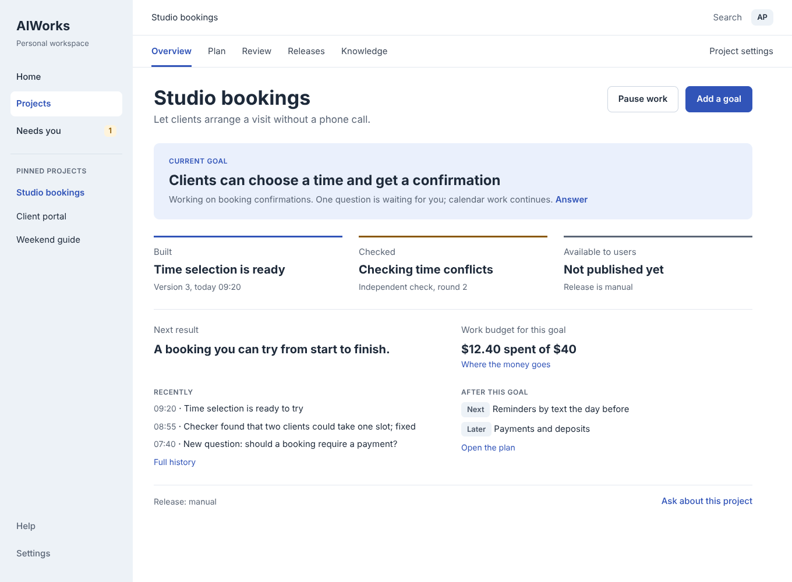
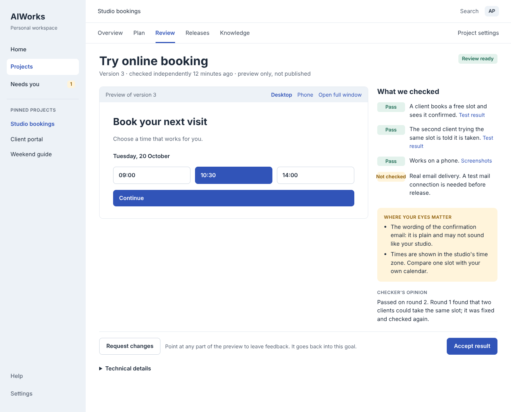

# Owner UI v2: goals, decisions and evidence

**Privacy boundary:** this is a design proposal, not a live installation record. Campaign declarations, approval records and installation status stay private under [AW-009](../DECISIONS.md#aw-009---public-commits-contain-no-installation-data). All projects, names, amounts and dates in the previews are fictional.

**Status:** design. WP1 is built in source (Home, the Overview tab, Settings › Connections, typed events with a server-side last-seen marker, and pause for all, a project or a goal; see [OPERATIONS_DASHBOARD.md](../OPERATIONS_DASHBOARD.md#home-overview-and-connections-owner-ui-v2-wp1)). WP2 is built in source: structured decisions on the step, answered, snoozed or marked as not needed ([OPERATIONS_DASHBOARD.md](../OPERATIONS_DASHBOARD.md#decisions-owner-ui-v2-wp2)). WP3 is built in source: the plan model on Review (Now, Next or Later, priority, done-when criteria with check method, included and later, estimate or "No estimate"), Edit plan as a new draft version and the changes from the version before; it reuses Plan and do and project connection, both still switched off ([OPERATIONS_DASHBOARD.md](../OPERATIONS_DASHBOARD.md#plan-and-do-review-and-approve-and-start-built-off-by-default)). WP4 is built in source: each done-when criterion with the independent checker's check and evidence ("Not checked" when it reported none), the verdict summary, open findings and where the owner's eyes matter, from validated verifier fields; Accept result records acceptance of the exact checked version and leaves merging to the merge gate; Request changes reopens the finished step as a bounded repair round that is checked again before anything is published; a goal with unresolved evidence is never shown as complete ([OPERATIONS_DASHBOARD.md](../OPERATIONS_DASHBOARD.md#review-of-a-result-owner-ui-v2-wp4)). WP6 is built in source without its answer buttons: Settings › Alerts keeps the owner's alert rules and quiet hours, and the notification outbox goes to a synthetic rehearsal transport or to Telegram, which sends only once the operator names its bot credential and chat as secret store references and switches sending on, and never resends an alert that may have arrived; an alert carries no authority, so answers stay on the dashboard until WP10 ([SUPERVISOR.md §10](../SUPERVISOR.md#10-owner-intervention-core)). It was checked against a synthetic network only. WP7 is built in source: Review's **Try this version** shows the static pages of exactly the checked commit, read from Git objects, in a sandboxed frame at desktop or phone width, or says why it is not available; nothing of the project is built or started, and AIWorks captures no screenshots ([OPERATIONS_DASHBOARD.md](../OPERATIONS_DASHBOARD.md#preview-of-a-checked-version-owner-ui-v2-wp7)). WP8 is built in source: Knowledge lists facts confirmed by the owner, found in the project's README at a named commit, or suggested by AI from its plans, with their history; only the owner's act confirms one, and an edited fact keeps where it came from; First run states the planning cost from history or "unavailable" and offers a synthetic sample project through the Add project check; Settings › Usage keeps unknown cost unknown and says hosting and subscriptions are not tracked ([OPERATIONS_DASHBOARD.md](../OPERATIONS_DASHBOARD.md#knowledge-sample-project-and-usage-owner-ui-v2-wp8)). Knowledge opens from Overview rather than as a fifth tab, so the four project tabs still fit at 320px. The owner journey between them is built in source too: **Plan** (`#/p/<project>/plan`, opened from Overview like Knowledge) groups the project's plans Now, Next and Later with each plan's version history from its stored drafts and Edit plan; Review of a result opens from Results, from *Results to review* on Home and on Overview, Accept result and Request changes, like answering, snoozing or dismissing a decision, run the caller check, and the owner's recorded acceptance is its own type in the change feed; Home answers its first decision with the same card as the step; and Add project starts from an idea that waits, as a draft, for an explicitly connected folder, its rules and the exact plan's approval ([OPERATIONS_DASHBOARD.md](../OPERATIONS_DASHBOARD.md#plan-and-the-idea-first-start-owner-ui-v2-wp3-and-screen-1)). Owner controls are built in source too: Overview shows the project's all-time and monthly budget and each goal's approved versions with what changed; Project settings explains how work runs, each goal's approved limits and what AIWorks never does; Knowledge adds the approved plans' requirements, the owner's recorded decision answers, the named materials and the project's history, each with its origin and none as a confirmed fact; each step carries a risk label from recorded routing or declared evidence ("not known" otherwise) and a high-risk decision is answered on a computer rather than a phone; stops at the repair limit, in a protected area or outside the plan offer only a retry under the same plan or a new plan to approve, never "allow once" ([OPERATIONS_DASHBOARD.md](../OPERATIONS_DASHBOARD.md#decisions-owner-ui-v2-wp2)). Nothing is deployed; Releases (WP9) and remote access (WP10) are not built. The built screens keep "Needs me" and the OWNER_WORKSPACE state words. It proposes the next shape of the owner UI and the backend work needed to back it. Statements about today's code are **observed** from the source at `b43faa2` (the endpoints, flags and tables named below were rechecked on `fdc4c2f`); none was checked on a running installation, so none is **verified**. Everything else is **planned**.

**Relationship to [OWNER_WORKSPACE.md](OWNER_WORKSPACE.md).** That design stays the authority for state words ([§2.3](OWNER_WORKSPACE.md#23-words-for-result-states)), state copy and the security boundary ([§10](OWNER_WORKSPACE.md#10-security-and-boundaries-kept)). This proposal changes the navigation and adds four models the current UI cannot show: a structured decision, a plan in user terms, acceptance with evidence, and a release step. Where the two disagree, the owner decides; until then OWNER_WORKSPACE.md applies.

Previews: [docs/design/previews/owner-ui-v2/](previews/owner-ui-v2/), one static HTML page and one screenshot per screen, linked to each other.

---

## 1. Product sentence

**You set the goal and answer real questions. AIWorks does the work and shows the evidence.**

The owner acts at three points in the life of every goal: **set the goal, approve the plan, accept the result.** Between them AIWorks plans, builds, checks independently, repairs and recovers on its own, and asks only through a decision. Human attention is the scarce resource: every screen answers "does anything need me?" in its first line.

## 2. Navigation

```
Home                        What changed, and what needs me?
Projects                    Which product?
Needs you                   Which decisions are mine?
  Project ▸ <name>
    Overview   (tab)        Where is the current goal?
    Plan       (tab)        What will be true when this is done?
    Review     (tab)        Does the result do what was promised?
    Releases   (tab)        What reaches users, and what can be undone?
    Knowledge  (tab)        What does AIWorks know about this product?
    Project settings        Under which rules does work run?
Help · Settings             Connections, usage, alerts
```

On a phone, Home, Projects and Needs you sit in a bottom bar. Technical detail (branches, commits, logs, run records) opens in place under "Details" on the screen that needs it; there is no global technical mode.

## 3. Concepts

| Concept | What the owner sees | Today's code |
| --- | --- | --- |
| Project | A product: a folder on this computer, with or without GitHub | `projects` |
| Goal | What should be true when finished, with a reason, priority and horizon (Now, Next, Later) | `campaigns`; horizon and priority on the plan's draft outline (`work_drafts`) |
| Plan | What users will be able to do; how we will know it is done (each criterion with its check method); included and later; budget; release mode | `envelope`, `work_drafts` |
| Result | A version ready for acceptance: preview or example, criteria with evidence, "not checked" with a reason, where the owner's eyes matter | `tasks`, `operations` |
| Decision | A question with options and consequences, AIWorks' suggestion and why, what continues meanwhile, what happens without an answer | `blockers` (free text) |
| Release | What changes for users, destination, version, checks, honest restore scope | `releases` (switched off) |
| Knowledge | Facts about the product, each marked confirmed by the owner, found in material or suggested by AI | Knowledge facts (WP8) |

Technical steps belong to the plan and open under "How AIWorks will do it".

## 4. Control: two settings and one boundary

1. **Work.** After Start work, AIWorks splits the goal, builds, checks, repairs and continues after crashes and limits. Any change to the goal, its criteria, its budget, protected data or the release returns to the owner as a new plan version with the difference shown.
2. **Release.** Manual by default. Automatic release is turned on per project only under an explicit rule that names the destination, allowed changes, required checks and what can be restored (AW-010).
3. **Protected areas.** Paths or topics in a project where any change becomes a decision.

Risk is a label on a result (low, medium, high). It decides what "where your eyes matter" shows and keeps high-risk decisions off the phone. It is not a ladder of trust levels.

## 5. States and colour

Two separate lines, never merged: work (Plan ready → Working / Checking → Waiting → Needs you → Review ready → Accepted) and release (Not released → Publishing → Live, Failed, Status unknown). Colour answers "who has to act": amber for the owner, blue while AIWorks works, grey for waiting under control, green for confirmed, red only for a break the owner must fix. Colour always comes with words. Word rules from [OWNER_WORKSPACE.md §2.3](OWNER_WORKSPACE.md#23-words-for-result-states) hold: "Accepted" only with recorded acceptance, "Live" only with release evidence, unknown is never shown as nothing or green.

## 6. Screens

| # | Screen | It answers | Preview |
| --- | --- | --- | --- |
| 1 | First run | What would you like to build? Idea or existing project; sample project; planning cost stated first | [html](previews/owner-ui-v2/01-first-run.html) · [png](previews/owner-ui-v2/01-first-run.png) |
| 2 | Home | One line "since your last visit", the decision first, projects with one sentence each | [html](previews/owner-ui-v2/02-home.html) · [png](previews/owner-ui-v2/02-home.png) |
| 3 | Overview | Current goal, the Built / Checked / Available to users strip, next result, budget, release mode | [html](previews/owner-ui-v2/03-overview.html) · [png](previews/owner-ui-v2/03-overview.png) |
| 4 | Plan | Now / Next / Later; what users will be able to do; done-when criteria with check method; agreed boundaries; Start work | [html](previews/owner-ui-v2/04-plan.html) · [png](previews/owner-ui-v2/04-plan.png) |
| 5 | Decision | Options with consequences, suggestion with reason, what continues, if unanswered, own answer, "this did not need me" | [html](previews/owner-ui-v2/05-decision.html) · [png](previews/owner-ui-v2/05-decision.png) |
| 6 | Review | Preview next to "what we checked", "not checked" with reason, where your eyes matter, checker's opinion, Request changes, Accept result | [html](previews/owner-ui-v2/06-review.html) · [png](previews/owner-ui-v2/06-review.png) |
| 7 | Releases | What changes for users, destination, checks, what can and cannot be restored, Publish | [html](previews/owner-ui-v2/07-releases.html) · [png](previews/owner-ui-v2/07-releases.png) |
| 8 | Knowledge | Product facts with provenance, materials, history, the project assistant | [html](previews/owner-ui-v2/08-knowledge.html) · [png](previews/owner-ui-v2/08-knowledge.png) |
| 9 | Project settings | How work runs, release, budget, ask-before-changing areas, notes for the AI, where work happens | [html](previews/owner-ui-v2/09-project-settings.html) · [png](previews/owner-ui-v2/09-project-settings.png) |
| 10 | Settings | Connections with limits, usage by source with unknown kept unknown, alert rules and quiet hours | [html](previews/owner-ui-v2/10-settings.html) · [png](previews/owner-ui-v2/10-settings.png) |
| 11 | States | Ten off-plan situations, each with a message and an action | [html](previews/owner-ui-v2/11-states.html) · [png](previews/owner-ui-v2/11-states.png) |
| 12–13 | Phone | Home and a decision; high-risk decisions are deferred to the computer | [home](previews/owner-ui-v2/12-phone-home.png) · [decision](previews/owner-ui-v2/13-phone-decision.png) |





## 7. Backend coverage in source (observed)

Observed in the source of this revision; none of it was checked on a running installation. The table first recorded the gaps at `b43faa2`; rows below now name what WP1 to WP8 and the connected owner journey built.

| Screen | Served today | Partly | Missing |
| --- | --- | --- | --- |
| First run | Start from an idea, kept as a draft until a folder is explicitly connected, then the project's rules and Plan work with the idea as its goal; project preflight and connect (`/api/projects/preflight`, `/connect`); sample project (`/api/projects/sample`); planning cost from history or "unavailable" | Plan from a description (`/api/work/requests` → `work_drafts`) only once a folder is connected; a brief only as a path inside it | An idea planned before any folder exists |
| Home | Changes since the server-side last-seen marker as typed events, the owner's acceptance among them (`homeView`); the first Needs me item with its decision card; results to review; project sentences; pause all | — | "Live" (release off) |
| Overview | Goals with Built, Checked and Available to users apart, goal budget, pause per goal and project (`overviewView`); the project's all-time and monthly budget (`project_settings`); each goal's approved versions and admitted plan amendments with their differences; results to review; links to Plan, Project settings and Knowledge | — | "Available to users" stays unknown while release is off |
| Plan | Plan screen: Now, Next and Later, priority, done-when criteria with check method, included and later, estimate or "No estimate", Edit plan as a new draft version, each plan's version history with what changed (`work_drafts`); approval of exactly the shown version (`/api/work/approve`) | Plan and do and project connection stay switched off by default | Next and Later starting by themselves (PROG5, off) |
| Decision | Structured decisions with options, consequences, suggestion, what continues and if unanswered; answer, snooze, "did not need me" (`/api/v2/decisions/*`), on the step and on Home | A stop without a structured decision is answered in the owner's own words | — |
| Review | Criteria with check and evidence, verdict summary, findings, where your eyes matter (`resultReview`); Accept result for GitHub results through the merge gate and Request changes on a finished step, both caller-checked (`/api/v2/results/*`); try the checked version (WP7); entries from Results, Home and Overview; local Apply (`/api/work/apply`) | — | Screenshots captured by AIWorks |
| Releases | Release states with honest unknown (`RELEASE_STATES`) | Destination, post-release check and rollback built, switched off | Publish action; user-facing change text; restore scope |
| Knowledge | Facts confirmed by the owner, found in the README at a named commit or suggested by AI, with history (`/api/v2/projects/:id/knowledge`); approved plans' done-when criteria and the owner's decision answers with their origin; documents the approved steps name, by path only; the project's typed events | Coordinator messages not bound to a project | The project assistant (not built) |
| Project settings | Folder, worktrees, relocate; standing protected areas, notes for the AI, project and monthly budget (WP5, `project_settings`); how work runs, each goal's approved limits and what AIWorks never does, read-only | Release modes narrow only; `denyWrites` per plan; instructions per step | — |
| Settings | Accounts with limit state (`/api/accounts`); supervisor and worker health | AI cost only, no period over HTTP | Hosting and subscription cost categories; answer buttons on a phone (WP6 built alert rules, quiet hours, a synthetic rehearsal transport in `alerts.mjs` and a Telegram transport in `alert-telegram.mjs`, off until the operator names secret store references and switches sending on; checked against a synthetic network only) |
| States | Limit waits, repair limits, pause and cancel, unknown after restart; repair-limit, protected-area and outside-the-plan stops say what can be done, only retry under the same plan or a new plan to approve; a request is *received* until a planning run starts | Computer offline is visible only locally; outside changes are spread over several mechanisms | "Allow this once" (never built: a held result stays held) |
| Phone | High-risk decisions shown in full on a phone-width touch screen and answered on a computer | — | Remote access with sign-in; push with answer buttons |

### Built but switched off

| Capability | Opens | Switch |
| --- | --- | --- |
| Plan and do | First run → Plan → Start work | `coordinator.intake` |
| Project connection from the dashboard | First run: choose a folder, connect GitHub | `projectConnection.enabled` |
| Plan approvals as records | Plan versions, decision history | `approvals.required` |
| Release | Releases, third rung of the strip | REL11 |
| Programs and waves | Next and Later starting by themselves | PROG5 |
| Plan amendments | New plan version on a scope change | table exists, writer in E3 |

Local Approve and Apply fail closed when the caller check cannot place the caller (`APPROVAL_UNCHECKED`), and Resume and Approve refuse while the running code is not merged (`RUNTIME_NOT_MERGED`, AW-005).

### First version on the backend of `b43faa2`

The first version was planned as what that backend could show truthfully: Home, Overview, Review with a pull request link, Plan read-only, States and Settings → Connections. The screens built since go beyond it (the table above); what is still unbuilt is hidden or marked as not yet available, and nothing unbuilt is shown as working.

## 8. Data contract for the new UI (planned)

A view layer beside `/api/state`, one view per screen, built server-side from existing tables, returning only allowlisted safe fields and a version for conflict checks. The current dashboard keeps working until the switch.

**Reads**

| Request | Screen | Built from | New in the store |
| --- | --- | --- | --- |
| `GET /api/v2/home` | Home, phone | `ownerView`, `projectsView`, `journal` | server-side last-seen marker |
| `GET /api/v2/projects/:id` | Overview | `campaigns`, `tasks`, `releaseLadder`, `campaignBudget` | project budget |
| `GET /api/v2/projects/:id/plan` | Plan | `envelope`, `work_drafts` | horizon and priority; criterion = {text, check method}; included / later; estimate |
| `GET /api/v2/decisions[/:id]` | Needs you | `blockers` | decision record: options, consequences, suggestion and reason, what continues, unanswered policy |
| `GET /api/v2/results/:id` | Review | `tasks.verification`, `operations.outcome` | criterion → check → evidence; safe verdict summary; eyes-on items from the verifier schema; preview references |
| `GET /api/v2/projects/:id/releases` | Releases | `releases`, `release_locks` | user-facing change, restore scope |
| `GET /api/v2/projects/:id/knowledge` | Knowledge | `journal`, approvals, blocker resolutions | facts with provenance |
| `GET /api/v2/projects/:id/settings` | Project settings | `projects`, `project_overlays` | protected areas, notes, release rule |
| `GET /api/v2/settings` | Settings | accounts, `costByUnit`, liveness | cost categories, alert rules |
| `GET /api/v2/events?since&project&type&cursor` | Home, Knowledge | `journal` | typed events for accepted, waiting, resumed |

**Actions** (POST with the CSRF token, version binding and a request ID, as today)

| Action | Effect | Builds on |
| --- | --- | --- |
| `decisions/:id/answer` {option or text} | Records the answer, clears the blocker, resumes the right step | recheck, instruct, `blockers` |
| `decisions/:id/snooze`, `/not-needed` | Remind later; "did not need me" feedback | `blockerAcknowledge` |
| `goals`, `goals/:id/plan`, `goals/:id/start`, `goals/:id/horizon` | New goal, new plan version, start, move between Now / Next / Later | `/api/work/requests`, `/approve` |
| `results/:id/accept` | Local: apply; GitHub: merge under the merge gate | `/api/work/apply`, `merge.mjs` |
| `results/:id/request-changes` {feedback, anchor} | Reopen repair in the same goal with the feedback | new |
| `pause` {all, project, goal}, `resume` | Pause with stopping vs stopped per goal | `/api/commands`, STOP |
| `releases/:id/publish` | Manual release of a checked version | `release/*` after REL11 |
| `projects/:id/settings`, `knowledge` | Standing rules; product facts | new |

The AI's own words (suggestion, verdict summary, eyes-on items) are served only as fields of a validated worker output schema, never as raw worker text.

**As built.** The routes differ from this plan where an existing route already served the data, so no second store or reader was added. Built reads: `GET /api/v2/home`, `/api/v2/projects/:id` (Overview), `/api/v2/projects/:id/settings`, `/api/v2/projects/:id/knowledge`, `/api/v2/settings`, `/api/v2/settings/alerts`, `/api/v2/settings/usage` and `/api/v2/events`. Plans, decisions and results have no GET route of their own: `GET /api/state` serves them, allowlisted, as `work.plans` (each plan with its outline, changes and `versions`), each step's `decision` and `review` under `supervisor.campaigns[].tasks[]`, and each project's Results rows with their Review entry under `owner.results`. Built actions: `/api/v2/decisions/{answer,snooze,not-needed}`, `/api/v2/results/{accept,request-changes,preview}`, `/api/v2/pause` and `/resume`, `/api/v2/projects/settings` and `/knowledge`, `/api/v2/settings/alerts`; a new goal, a new plan version and start remain `/api/work/requests`, `/api/work/edit` and `/api/work/approve`, and a horizon moves by an edit. Release publish is not built.

## 9. Work packages

Each package is one or more reviewable PRs. The first four give the full daily loop on the computer: goal → plan → decision → acceptance.

| # | Package | Brings to life | Depends on |
| --- | --- | --- | --- |
| WP1 | `/api/v2` view layer over existing data; typed event feed with a server-side last-seen marker; pause for all / project / goal | Home, Overview, States, Settings → Connections | — |
| WP2 | Structured decisions: record, answer that resumes the step, snooze, "did not need me"; builder and verifier schemas return options and a suggestion | Needs you, the Home card | WP1 |
| WP3 | Plan model: horizon and priority, criteria with check method, included / later, estimate or "no estimate"; draft editing and version diff; enable Plan and do and project connection | First run, Plan, re-approval on scope change | WP1 |
| WP4 | Acceptance: criterion → check → evidence; safe verdict summary; eyes-on items in the verifier schema; request changes on a finished step; accept for GitHub results through the merge gate | Review | WP1, WP3 |
| WP5 | Standing project settings: protected areas, notes for the AI, project and monthly budget | Project settings; "do not start what the budget cannot cover" | WP1 |
| WP6 | Notification delivery replacing the no-op transport, quiet hours, alert rules, answer buttons | Settings → Alerts | WP2 |
| WP7 | Preview of a checked version: run it locally and capture screenshots | Review: try, desktop / phone | WP4 |
| WP8 | Knowledge facts with provenance; sample project on synthetic data; planning-cost estimate; cost categories | Knowledge, First run, Usage | WP3 |
| WP9 | Manual release and its content: user-facing change, restore scope, post-release check (after REL11) | Releases, the third rung | WP4, owner decision |
| WP10 | Remote access with sign-in and phone push | Phone | WP1, WP2, WP6, owner decision |

Tests follow [AGENTS.md](../../AGENTS.md#validation): only product-critical behaviour, for example an answer that resumes the wrong step, an accept that merges an unchecked commit, a pause that does not stop new runs, or a view that leaks worker text or paths.

## 10. Owner-reserved questions

- **Remote access (WP10).** The dashboard binds loopback only and its token is readable by any local process (AW-003). A phone needs a separately reviewed sign-in, a paired relay or a trusted device. Which one?
- **Release (WP9).** Which destinations may a manual Publish reach, per project (AW-010)?
- **GitHub reads (WP4).** Settled for WP4: accept and request changes for GitHub results go through the supervisor and its merge gate; the dashboard still makes no GitHub API call and reads no review state.
- **Words.** This proposal says "Needs you" and "Accept result"; OWNER_WORKSPACE.md says "Needs me" and reserves "Accepted" for recorded acceptance. Keep, rename, or adopt?

WP1 to WP8 can start without these answers.
