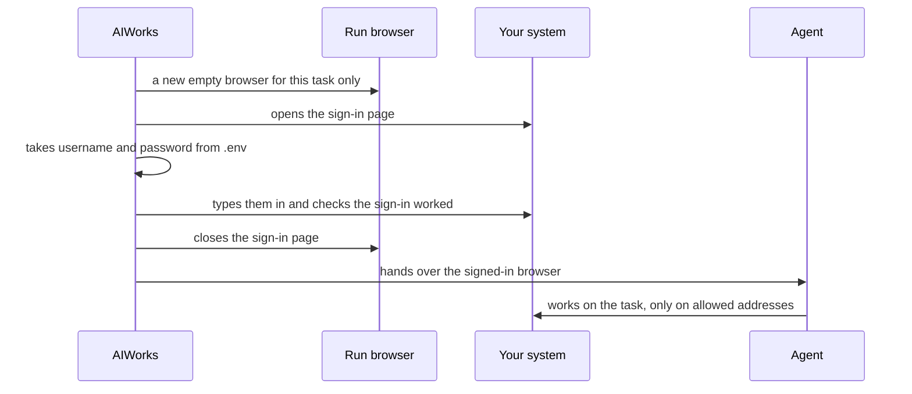

# AIWorks plugins

**English** · [Русский](README.ru.md)

A plugin is a capability that connects AIWorks to something outside it: another agent, another computer, another system, your phone. The basic installation works without them. Each plugin is off until you turn it on, and one edit turns it off again.

Every plugin below has the same passport: **why** it exists, **when** to turn it on, **what** changes in `config.json`, which **secrets** it needs, the messages to your assistant to **turn it on** and **turn it off**, and **how to check** it.

| Plugin | Connects to | Status |
| --- | --- | --- |
| [Backup agents](#backup-agents) | Codex, Cursor | Codex works as a checker; Cursor on Windows does not yet |
| [Multiple accounts](#multiple-accounts) | Several subscriptions with one provider | Built, not yet connected to the running supervisor |
| [Projects without GitHub](#projects-without-github) | Local Git, a folder on disk | Built, off |
| [Automatic merge](#automatic-merge) | The main branch of your projects | Built, off |
| [Release](#release) | A project's server or hosting | Built, off |
| [External check service](#external-check-service) | Another computer for tests | Built, off |
| [Tasks through the API](#tasks-through-the-api) | Your tracker, CRM or own service | Built, off |
| [Telegram alerts](#telegram-alerts) | Your Telegram | Built, not tested with a live bot |
| [Website checks in a browser](#website-checks-in-a-browser) | Chrome or AGY | Built, not tested on a real project |
| [Sign-in to web systems](#sign-in-to-web-systems) | The web interface of your CRM, admin panel or accounting system | Built, off |
| [Parallel work](#parallel-work) | Your computer's resources | Built, off |

**Secrets** (tokens, keys, service passwords) are never written to `config.json`. It holds only a reference name, and the value lives in the secret store: by default, the file `.local/supervisor/.env`. You type the value in yourself, and the assistant never sees it. Windows Credential Manager, Infisical and other services are optional. More in the [setup by layers](../setup/README.md#where-secrets-live).

**After any edit to `config.json`** the supervisor must be restarted. If work is running, use the [update](../setup/README.md#layer-6-work) (`npm run rebuild`), which pauses the work first.

---

## Backup agents

**Why.** When Claude runs out of its limit or its sign-in breaks, the work moves to the next agent in the list instead of waiting until morning.

**When to turn it on.** If you have a Codex subscription and often hit Claude's limits.

**Good to know.** Work moves to another agent only because of a provider problem: a limit, a sign-in or unavailability. Denied access or a failed check is never "worked around" with another agent. On Windows, Codex can check a result but cannot change code. Cursor as a builder is not yet supported on Windows. With the switch `"agy": { "codeRoles": true }` AGY can also take plans and reports, and check reports, in a sandbox without network or write access; it never makes or checks commits. The switch is off by default, and AGY then only checks websites. Turn it on after the comparison has run on your computer. Which agent suits which role is in the [agent comparison](../AGENTS_COMPARISON.md).

**config.json** holds the path to the program:

```json
"commands": {
  "claude": ["C:/Tools/Claude/claude.exe"],
  "codex": ["C:/Tools/Codex/codex.exe"]
}
```

The order of agents is set in each plan. By default it is Claude, then Codex, then Cursor.

**Secrets.** None. You sign in to Codex through its own sign-in window, under the same Windows account.

**Turn on:**

```text
Connect Codex as a backup agent for AIWorks. Find the installed codex.exe,
write it into config.json, check that I am signed in, and restart the supervisor
with npm run rebuild. If Codex is not installed, tell me how to install it.
```

**Turn off:** `Remove Codex from the AIWorks config.json and restart the supervisor.`

**AGY for plans and reports:**

```text
Let AGY take plans and reports in AIWorks: set "agy": { "codeRoles": true } in config.json
and the path to agy.exe in commands.agy, then restart the supervisor with npm run rebuild.
First run scripts/provider-benchmark.mjs and show me whether AGY coped.
```

**How to check.** `codex --version` answers. In the dashboard, under **Settings › Usage**, Codex runs appear after the next Claude limit.

---

## Multiple accounts

**Why.** Work is spread across several subscriptions with one provider, for example two Claude accounts. One account's limit does not stop the work: the next run goes on the other.

**When to turn it on.** If you have several subscriptions and you hit limits.

**Good to know.** The accounts are kept by a program called [CAAM](../SUPERVISOR.md#13-caam-account-profiles-built-not-enabled) (Coding Agent Account Manager). AIWorks only reads which profiles are alive and free, and chooses where to run. The choosing and launching logic is built and tested with synthetic tests, but it is not yet connected to the running supervisor. Turning it on changes nothing for now.

**config.json:**

```json
"caam": { "enabled": true },
"commands": { "caam": ["C:/Tools/caam/caam.exe"] }
```

**Secrets.** None: the sign-ins are kept in CAAM.

**Turn on**, once the connection is ready:

```text
Turn on working with several accounts in AIWorks through CAAM. Check that CAAM
is installed and sees my Claude profiles, write it into config.json and restart the supervisor.
```

**Turn off:** `"caam": { "enabled": false }`. New runs go back to a single account.

---

## Projects without GitHub

**Why.** Work on a project that does not live on GitHub: a local Git repository, or just a folder, for example with texts. You connect the project with the **Add project** button in the dashboard, and approve the plan with the **Approve and start** button.

**When to turn it on.** If you need to work with something other than GitHub repositories.

**Good to know.** AIWorks does not change your folder. It works in its own copy. The finished result appears in the project's **Review** tab. You press **Apply** to move it into your folder, or **Undo** to roll it back. Such a project never gets a pull request.

**config.json:**

```json
"projectConnection": { "enabled": true },
"coordinator": { "intake": true }
```

**Secrets.** None.

**Turn on:**

```text
Turn on connecting projects without GitHub (Add project) in AIWorks, and plan approval
by button. Restart the supervisor and tell me where in the dashboard to add a project.
```

**Turn off:** remove `projectConnection` from `config.json`. Connected projects stay in the database, but new ones cannot be added.

**How to check.** The **Projects** screen shows an **Add project** button.

---

## Automatic merge

**Why.** AIWorks merges a checked pull request into the main branch itself, with no need for you and no waiting overnight.

**When to turn it on.** When the project's tests are reliable and you trust the check. If you want to look at every result yourself before a merge, leave it off, or choose **I accept results myself** in the project's settings. AIWorks then merges only what you have accepted.

**Good to know.** AIWorks merges only if exactly the version the checker approved lands in main. If main has moved on in the meantime, the change is first brought up to date and checked again. There is no squash, no rebase and no force-push, and branch protection rules are not bypassed. A merge is not a release.

**config.json:**

```json
"merges": {
  "delegatedTo": "supervisor",
  "decision": "owner-2026-11",
  "repositories": ["your-account/your-project"]
},
"ciRepair": { "enabled": true }
```

`decision` is any label for your decision. Without it, the dashboard assumes merging has not been handed over, and shows ready pull requests in **Needs you**. `ciRepair` lets AIWorks read GitHub check results before a merge. You can hold back a single pull request: `"held": { "<PR link>": "owner-review" }`.

**Secrets.** None: it uses your `gh` sign-in.

**Turn on:**

```text
Turn on automatic merge in AIWorks for the project <owner/repo>. Add the merges block
with my decision and ciRepair to config.json and restart the supervisor with npm run rebuild.
```

**Turn off:** remove the repository from `merges.repositories`.

**How to check.** Ready pull requests of this project no longer appear in **Needs you**. The project's log shows merge entries.

---

## Release

**Why.** After a merge, AIWorks releases the project by its own instructions, checks what was released, and rolls back if it fails.

**When to turn it on.** If the project has clear release instructions, a check after the release and a rollback.

**Good to know.** AIWorks looks for the instructions in the project itself: `PUBLISHING.md`, `DEPLOY.md` or `RELEASE.md` in the root, or a Publish / Deploy / Release section in `AGENTS.md` or `README.md`. It runs only a safe set of commands: `npm run <script>`, `npm ci`, `npm test` and the project's own scripts. If the instructions contain `ssh`, `git push`, `curl` or similar, AIWorks does not run them and records why. A change that touches the release instructions themselves is not released automatically. AIWorks itself is never released this way.

**config.json:**

```json
"release": { "enabled": true }
```

**Secrets.** It uses only sign-ins that already exist on this computer. AIWorks creates no new ones.

**Turn on:**

```text
Turn on release in AIWorks for the project <name>. Check that the project has release
instructions with a check and a rollback, and show me which of its commands AIWorks will be able to run.
If there are no instructions, suggest their text, but do not commit it to the project. Then turn on release
in config.json and restart the supervisor.
```

**Turn off** in three levels, from gentle to firm:

```powershell
node src/supervisor/cli.mjs release-mode <project> publication-instructions review-only --data <data>   # this project only
node src/supervisor/cli.mjs release-stop --data <data>                                                    # all releases on this computer
```

or `"release": { "enabled": false }` in `config.json`. A stop does not interrupt a step that is already running and does not block a rollback.

**How to check.** After the next merge, the project's log shows a release entry: what was released, which version is running and the check result.

---

## External check service

**Why.** Another computer also runs the full tests on the exact checked version. This helps when tests are long, need a different environment, or when the project's online checks do not run on Windows.

**When to turn it on.** If you have a separate computer that can accept check jobs.

**Good to know.** The external service's result is extra information. The required check on this computer still runs. A service that is unavailable, busy or broken stops nothing: publishing and merging go on. The service must answer by the [described HTTP contract](../guides/check-services.md), over HTTPS with its own certificate.

**config.json:**

```json
"checkServices": [
  {
    "name": "test-machine",
    "kind": "remote-gate-http",
    "baseUrl": "https://192.0.2.10:4319",
    "caFile": "check-services/test-machine-ca.crt",
    "offer": "verified",
    "projects": {
      "your-account/your-project": { "projectId": "your-project", "profile": "full" }
    },
    "queueSeconds": 120,
    "timeoutMinutes": 60
  }
]
```

**Secrets.** If the service needs a key, add an `auth` block with a reference that starts with `aiworks-check-service:`. You put the value in yourself.

**Turn on:**

```text
Connect an external check service to AIWorks at <address> for the project <owner/repo>.
Follow docs/guides/check-services.md: check /health, the certificate and the contract,
and write the checkServices block. If the service needs a key, tell me under which name
to put it into the secret store. Restart the supervisor.
```

**Turn off:** remove the service from `checkServices`, or delete its `"offer"`. Then nothing is offered to it.

**How to check.** `node src/supervisor/cli.mjs status <campaign> --data <data>` shows `checkServices` with the result of the last job.

---

## Tasks through the API

**Why.** Your own system (a task tracker, a CRM, an internal portal) submits tasks to AIWorks itself and picks up the reports. No person is needed in between.

**When to turn it on.** If tasks are born in another system, not in your head.

**Good to know.** AIWorks sends no notifications outward. Your system submits the task and asks for the status itself, as often as it needs. This way AIWorks never opens an outgoing connection to wherever a task's text points. The API works only on this computer (`127.0.0.1`). For outside access you can move it to a separate port and forward it with your own tunnel. Each project has its own token: one project's token does not open another.

| Request | What it does |
| --- | --- |
| `POST /api/campaigns` | Registers a task, the same as `cli.mjs start` |
| `GET /api/campaigns/<id>/status` | Where the work stands |
| `GET /api/campaigns/<id>/report` | The checked report |

Authorization is the header `Authorization: Bearer <token>`.

**config.json.** Write `credentialStore` first; the token-issuing command adds the rest itself:

```json
"campaignApi": {
  "enabled": true,
  "tokenRefs": ["aiworks-campaign-api:your-project"],
  "credentialStore": { "kind": "env-file", "path": "C:/Work/aiworks/.local/supervisor/.env" }
}
```

**Secrets.** The token is created by a command and written straight into `.env` as the line `AIWORKS_CAMPAIGN_API_<PROJECT>`. It is never shown on screen. You take it from there for your system.

```powershell
node src/supervisor/cli.mjs campaign-token create <projectId> --data <data>   # issue
node src/supervisor/cli.mjs campaign-token rotate <projectId> --data <data>   # replace
```

**Turn on:**

```text
Turn on tasks through the API in AIWorks for the project <name>. Issue a token with the
campaign-token create command with the env-file store in campaignApi, check the campaignApi block in config.json and restart the supervisor.
Tell me where the token is kept and which address to give my system. Do not write the token itself in the chat.
```

**Turn off:** `"campaignApi": { "enabled": false }`, or remove the project's reference from `tokenRefs`.

**How to check.** `GET /api/campaigns/<any id>/status` without a token answers `401`. With a token it answers with a status or `404`.

---

## Telegram alerts

**Why.** A message in Telegram when something is blocked and needs your attention.

**When to turn it on.** If you do not want to look at the dashboard to find out that you are needed.

**Good to know.** The bot only writes. You cannot answer it, approve a plan or accept a result through Telegram. All of that stays in the dashboard on your computer. There are quiet-hours rules: in quiet hours, messages wait. The same event is never sent twice. Sending has been tested on a synthetic network, but not yet with a live bot.

**config.json:**

```json
"ownerIntervention": { "enabled": true, "deliver": true },
"alerts": {
  "transport": {
    "kind": "telegram",
    "secretRef": "env:aiworks-alerts/bot",
    "recipientRef": "env:aiworks-alerts/chat"
  }
}
```

**Secrets.** The bot token and the chat number are two lines in `.env` (its path is `envFile` at the top of `config.json`):

```dotenv
AIWORKS_ALERTS_BOT=
AIWORKS_ALERTS_CHAT=
```

To keep them in Windows Credential Manager or Infisical, use the prefix `windows:` or `helper:` instead of `env:`.

**Turn on:**

```text
Turn on Telegram alerts in AIWorks. Write the ownerIntervention and alerts blocks
with references to the secrets in .env, and tell me which two lines to type there. After I say "done", restart the supervisor
and check in Settings › Alerts that sending is ready.
```

**Turn off:** `"deliver": false`. Events are still recorded and visible in **Needs you**, but they are not sent.

**How to check.** **Settings › Alerts** in the dashboard shows that sending is on.

---

## Website checks in a browser

**Why.** For web projects, an agent opens the page in a real browser and checks it the way a person will see it, not only through tests.

**When to turn it on.** For websites and web apps where it matters how the page looks and works.

**Good to know.** It needs AGY or Chrome 149 or newer. The project's own preview server is started only if you have named its script explicitly. Built, but not yet tested on a real project.

**config.json:**

```json
"commands": { "chrome": ["C:/Program Files/Google/Chrome/Application/chrome.exe"] },
"previews": {
  "servers": { "your-account/your-site": { "script": "scripts/preview.mjs", "ready": "/" } }
}
```

**Secrets.** None.

**Turn on:**

```text
Turn on browser checks in AIWorks for the website <owner/repo>. Find Chrome, check
its version and write it into config.json. If the project has a preview start script,
write it into previews. If not, tell me which one is needed. Restart the supervisor.
```

**Turn off:** remove `chrome` and the project's entry from `previews`.

---

## Sign-in to web systems

**Why.** A task where an agent works in the web interface of another system (a CRM, an admin panel, an accounting system): it checks screens or makes changes the way a person would. For that, the system needs a sign-in with an account.

**How the sign-in is passed.** The password never reaches the agent: not in the task, not in chat, not in the browser. You type the username and password into `.env`. `config.json` holds a **sign-in profile** for the system's address: the sign-in page and the form fields. AIWorks does the rest:



The agent gets a browser that is already signed in. It sees neither the password, nor the sign-in form, nor the sign-in requests. The checker later signs in again, in its own separate browser.

**Two kinds of such tasks**

| Mode | What the agent does | What it needs besides the sign-in profile |
| --- | --- | --- |
| **Check** | Opens pages and compares them with the criteria. Changes nothing | The page addresses in the task |
| **Changes** | Changes data through the system's interface and reports what it was, what it is now and where to see it | 🙋 Your permission: the system's address in the project's `web.buildOrigins` list in the governance folder |

**Good to know**

- The agent goes only to the addresses in the task. A new address means a new task.
- HTTPS only. HTTP only for systems on this same computer.
- Create a **separate account for AIWorks with the fewest rights it needs**. The agent can do anything that account can.
- Each system gets its own profile and its own lines in `.env`. A production address gets a separate profile.
- The signed-in browser lives only for this run. Cookies and passwords are not saved anywhere and never appear in reports.
- If the sign-in fails, the task does not start and the reason is recorded. The sign-in form is never sent twice, so the account does not get locked.
- Only Claude makes changes through an interface.

**config.json:**

```json
"commands": { "chrome": ["C:/Program Files/Google/Chrome/Application/chrome.exe"] },
"browserLogin": {
  "credentialStore": { "kind": "env-file", "path": "C:/Work/aiworks/.local/supervisor/.env" },
  "profiles": [
    {
      "origin": "https://crm.example.invalid",
      "loginUrl": "https://crm.example.invalid/login",
      "usernameRef": "example-crm-user",
      "passwordRef": "example-crm-password",
      "usernameSelector": "input[name=user]",
      "passwordSelector": "input[type=password]",
      "submitSelector": "button[type=submit]",
      "successSelector": "#signed-in"
    }
  ]
}
```

`successSelector` is an element that is on the page only after a successful sign-in: the user name, a "Sign out" button.

**Secrets:** two lines in `.env`:

```dotenv
EXAMPLE_CRM_USER=aiworks-bot
EXAMPLE_CRM_PASSWORD=
```

**Permission to make changes:** in the governance folder, in the project's record `registry/projects/<id>.json`:

```json
"web": { "buildOrigins": ["https://crm.example.invalid"] }
```

**Turn on:**

```text
I want AIWorks to work in the web system <address> for project <name>.
Open the sign-in page and find the username field, the password field, the sign-in
button and an element that is visible only after signing in. Write a browserLogin
profile with the .env store, and tell me which two lines to type into .env.
Do not ask me for the password. If the agent must change things there, not only look,
prepare the web.buildOrigins record for the project and ask me whether I allow it.
```

**Give a task:**

```text
Use AIWorks for project <name>: in the system <address> I need <what to do>.
This is browser work in <check | changes> mode, pages: <addresses>.
Write a plan with criteria the checker can use to confirm it is done.
```

**Turn off:** remove the profile from `browserLogin.profiles` and its lines from `.env`. To forbid changes, remove the address from `web.buildOrigins`.

**How to check.** Give a small task in check mode: "open the home page after signing in and describe what you see". The report should show the page of a signed-in user.

---

## Parallel work

**Why.** Several tasks run at once, and AIWorks makes sure the computer does not choke: memory, processor, disk, Docker.

**When to turn it on.** When there are many tasks and the computer is powerful. By default, tasks run one at a time.

**Good to know.** Two steps of one task do not run at once unless the plan allows it. Under load, AIWorks does not take new work, but it does not stop the work already running.

**config.json:**

```json
"scheduler": { "enabled": true, "maxWorkers": 2 }
```

Without `maxWorkers`, the limit is worked out from the number of cores: from 1 to 4.

**Secrets.** None.

**Turn on:**

```text
Turn on parallel work in AIWorks. Check how many cores and how much memory this computer has,
suggest maxWorkers, write scheduler into config.json and restart the supervisor.
```

**Turn off:** `"scheduler": { "enabled": false }`.

**How to check.** On the **Work** tab, several tasks are running at the same time.

---

All the fields and details of each plugin are in the [supervisor runbook](../SUPERVISOR.md) and the [configuration description](../guides/CONFIGURATION.md).
