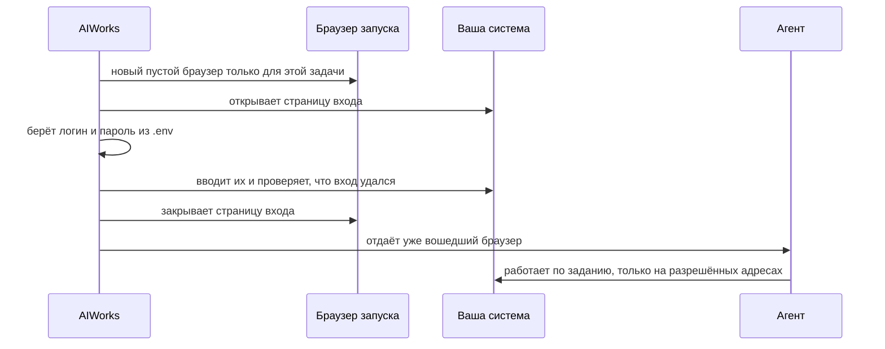

# Плагины AIWorks

[English](README.md) · **Русский**

Плагин — возможность, которая связывает AIWorks с чем-то внешним: другим агентом, другим компьютером, другой системой, вашим телефоном. Базовая установка обходится без них. Каждый плагин выключен, пока вы его не включите, и выключается обратно одной правкой.

У каждого плагина ниже одинаковый паспорт: **зачем** он, **когда** включать, **что** меняется в `config.json`, какие нужны **секреты**, сообщения ассистенту **«включи»** и **«выключи»**, и **как проверить**.

| Плагин | Связывает с | Готовность |
| --- | --- | --- |
| [Запасные агенты](#запасные-агенты) | Codex, Cursor | Codex — как проверяющий; Cursor на Windows — пока нет |
| [Несколько аккаунтов](#несколько-аккаунтов) | Несколько подписок одного провайдера | Построено, к работающему супервизору ещё не подключено |
| [Проекты без GitHub](#проекты-без-github) | Локальный Git, папка на диске | Построено, выключено |
| [Автоматический merge](#автоматический-merge) | Ветка main ваших проектов | Построено, выключено |
| [Выкладка](#выкладка) | Сервер или площадка проекта | Построено, выключено |
| [Внешний сервис проверок](#внешний-сервис-проверок) | Другой компьютер для тестов | Построено, выключено |
| [Приём задач через API](#приём-задач-через-api) | Ваш трекер, CRM или свой сервис | Построено, выключено |
| [Уведомления в Telegram](#уведомления-в-telegram) | Ваш Telegram | Построено, на живом боте не проверено |
| [Проверка сайтов в браузере](#проверка-сайтов-в-браузере) | Chrome или AGY | Построено, на реальном проекте не проверено |
| [Вход в системы через браузер](#вход-в-системы-через-браузер) | Веб-интерфейс вашей CRM, админки, учётной системы | Построено, выключено |
| [Параллельная работа](#параллельная-работа) | Ресурсы вашего компьютера | Построено, выключено |

**Секреты** — токены, ключи, пароли сервисов — никогда не пишутся в `config.json`. Там только имя-ссылка, а значение лежит в хранилище секретов: по умолчанию в файле `.local/supervisor/.env`. Значение вписываете вы сами, ассистент его не видит. Диспетчер учётных данных Windows, Infisical и другие сервисы — по желанию. Подробнее — в [настройке по слоям](../setup/README.ru.md#где-хранятся-секреты).

**После любой правки `config.json`** супервизор нужно перезапустить. Если идёт работа — через [обновление](../setup/README.ru.md#слой-6-работа) (`npm run rebuild`), которое сначала ставит её на паузу.

---

## Запасные агенты

**Зачем.** Когда у Claude кончился лимит или сломался вход, работа переходит к следующему агенту в списке, а не стоит до утра.

**Когда включать.** Если у вас есть подписка Codex и вы часто упираетесь в лимиты Claude.

**Что важно знать.** Переход на другого агента бывает только из-за проблемы провайдера: лимит, вход, недоступность. Отказ в доступе или проваленная проверка никогда не «обходятся» другим агентом. На Windows Codex может проверять результат, но не менять код. Cursor как исполнитель на Windows пока не поддерживается. AGY можно допустить ко всем ролям — планам, коду, проверке и слиянию — переключателем `"agy": { "codeRoles": true }`; по умолчанию он выключен и AGY только проверяет сайты. Включать его стоит после прогона сравнения на вашем компьютере. Какой агент на что годится — в [сравнении агентов](../AGENTS_COMPARISON.ru.md).

**config.json** — путь к программе:

```json
"commands": {
  "claude": ["C:/Tools/Claude/claude.exe"],
  "codex": ["C:/Tools/Codex/codex.exe"]
}
```

Порядок агентов задаётся в каждом плане. По умолчанию — Claude, потом Codex, потом Cursor.

**Секреты.** Нет. Вы входите в Codex через его собственное окно под той же учётной записью Windows.

**Включи:**

```text
Подключи Codex как запасного агента AIWorks. Найди установленный codex.exe,
пропиши его в config.json, проверь, что вход выполнен, и перезапусти супервизор
через npm run rebuild. Если Codex не установлен — скажи, как его поставить.
```

**Выключи:** `Убери Codex из config.json AIWorks и перезапусти супервизор.`

**AGY во всех ролях:**

```text
Включи в AIWorks AGY во всех ролях: пропиши "agy": { "codeRoles": true } в config.json
и путь к agy.exe в commands.agy, перезапусти супервизор через npm run rebuild.
Сначала прогони scripts/provider-benchmark.mjs и покажи, справился ли AGY.
```

**Как проверить.** `codex --version` отвечает; в дашборде, в **Settings › Usage**, после очередного лимита Claude видны запуски Codex.

---

## Несколько аккаунтов

**Зачем.** Работа распределяется между несколькими подписками одного провайдера, например двумя аккаунтами Claude. Лимит одного не останавливает работу: следующий запуск идёт на другом.

**Когда включать.** Если у вас несколько подписок и вы упираетесь в лимиты.

**Что важно знать.** Аккаунты хранит программа [CAAM](../SUPERVISOR.md#13-caam-account-profiles-built-not-enabled) (Coding Agent Account Manager). AIWorks только читает, какие профили живы и свободны, и сам выбирает, где запускать. Логика выбора и запуска построена и проверена синтетическими тестами, но к работающему супервизору ещё не подключена. Включение сейчас ничего не меняет.

**config.json:**

```json
"caam": { "enabled": true },
"commands": { "caam": ["C:/Tools/caam/caam.exe"] }
```

**Секреты.** Нет: входы хранятся в CAAM.

**Включи** — когда подключение будет готово:

```text
Включи в AIWorks работу с несколькими аккаунтами через CAAM. Проверь, что CAAM
установлен и видит мои профили Claude, пропиши его в config.json и перезапусти супервизор.
```

**Выключи:** `"caam": { "enabled": false }` — новые запуски снова идут под одним аккаунтом.

---

## Проекты без GitHub

**Зачем.** Работа над проектом, который не живёт на GitHub: локальный Git-репозиторий или просто папка — например, с текстами. Проект подключается кнопкой **Add project** в дашборде, план одобряется кнопкой **Approve and start**.

**Когда включать.** Если нужно работать с чем-то кроме репозиториев GitHub.

**Что важно знать.** Вашу папку AIWorks не меняет: он работает в своей копии. Готовый результат появляется во вкладке **Review** проекта; вы нажимаете **Apply**, чтобы перенести его в свою папку, или **Undo**, чтобы откатить. Pull request у такого проекта не бывает.

**config.json:**

```json
"projectConnection": { "enabled": true },
"coordinator": { "intake": true }
```

**Секреты.** Нет.

**Включи:**

```text
Включи в AIWorks подключение проектов без GitHub (Add project) и одобрение планов
кнопкой. Перезапусти супервизор и скажи, где в дашборде добавить проект.
```

**Выключи:** убрать `projectConnection` из `config.json`. Подключённые проекты остаются в базе, но новые не добавить.

**Как проверить.** На экране **Projects** появляется кнопка **Add project**.

---

## Автоматический merge

**Зачем.** AIWorks сам сливает проверенный pull request в основную ветку — без вас и без ночного простоя.

**Когда включать.** Когда тесты проекта надёжны и вы доверяете проверке. Если хотите сами смотреть каждый результат перед merge — оставьте выключенным или выберите в настройках проекта **I accept results myself**: тогда AIWorks сливает только то, что вы приняли.

**Что важно знать.** AIWorks сливает, только если в main попадает ровно та версия, которую одобрил проверяющий. Если main за это время ушёл вперёд, изменение сначала обновляется и проверяется заново. Никаких squash, rebase и force-push, правила защиты ветки не обходятся. Merge — это не выкладка.

**config.json:**

```json
"merges": {
  "delegatedTo": "supervisor",
  "decision": "owner-2026-11",
  "repositories": ["your-account/your-project"]
},
"ciRepair": { "enabled": true }
```

`decision` — любая метка вашего решения; без неё дашборд считает, что merge не передан, и показывает готовые pull request в **Needs you**. `ciRepair` нужен, чтобы AIWorks читал результаты проверок GitHub перед merge. Отдельный pull request можно придержать: `"held": { "<ссылка на PR>": "owner-review" }`.

**Секреты.** Нет: используется ваш вход в `gh`.

**Включи:**

```text
Включи в AIWorks автоматический merge для проекта <owner/repo>. Добавь блок merges
с моим решением и ciRepair в config.json и перезапусти супервизор через npm run rebuild.
```

**Выключи:** убрать репозиторий из `merges.repositories`.

**Как проверить.** Готовые pull request этого проекта больше не появляются в **Needs you**; в журнале проекта видны записи о merge.

---

## Выкладка

**Зачем.** После merge AIWorks выкладывает проект по его собственной инструкции, проверяет, что выложилось, и при неудаче откатывает.

**Когда включать.** Если у проекта есть понятная инструкция выкладки, проверка после неё и откат.

**Что важно знать.** AIWorks ищет инструкцию в самом проекте: `PUBLISHING.md`, `DEPLOY.md` или `RELEASE.md` в корне, либо раздел Publish / Deploy / Release в `AGENTS.md` или `README.md`. Он выполняет только безопасный набор команд: `npm run <скрипт>`, `npm ci`, `npm test` и скрипты самого проекта. Если в инструкции есть `ssh`, `git push`, `curl` и подобное, AIWorks её не выполняет и записывает, почему. Изменение, которое трогает саму инструкцию выкладки, не выкладывается автоматически. Сам AIWorks так не выкладывается никогда.

**config.json:**

```json
"release": { "enabled": true }
```

**Секреты.** Используются только входы, которые уже есть на этом компьютере. Новых AIWorks не создаёт.

**Включи:**

```text
Включи в AIWorks выкладку для проекта <имя>. Проверь, что в проекте есть инструкция
выкладки с проверкой и откатом, и покажи, какие её команды AIWorks сможет выполнить.
Если инструкции нет — предложи её текст, но в проект не коммить. Потом включи release
в config.json и перезапусти супервизор.
```

**Выключи** — три уровня, от мягкого к жёсткому:

```powershell
node src/supervisor/cli.mjs release-mode <project> publication-instructions review-only --data <data>   # только этот проект
node src/supervisor/cli.mjs release-stop --data <data>                                                    # все выкладки на компьютере
```

или `"release": { "enabled": false }` в `config.json`. Остановка не прерывает уже идущий шаг и не мешает откату.

**Как проверить.** После очередного merge в журнале проекта появляется запись о выкладке: что выложено, какая версия работает и результат проверки.

---

## Внешний сервис проверок

**Зачем.** Другой компьютер дополнительно прогоняет полные тесты на точной проверенной версии. Это нужно, когда тесты долгие, требуют другой среды или когда онлайн-проверки проекта идут не на Windows.

**Когда включать.** Если есть отдельный компьютер, который может принимать задания на проверку.

**Что важно знать.** Результат внешнего сервиса — дополнительная информация. Обязательная проверка на этом компьютере всё равно идёт. Недоступный, занятый или сломанный сервис ничего не останавливает: публикация и merge продолжаются. Сервис должен отвечать по [описанному HTTP-контракту](../guides/check-services.md) с HTTPS и своим сертификатом.

**config.json:**

```json
"checkServices": [
  {
    "name": "test-machine",
    "kind": "remote-gate-http",
    "baseUrl": "https://192.0.2.10:4319",
    "caFile": "check-services/test-machine-ca.crt",
    "offer": "verified",
    "projects": {
      "your-account/your-project": { "projectId": "your-project", "profile": "full" }
    },
    "queueSeconds": 120,
    "timeoutMinutes": 60
  }
]
```

**Секреты.** Если сервис требует ключ — блок `auth` со ссылкой, начинающейся на `aiworks-check-service:`. Значение кладёте вы сами.

**Включи:**

```text
Подключи к AIWorks внешний сервис проверок по адресу <адрес> для проекта <owner/repo>.
Действуй по docs/guides/check-services.md: проверь /health, сертификат и контракт,
пропиши блок checkServices. Если сервис требует ключ — скажи, под каким именем мне
положить его в хранилище секретов. Перезапусти супервизор.
```

**Выключи:** убрать сервис из `checkServices` или удалить у него `"offer"` — тогда ему ничего не предлагается.

**Как проверить.** `node src/supervisor/cli.mjs status <campaign> --data <data>` показывает `checkServices` с результатом последнего задания.

---

## Приём задач через API

**Зачем.** Ваша система — трекер задач, CRM, внутренний портал — сама ставит задачи в AIWorks и забирает отчёты. Человек между ними не нужен.

**Когда включать.** Если задачи рождаются не у вас в голове, а в другой системе.

**Что важно знать.** AIWorks не шлёт уведомления наружу. Ваша система сама кладёт задачу и сама спрашивает статус так часто, как ей нужно. Так AIWorks никогда не открывает исходящие соединения туда, куда укажет текст задачи. API работает только на этом компьютере (`127.0.0.1`); для доступа извне его можно вынести на отдельный порт и пробросить своим туннелем. У каждого проекта свой токен: токен одного проекта не открывает другой.

| Запрос | Что делает |
| --- | --- |
| `POST /api/campaigns` | Регистрирует задачу — то же, что `cli.mjs start` |
| `GET /api/campaigns/<id>/status` | Где работа |
| `GET /api/campaigns/<id>/report` | Проверенный отчёт |

Авторизация — заголовок `Authorization: Bearer <токен>`.

**config.json** — `credentialStore` пропишите заранее, остальное команда выпуска токена допишет сама:

```json
"campaignApi": {
  "enabled": true,
  "tokenRefs": ["aiworks-campaign-api:your-project"],
  "credentialStore": { "kind": "env-file", "path": "C:/Work/aiworks/.local/supervisor/.env" }
}
```

**Секреты.** Токен создаётся командой и сразу записывается в `.env` строкой `AIWORKS_CAMPAIGN_API_<ПРОЕКТ>`. На экран он не выводится — берёте его оттуда для своей системы.

```powershell
node src/supervisor/cli.mjs campaign-token create <projectId> --data <data>   # выпустить
node src/supervisor/cli.mjs campaign-token rotate <projectId> --data <data>   # заменить
```

**Включи:**

```text
Включи в AIWorks приём задач через API для проекта <имя>. Пропиши в campaignApi
хранилище env-file, выпусти токен командой campaign-token create, проверь блок campaignApi в config.json и перезапусти супервизор.
Скажи, где лежит токен и какой адрес дать моей системе. Сам токен мне в чат не пиши.
```

**Выключи:** `"campaignApi": { "enabled": false }` или убрать ссылку проекта из `tokenRefs`.

**Как проверить.** `GET /api/campaigns/<любой id>/status` без токена отвечает `401`, с токеном — статусом или `404`.

---

## Уведомления в Telegram

**Зачем.** Сообщение в Telegram, когда что-то встало и требует вашего внимания.

**Когда включать.** Если не хотите заглядывать в дашборд, чтобы узнать, что вы нужны.

**Что важно знать.** Бот только пишет. Ответить ему, одобрить план или принять результат через Telegram нельзя — всё это остаётся в дашборде на вашем компьютере. Есть правила тишины: в тихие часы сообщения ждут. Одно и то же событие не присылается дважды. Отправка проверена на синтетической сети, на живом боте — ещё нет.

**config.json:**

```json
"ownerIntervention": { "enabled": true, "deliver": true },
"alerts": {
  "transport": {
    "kind": "telegram",
    "secretRef": "env:aiworks-alerts/bot",
    "recipientRef": "env:aiworks-alerts/chat"
  }
}
```

**Секреты.** Токен бота и номер чата — две строки в `.env` (путь к нему — `envFile` в начале `config.json`):

```dotenv
AIWORKS_ALERTS_BOT=
AIWORKS_ALERTS_CHAT=
```

Хранить их в Диспетчере Windows или Infisical — приставка `windows:` или `helper:` вместо `env:`.

**Включи:**

```text
Включи в AIWorks уведомления в Telegram. Пропиши блоки ownerIntervention и alerts
со ссылками на секреты в .env и скажи, какие две строки мне туда вписать. После того как я скажу «готово», перезапусти супервизор
и проверь в Settings › Alerts, что отправка готова.
```

**Выключи:** `"deliver": false` — события продолжают записываться и видны в **Needs you**, но не отправляются.

**Как проверить.** **Settings › Alerts** в дашборде показывает, что отправка включена.

---

## Проверка сайтов в браузере

**Зачем.** Для веб-проектов агент открывает страницу в настоящем браузере и проверяет её так, как увидит человек, а не только по тестам.

**Когда включать.** Для сайтов и веб-приложений, где важно, как страница выглядит и работает.

**Что важно знать.** Нужен AGY или Chrome 149 и новее. Свой сервер проекта для предпросмотра запускается, только если вы явно указали его скрипт. Построено, но на реальном проекте ещё не проверено.

**config.json:**

```json
"commands": { "chrome": ["C:/Program Files/Google/Chrome/Application/chrome.exe"] },
"previews": {
  "servers": { "your-account/your-site": { "script": "scripts/preview.mjs", "ready": "/" } }
}
```

**Секреты.** Нет.

**Включи:**

```text
Включи в AIWorks проверку сайта <owner/repo> в браузере. Найди Chrome, проверь
версию, пропиши его в config.json. Если в проекте есть скрипт запуска для предпросмотра —
пропиши его в previews, если нет — скажи, какой нужен. Перезапусти супервизор.
```

**Выключи:** убрать `chrome` и запись проекта из `previews`.

---

## Вход в системы через браузер

**Зачем.** Задача, где агент работает в веб-интерфейсе другой системы — CRM, админки, учётной системы: проверяет экраны или вносит изменения так, как это сделал бы человек. Для этого системе нужен вход под учётной записью.

**Как передаётся вход.** Агенту пароль не передаётся никогда — ни в задании, ни в чате, ни в браузере. Вы вписываете логин и пароль в `.env`. В `config.json` описан **профиль входа** для адреса системы: страница входа и поля формы. Дальше всё делает AIWorks:



Агент получает браузер, в котором уже выполнен вход. Он не видит ни пароля, ни формы входа, ни запросов авторизации. Проверяющий потом входит заново, в своём отдельном браузере.

**Два вида таких задач**

| Режим | Что делает агент | Что нужно, кроме профиля входа |
| --- | --- | --- |
| **Проверка** | Открывает страницы и сверяет их с критериями. Ничего не меняет | Адреса страниц в задании |
| **Изменения** | Меняет данные через интерфейс системы и пишет отчёт: что было, что стало, где посмотреть | 🙋 Ваше разрешение: адрес системы в списке `web.buildOrigins` проекта в папке правил |

**Что важно знать**

- Агент ходит только по адресам из задания. Новый адрес — новое задание.
- Только HTTPS. HTTP — только для систем на этом же компьютере.
- Заведите для AIWorks **отдельную учётную запись с минимальными правами**. Агент может всё, что может эта учётная запись.
- Для каждой системы — свой профиль и свои строки в `.env`. Боевой адрес — отдельный профиль.
- Браузер со входом живёт только в этом запуске. Cookies и пароли никуда не сохраняются и не попадают в отчёты.
- Если вход не удался, задача не начинается, а причина записывается. Форма входа повторно не отправляется — чтобы не заблокировать учётную запись.
- Изменения через интерфейс выполняет только Claude.

**config.json:**

```json
"commands": { "chrome": ["C:/Program Files/Google/Chrome/Application/chrome.exe"] },
"browserLogin": {
  "credentialStore": { "kind": "env-file", "path": "C:/Work/aiworks/.local/supervisor/.env" },
  "profiles": [
    {
      "origin": "https://crm.example.invalid",
      "loginUrl": "https://crm.example.invalid/login",
      "usernameRef": "example-crm-user",
      "passwordRef": "example-crm-password",
      "usernameSelector": "input[name=user]",
      "passwordSelector": "input[type=password]",
      "submitSelector": "button[type=submit]",
      "successSelector": "#signed-in"
    }
  ]
}
```

`successSelector` — элемент, который есть на странице только после успешного входа: имя пользователя, кнопка «Выйти».

**Секреты** — две строки в `.env`:

```dotenv
EXAMPLE_CRM_USER=aiworks-bot
EXAMPLE_CRM_PASSWORD=
```

**Разрешение на изменения** — в папке правил, в записи проекта `registry/projects/<id>.json`:

```json
"web": { "buildOrigins": ["https://crm.example.invalid"] }
```

**Включи:**

```text
Хочу, чтобы AIWorks работал в веб-системе <адрес> для проекта <имя>.
Открой страницу входа, найди поле логина, поле пароля, кнопку входа и элемент,
который виден только после входа. Пропиши профиль в browserLogin с хранилищем .env
и скажи, какие две строки мне вписать в .env. Пароль у меня не спрашивай.
Если агент должен там что-то менять, а не только смотреть, подготовь запись
web.buildOrigins для проекта и спроси меня, разрешаю ли я.
```

**Как поставить задачу:**

```text
Используй AIWorks для проекта <имя>: в системе <адрес> нужно <что сделать>.
Это работа через браузер в режиме <проверка | изменения>, страницы: <адреса>.
Составь план с критериями, по которым проверяющий убедится, что всё сделано.
```

**Выключи:** убрать профиль из `browserLogin.profiles` и строки из `.env`. Чтобы запретить изменения, убрать адрес из `web.buildOrigins`.

**Как проверить.** Поставить маленькую задачу в режиме проверки: «открой главную страницу после входа и опиши, что на ней видно». В отчёте должна быть страница уже вошедшего пользователя.

---

## Параллельная работа

**Зачем.** Несколько задач идут одновременно, и AIWorks следит, чтобы компьютер не захлебнулся: память, процессор, диск, Docker.

**Когда включать.** Когда задач много и компьютер мощный. По умолчанию задачи идут по одной.

**Что важно знать.** Два шага одной задачи одновременно не идут, если план этого не разрешает. Под нагрузкой AIWorks не берёт новую работу, но идущую не останавливает.

**config.json:**

```json
"scheduler": { "enabled": true, "maxWorkers": 2 }
```

Без `maxWorkers` предел считается от числа ядер: от 1 до 4.

**Секреты.** Нет.

**Включи:**

```text
Включи в AIWorks параллельную работу. Посмотри, сколько у компьютера ядер и памяти,
предложи maxWorkers, пропиши scheduler в config.json и перезапусти супервизор.
```

**Выключи:** `"scheduler": { "enabled": false }`.

**Как проверить.** На вкладке **Work** несколько задач одновременно в работе.

---

Все поля и тонкости каждого плагина — в [runbook супервизора](../SUPERVISOR.md) и [описании настроек](../guides/CONFIGURATION.md) (англ.).
