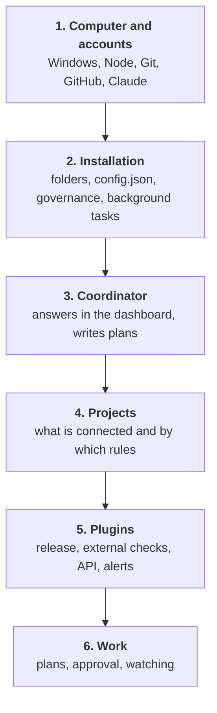
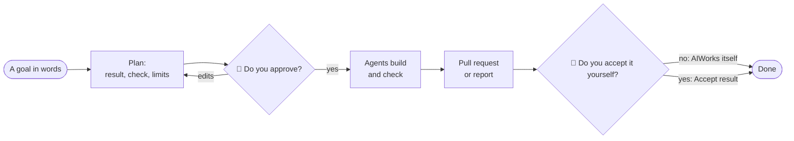

# Setting up AIWorks, layer by layer

**English** · [Русский](README.ru.md)

AIWorks is built from six layers. Each one rests on the one before it, and each has its own decisions. Usually your AI assistant does all of this from the [ready-made messages on the home page](../../README.md#set-up-in-four-messages). This page covers the same thing in detail: why each layer exists, what you decide, which commands run and how to check that everything works.



The 🙋 mark shows where your decision or your action is needed. The assistant does everything else itself.

The paths in the examples (`C:/Work/aiworks`) are placeholders. The assistant will use its own and will not touch an existing installation.

---

## Layer 1. Computer and accounts

**Why.** AIWorks' agents are the programs Claude Code, Codex and Cursor, running on your computer on your behalf. They need installed programs and your sign-ins. AIWorks never signs in anywhere itself and never creates accounts.

🙋 **What you decide**

- **Which computer.** One you can leave switched on: no work happens in sleep mode. If you need the computer for something else, a separate one is better, because the agents load it noticeably.
- **Which subscriptions.** Claude is required: it is the main builder and the only coordinator. Codex is a backup for when limits are hit. The usage comes from your subscriptions or API credits.

🙋 **What you do:** sign in to GitHub and to Claude Code through their own sign-in windows. Passwords and tokens are never pasted into the chat or into settings files.

**Commands**

```powershell
node --version     # needs 22.18 or newer
git --version      # 2.38 or newer
node --input-type=module -e "import { DatabaseSync } from 'node:sqlite'; new DatabaseSync(':memory:').close(); console.log('SQLite ready')"

gh auth login --web
gh auth status

claude --version
```

Install Claude Code with the [native installer](https://code.claude.com/docs/en/setup), under the same Windows account that AIWorks will run under. An npm or `.cmd` wrapper that works in your terminal may fail to start from AIWorks.

**How to check.** Every command above answers with a version, and `gh auth status` shows you are signed in. A version number only proves the program is there. The assistant checks that your account actually works in layer 3.

---

## Layer 2. Installation

**Why.** AIWorks keeps four things apart, so that an update does not break running work and your data does not end up in public code:

| What | Default location | Why separate |
| --- | --- | --- |
| Source code | `C:/Work/aiworks` | Updates come from here |
| Working copy | `C:/Work/aiworks/.local/runtime` | Only a verified version runs; an update never happens under running agents |
| Data | `C:/Work/aiworks/.local/supervisor` | The database, the log, `config.json`. Survives updates |
| Governance | `C:/Work/aiworks/.local/governance` | Which projects are allowed and by which rules. AIWorks only reads it |

Everything in `.local/` stays out of Git.

🙋 **What you decide:** where the data lives. The default fits almost always.

**Commands**

```powershell
Set-Location C:/Work
git clone https://github.com/netbka/aiworks.git
Set-Location C:/Work/aiworks
npm ci

$Root = 'C:/Work/aiworks'
$Runtime = "$Root/.local/runtime"
$Data = "$Root/.local/supervisor"
New-Item -ItemType Directory -Force "$Root/.local", $Data | Out-Null

# The working copy is exactly the version merged into main
git -C $Root fetch origin main
git -C $Root worktree add --detach $Runtime (git -C $Root rev-parse origin/main).Trim()
Set-Location $Runtime; npm ci

# The governance folder from the bundled starter (does not overwrite an existing one)
Set-Location $Root; npm run setup:local

# Settings from the example
Copy-Item "$Root/docs/guides/examples/config.example.json" "$Data/config.json"
```

The assistant replaces every example in `config.json` with real paths. A minimal file looks like this:

```json
{
  "governanceRoot": "C:/Work/aiworks/.local/governance",
  "envFile": "C:/Work/aiworks/.local/supervisor/.env",
  "repositories": {},
  "commands": {
    "claude": ["C:/Tools/Claude/claude.exe"],
    "git": ["C:/Program Files/Git/cmd/git.exe"],
    "gh": ["C:/Program Files/GitHub CLI/gh.exe"]
  }
}
```

`config.json` holds only paths and switches. It never holds secrets: they live next to it in `.env`, see [layer 5](#where-secrets-live).

**First start.** Do it by hand first, so you can see any errors. Use two windows, from the working copy:

```powershell
node src/supervisor/cli.mjs serve --data C:/Work/aiworks/.local/supervisor --governance C:/Work/aiworks/.local/governance
npm run dashboard -- --data C:/Work/aiworks/.local/supervisor --governance C:/Work/aiworks/.local/governance
```

**Background tasks.** Set these up once the manual start works. Two Windows tasks start AIWorks when you sign in, and every 5 minutes if it has stopped. No windows are left open.

```powershell
powershell -NoProfile -File scripts/supervisor/install-windows-task.ps1   -Checkout C:/Work/aiworks/.local/runtime -DataDir C:/Work/aiworks/.local/supervisor
powershell -NoProfile -File scripts/supervisor/install-dashboard-task.ps1 -Checkout C:/Work/aiworks/.local/runtime -DataDir C:/Work/aiworks/.local/supervisor
```

**How to check.** Open `http://127.0.0.1:4318`. The dashboard shows an empty list of projects. Task Scheduler has the tasks **AIWorks Supervisor** and **AIWorks Dashboard**.

> Want to see the screens first, without any setup? `node tests/dashboard/fixtures/review-store.mjs --port 4319` opens the dashboard with made-up projects at `http://127.0.0.1:4319`. No agent runs there.

---

## Layer 3. Coordinator

**Why.** The coordinator is a Claude agent that answers your messages in the dashboard and writes plans. It only reads your projects and changes nothing in them. Without it, messages in the dashboard are saved, but nobody reads them.

🙋 **What you decide**

- **Whether to turn the coordinator on.** We recommend it.
- **How to approve plans.** With the **Approve and start** button in the dashboard (the `coordinator.intake` setting, "Plan and do"), or by telling the assistant, which then registers the plan with a command. The button is more convenient: only a person at this computer can press it. It is built and tested on synthetic projects, and is off by default.

**Setup** is a block in `config.json`:

```json
"coordinator": {
  "enabled": true,
  "intake": true,
  "repositories": ["your-account/your-project"],
  "reportTo": "your-account/your-project#1",
  "model": "opus",
  "permissionMode": "dontAsk",
  "timeoutMinutes": 30,
  "sourceRepo": "C:/Work/aiworks",
  "runtimeRoot": "C:/Work/aiworks/.local/runtime",
  "worktreeRoot": "C:/Work/aiworks/.local/worktrees/aiworks"
}
```

`reportTo` is an issue in your repository where an answer can be posted. `permissionMode` is always `dontAsk`: whatever the coordinator is not allowed to do is simply refused.

**How to check**

```powershell
node src/supervisor/cli.mjs message "Describe the project and suggest a first small task. Change nothing." --data C:/Work/aiworks/.local/supervisor
node src/supervisor/cli.mjs messages --data C:/Work/aiworks/.local/supervisor
```

The message goes through "received, read, answered". The answer appears in the dashboard under **Messages**.

---

## Layer 4. Projects

**Why.** AIWorks works only on projects you have explicitly allowed, and only by their rules. This is the main protection against an agent taking on the wrong thing.

A project is connected in two steps:

1. **Permission.** A record about the project in the governance folder: `.local/governance/registry/projects/<id>.json`, following the `project.example` sample. The record is your decision. The assistant prepares it and you agree.
2. **Connection.** Where the project lives on disk. For a GitHub project, this is a line in `config.json`:

```json
"repositories": {
  "your-account/your-project": {
    "path": "C:/Work/your-project",
    "worktreeRoot": "C:/Work/aiworks/.local/worktrees/your-project"
  }
}
```

Agents do not work in your folder. They work in separate copies inside `worktreeRoot`. Your working folder stays untouched.

With the [Projects without GitHub plugin](../plugins/README.md#projects-without-github), a project is connected with the **Add project** button in the dashboard: GitHub, local Git or just a folder.

🙋 **What you decide**, in the dashboard, in the project's settings:

| Decision | Options | Default | How to choose |
| --- | --- | --- | --- |
| What agents must not touch | A list of protected folders and files | Nothing | Secrets, database migrations, other people's code |
| How to check the result | The project's test command, for example `npm test` | From the project's rules | If there are no tests, the checker relies on the plan's criteria |
| Who accepts the result | AIWorks itself, or "I accept results myself" | AIWorks itself | Accept yourself while you do not yet trust it, or when the project is sensitive |
| Whether AIWorks merges by itself | Yes: the [Automatic merge plugin](../plugins/README.md#automatic-merge) | No, you merge | Turn it on when the project's checks are reliable |
| Whether to release after a merge | Yes: the [Release plugin](../plugins/README.md#release) | No | Only if the project has release instructions and a check |

Project settings can only add protection and limits. They cannot widen the agents' rights.

**How to check.** The project is visible in **Projects** and has a status line. For a GitHub project, `git -C C:/Work/your-project status --short --branch` shows a clean branch.

---

## Layer 5. Plugins

**Why.** The basic installation is enough to plan, build, check and hand over a pull request. Everything that connects AIWorks to the outside world (release, other computers, other systems, alerts) lives in plugins. Each one is off until you turn it on.

🙋 **What you decide:** which plugins you need. The [plugin catalog](../plugins/README.md) gives, for each one: why it exists, which `config.json` block it uses, which secrets it needs, a "turn on" message, a "turn off" message and how to check.

### Where secrets live

Tokens, bot keys, logins and service passwords are never written to `config.json`. It holds only a **reference name**, and the value lives in the secret store. AIWorks reads one value at the moment it needs it and passes it nowhere else. The builder agents never see it.

**By default this is a plain `.env` file** in the data folder: `.local/supervisor/.env`. It never goes into Git, and AIWorks never loads it into its environment as a whole: values are read one at a time.

```powershell
Copy-Item C:/Work/aiworks/docs/guides/examples/secrets.env.example C:/Work/aiworks/.local/supervisor/.env
notepad C:/Work/aiworks/.local/supervisor/.env
```

The name of a line in `.env` is the reference from `config.json` in capital letters, with everything except letters and digits turned into `_`:

```dotenv
# reference aiworks-alerts/bot
AIWORKS_ALERTS_BOT=123456:ABC-example
# reference example-crm-password
EXAMPLE_CRM_PASSWORD="a password with spaces, in quotes"
```

In `config.json` the file's path is given once at the top (`"envFile"`), and in plugin blocks as their store:

```json
"envFile": "C:/Work/aiworks/.local/supervisor/.env",
"campaignApi": {
  "enabled": true,
  "tokenRefs": ["aiworks-campaign-api:your-project"],
  "credentialStore": { "kind": "env-file", "path": "C:/Work/aiworks/.local/supervisor/.env" }
}
```

🙋 **What you do:** you type the values into `.env` yourself. The assistant only tells you which lines are needed. Do not send the values in chat.

#### Other stores, if you want them

If your secrets already live somewhere else, AIWorks can take them from there. This is optional: `.env` is enough.

| Store | Block setting | When it fits |
| --- | --- | --- |
| Windows Credential Manager | `{ "kind": "windows" }`; value: `cmdkey /generic:<reference> /user:aiworks /pass` | Secrets tied to your Windows account, not lying in a file on disk |
| [Infisical](https://infisical.com) | `{ "kind": "command", "command": ["node", "scripts/infisical-credential-helper.mjs", "--project", "<id>", "--environment", "prod"] }` | Secrets shared by several computers or a team; key names are the same as in `.env` |
| Any other service (1Password, Bitwarden, Vault…) | `{ "kind": "command", "command": [<your command>] }` | Needs a small helper command: `get <reference>` prints the value; `has` and `set` follow [the protocol](../SUPERVISOR.md#16-external-campaign-api-off-by-default) |

A block without `credentialStore` still reads Windows Credential Manager: that is how installations made before `.env` work. For Telegram alerts the store is chosen by the reference's prefix: `env:`, `windows:` or `helper:`.

---

## Layer 6. Work

**Why.** Here you no longer set things up. You use them.



🙋 **What you do**

- **Set a goal:** what should be true when the work is finished. Not how to do it, but what you want to get.
- **Approve the plan.** The scope of the work does not change without a new approval.
- **Look at Needs you** when it suits you. It holds only what only you can do.

**Commands**, for those who prefer them, and for your assistant:

```powershell
$D = '--data', 'C:/Work/aiworks/.local/supervisor'
node src/supervisor/cli.mjs start .local/campaigns/my-work.json @D   # register an approved plan
node src/supervisor/cli.mjs status my-work @D                        # where the work stands
node src/supervisor/cli.mjs pause my-work @D                         # pause; to resume, run the same start with the same file
node src/supervisor/cli.mjs recheck my-work @D                       # check again after a fix
node src/supervisor/cli.mjs cancel my-work @D                        # cancel
node src/supervisor/cli.mjs stop @D                                  # stop AIWorks completely
```

A plan is your own private file in `.local/campaigns/`. It never goes into Git. The format is described in `src/supervisor/campaign.mjs`, and examples are in `tests/fixtures/campaigns/`. All commands are in the [reference](../guides/CLI_REFERENCE.md).

#### A task in another system's web interface

If the work has to be done in another system through a browser (a CRM, an admin panel, an accounting system), the password never reaches the agent. You type the username and password of a separate account into `.env`, the assistant describes the sign-in in the settings, and before each run AIWorks signs in itself and hands the agent a browser that is already signed in. Making changes, not only looking, needs your permission for the system's address. Step by step in the [Sign-in to web systems plugin](../plugins/README.md#sign-in-to-web-systems).

**Updating AIWorks** takes one command, run from a clean copy of the source at a verified version:

```powershell
npm run rebuild
```

It pauses the current work, waits for open steps to finish, updates the working copy and resumes exactly what it paused. If something fails, running it again continues from the same place.

---

## If something goes wrong

- Look first at **Needs you** and the **Diagnostics** tab in the dashboard.
- Common stops and what to do are in [Troubleshooting](../guides/TROUBLESHOOTING.md).
- Do not delete the database, its log files or the run folders in order to "start over". That loses the history and still does not bring the work back.
- The full technical description is in the [supervisor runbook](../SUPERVISOR.md).
