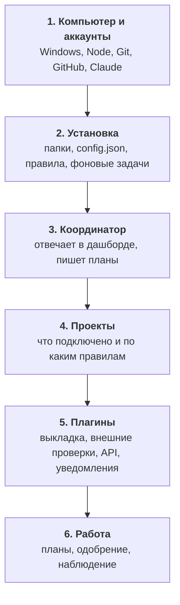
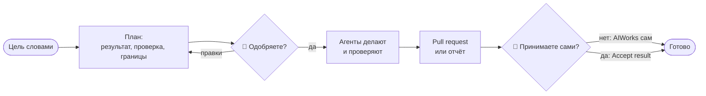

# Настройка AIWorks по слоям

[English](README.md) · **Русский**

AIWorks собирается из шести слоёв. Каждый следующий опирается на предыдущий, и у каждого свои решения. Обычно всё это делает ваш ИИ-ассистент по [готовым сообщениям с главной страницы](../../README.ru.md#настройка-за-четыре-сообщения). Здесь — то же самое подробно: зачем нужен слой, что решаете вы, какие команды выполняются и как убедиться, что всё работает.



Значком 🙋 отмечены места, где нужно ваше решение или ваше действие. Всё остальное ассистент делает сам.

Пути в примерах (`C:/Work/aiworks`) условные. Ассистент подставит свои и не тронет уже существующую установку.

---

## Слой 1. Компьютер и аккаунты

**Зачем.** Агенты AIWorks — это программы Claude Code, Codex и Cursor, которые запускаются на вашем компьютере от вашего имени. Им нужны установленные программы и ваши входы в аккаунты. AIWorks сам никуда не входит и аккаунтов не создаёт.

🙋 **Что решаете вы**

- **Какой компьютер.** Тот, что можно оставить включённым: в спящем режиме работа не идёт. Если компьютер нужен вам для другого, удобнее отдельный — агенты заметно его нагружают.
- **Какие подписки.** Claude обязателен: это основной исполнитель и единственный координатор. Codex — запасной на случай лимитов. Расход идёт из ваших подписок или API-кредитов.

🙋 **Что делаете вы:** входите в GitHub и в Claude Code через их собственные окна входа. Пароли и токены никогда не вставляются в чат и в файлы настроек.

**Команды**

```powershell
node --version     # нужен 22.18 или новее
git --version      # 2.38 или новее
node --input-type=module -e "import { DatabaseSync } from 'node:sqlite'; new DatabaseSync(':memory:').close(); console.log('SQLite ready')"

gh auth login --web
gh auth status

claude --version
```

Ставить Claude Code нужно [нативным установщиком](https://code.claude.com/docs/en/setup) под той же учётной записью Windows, под которой будет работать AIWorks. Обёртка через npm или `.cmd`, которая работает у вас в терминале, может не запуститься из AIWorks.

**Как проверить.** Все команды выше отвечают версией, `gh auth status` показывает вход. Номер версии доказывает только, что программа есть; работает ли ваш аккаунт, ассистент проверит на слое 3.

---

## Слой 2. Установка

**Зачем.** AIWorks держит отдельно четыре вещи, чтобы обновление не ломало работу, а ваши данные не попадали в публичный код:

| Что | Где по умолчанию | Зачем отдельно |
| --- | --- | --- |
| Исходный код | `C:/Work/aiworks` | Отсюда берутся обновления |
| Рабочая копия | `C:/Work/aiworks/.local/runtime` | Запускается только проверенная версия; обновление не идёт под работающими агентами |
| Данные | `C:/Work/aiworks/.local/supervisor` | База, журнал, `config.json`. Переживает обновления |
| Правила | `C:/Work/aiworks/.local/governance` | Какие проекты разрешены и по каким правилам. AIWorks их только читает |

Всё в `.local/` в Git не попадает.

🙋 **Что решаете вы:** где будут лежать данные. Вариант по умолчанию подходит почти всегда.

**Команды**

```powershell
Set-Location C:/Work
git clone https://github.com/netbka/aiworks.git
Set-Location C:/Work/aiworks
npm ci

$Root = 'C:/Work/aiworks'
$Runtime = "$Root/.local/runtime"
$Data = "$Root/.local/supervisor"
New-Item -ItemType Directory -Force "$Root/.local", $Data | Out-Null

# Рабочая копия — ровно та версия, что слита в main
git -C $Root fetch origin main
git -C $Root worktree add --detach $Runtime (git -C $Root rev-parse origin/main).Trim()
Set-Location $Runtime; npm ci

# Папка правил из готовой заготовки (существующую не перезаписывает)
Set-Location $Root; npm run setup:local

# Настройки из примера
Copy-Item "$Root/docs/guides/examples/config.example.json" "$Data/config.json"
```

Ассистент заменяет в `config.json` все примеры на настоящие пути. Минимальный файл выглядит так:

```json
{
  "governanceRoot": "C:/Work/aiworks/.local/governance",
  "envFile": "C:/Work/aiworks/.local/supervisor/.env",
  "repositories": {},
  "commands": {
    "claude": ["C:/Tools/Claude/claude.exe"],
    "git": ["C:/Program Files/Git/cmd/git.exe"],
    "gh": ["C:/Program Files/GitHub CLI/gh.exe"]
  }
}
```

В `config.json` только пути и переключатели. Секретов там не бывает никогда: они лежат в `.env` рядом, о нём — [на слое 5](#где-хранятся-секреты).

**Первый запуск** — сначала вручную, чтобы увидеть ошибки, в двух окнах из рабочей копии:

```powershell
node src/supervisor/cli.mjs serve --data C:/Work/aiworks/.local/supervisor --governance C:/Work/aiworks/.local/governance
npm run dashboard -- --data C:/Work/aiworks/.local/supervisor --governance C:/Work/aiworks/.local/governance
```

**Фоновые задачи** — когда ручной запуск работает. Две задачи Windows запускают AIWorks при входе в систему и каждые 5 минут, если он остановился. Окон не остаётся.

```powershell
powershell -NoProfile -File scripts/supervisor/install-windows-task.ps1   -Checkout C:/Work/aiworks/.local/runtime -DataDir C:/Work/aiworks/.local/supervisor
powershell -NoProfile -File scripts/supervisor/install-dashboard-task.ps1 -Checkout C:/Work/aiworks/.local/runtime -DataDir C:/Work/aiworks/.local/supervisor
```

**Как проверить.** Открыть `http://127.0.0.1:4318` — дашборд показывает пустой список проектов. В планировщике Windows есть задачи **AIWorks Supervisor** и **AIWorks Dashboard**.

> Хотите сначала посмотреть на экраны без настройки? `node tests/dashboard/fixtures/review-store.mjs --port 4319` открывает дашборд с выдуманными проектами на `http://127.0.0.1:4319`. Ни один агент там не работает.

---

## Слой 3. Координатор

**Зачем.** Координатор — агент Claude, который отвечает на ваши сообщения в дашборде и составляет планы. Он только читает ваши проекты и ничего в них не меняет. Без него сообщения в дашборде сохраняются, но их никто не читает.

🙋 **Что решаете вы**

- **Включать ли координатора.** Советуем включить.
- **Как одобрять планы.** Кнопкой **Approve and start** в дашборде (настройка `coordinator.intake`, «Plan and do») или словами ассистенту, который регистрирует план командой. Кнопка удобнее: нажать её может только человек за этим компьютером. Она построена и проверена на синтетических проектах, по умолчанию выключена.

**Настройка** — блок в `config.json`:

```json
"coordinator": {
  "enabled": true,
  "intake": true,
  "repositories": ["your-account/your-project"],
  "reportTo": "your-account/your-project#1",
  "model": "opus",
  "permissionMode": "dontAsk",
  "timeoutMinutes": 30,
  "sourceRepo": "C:/Work/aiworks",
  "runtimeRoot": "C:/Work/aiworks/.local/runtime",
  "worktreeRoot": "C:/Work/aiworks/.local/worktrees/aiworks"
}
```

`reportTo` — issue в вашем репозитории, куда можно опубликовать ответ. `permissionMode` всегда `dontAsk`: всё, что координатору не разрешено, просто отклоняется.

**Как проверить**

```powershell
node src/supervisor/cli.mjs message "Опиши проект и предложи первую небольшую задачу. Ничего не меняй." --data C:/Work/aiworks/.local/supervisor
node src/supervisor/cli.mjs messages --data C:/Work/aiworks/.local/supervisor
```

Сообщение проходит путь «получено → прочитано → отвечено». Ответ появляется в дашборде в разделе **Messages**.

---

## Слой 4. Проекты

**Зачем.** AIWorks работает только с проектами, которые вы явно разрешили, и только по их правилам. Это главная защита от того, что агент возьмётся не за то.

Проект подключается в два шага:

1. **Разрешение** — запись о проекте в папке правил: `.local/governance/registry/projects/<id>.json` по образцу `project.example`. Запись — ваше решение; ассистент готовит её, вы соглашаетесь.
2. **Подключение** — где лежит проект на диске. Для проекта на GitHub — строка в `config.json`:

```json
"repositories": {
  "your-account/your-project": {
    "path": "C:/Work/your-project",
    "worktreeRoot": "C:/Work/aiworks/.local/worktrees/your-project"
  }
}
```

Агенты работают не в вашей папке, а в отдельных копиях внутри `worktreeRoot`. Ваша рабочая папка остаётся нетронутой.

С [плагином «Проекты без GitHub»](../plugins/README.ru.md#проекты-без-github) проект подключается кнопкой **Add project** в дашборде: GitHub, локальный Git или просто папка.

🙋 **Что решаете вы** — в дашборде, в настройках проекта:

| Решение | Варианты | По умолчанию | Как выбрать |
| --- | --- | --- | --- |
| Что агентам трогать нельзя | Список защищённых папок и файлов | Ничего | Секреты, миграции базы, чужой код |
| Чем проверять результат | Команда тестов проекта, например `npm test` | Из правил проекта | Если тестов нет, проверяющий опирается на критерии плана |
| Кто принимает результат | AIWorks сам или «I accept results myself» | AIWorks сам | Сами — пока не доверяете или проект чувствительный |
| Сливает ли AIWorks сам | Да — [плагин «Автоматический merge»](../plugins/README.ru.md#автоматический-merge) | Нет, merge делаете вы | Включайте, когда проверки проекта надёжны |
| Выкладывать ли после merge | Да — [плагин «Выкладка»](../plugins/README.ru.md#выкладка) | Нет | Только если у проекта есть инструкция выкладки и проверка |

Настройки проекта могут только добавлять защиту и ограничения. Расширить права агентам они не могут.

**Как проверить.** Проект виден в **Projects**, у него есть строка состояния. Для проекта на GitHub — `git -C C:/Work/your-project status --short --branch` показывает чистую ветку.

---

## Слой 5. Плагины

**Зачем.** Базовой установки хватает, чтобы планировать, делать, проверять и отдавать pull request. Всё, что связывает AIWorks с внешним миром — выкладка, другие компьютеры, другие системы, уведомления, — вынесено в плагины. Каждый выключен, пока вы его не включите.

🙋 **Что решаете вы:** какие плагины нужны. Для каждого в [каталоге плагинов](../plugins/README.ru.md) есть: зачем он, какой блок `config.json`, какие секреты, сообщение «включи», сообщение «выключи» и как проверить.

### Где хранятся секреты

Токены, ключи ботов, логины и пароли сервисов не пишутся в `config.json`. Там только **имя-ссылка**, а значение лежит в хранилище секретов. AIWorks читает одно значение в тот момент, когда оно нужно, и никуда его не передаёт. Агенты-исполнители его не видят.

**По умолчанию это обычный файл `.env`** в папке данных: `.local/supervisor/.env`. В Git он не попадает, а в окружение AIWorks не загружается целиком — значения читаются по одному.

```powershell
Copy-Item C:/Work/aiworks/docs/guides/examples/secrets.env.example C:/Work/aiworks/.local/supervisor/.env
notepad C:/Work/aiworks/.local/supervisor/.env
```

Имя строки в `.env` — это ссылка из `config.json` большими буквами, где всё, кроме букв и цифр, заменено на `_`:

```dotenv
# ссылка aiworks-alerts/bot
AIWORKS_ALERTS_BOT=123456:ABC-пример
# ссылка example-crm-password
EXAMPLE_CRM_PASSWORD="пароль с пробелами в кавычках"
```

В `config.json` путь к файлу указывается один раз сверху (`"envFile"`), а в блоках плагинов — как хранилище:

```json
"envFile": "C:/Work/aiworks/.local/supervisor/.env",
"campaignApi": {
  "enabled": true,
  "tokenRefs": ["aiworks-campaign-api:your-project"],
  "credentialStore": { "kind": "env-file", "path": "C:/Work/aiworks/.local/supervisor/.env" }
}
```

🙋 **Что делаете вы:** вписываете значения в `.env` сами. Ассистент только говорит, какие строки нужны. Значения в чат не отправляйте.

#### Другие хранилища — по желанию

Если секреты у вас уже живут в другом месте, AIWorks может брать их оттуда. Это не обязательно: `.env` достаточно.

| Хранилище | Настройка блока | Когда удобно |
| --- | --- | --- |
| Диспетчер учётных данных Windows | `{ "kind": "windows" }`; значение: `cmdkey /generic:<ссылка> /user:aiworks /pass` | Секреты привязаны к учётной записи Windows и не лежат файлом на диске |
| [Infisical](https://infisical.com) | `{ "kind": "command", "command": ["node", "scripts/infisical-credential-helper.mjs", "--project", "<id>", "--environment", "prod"] }` | Секреты общие для нескольких компьютеров или команды; имена ключей те же, что в `.env` |
| Любой другой сервис (1Password, Bitwarden, Vault…) | `{ "kind": "command", "command": [<ваша команда>] }` | Нужна небольшая команда-помощник: `get <ссылка>` печатает значение, `has` и `set` — по [описанию протокола](../SUPERVISOR.md#16-external-campaign-api-off-by-default) |

Блок без `credentialStore` по-прежнему читает Диспетчер Windows — так работают установки, сделанные до появления `.env`. Для уведомлений в Telegram хранилище выбирается приставкой ссылки: `env:`, `windows:` или `helper:`.

---

## Слой 6. Работа

**Зачем.** Здесь вы уже не настраиваете, а пользуетесь.



🙋 **Что делаете вы**

- **Ставите цель** — что должно быть правдой, когда работа закончена. Не как делать, а что получить.
- **Одобряете план.** Объём работы не меняется без нового одобрения.
- **Смотрите в Needs you**, когда удобно. Там только то, что можете сделать лишь вы.

**Команды** для тех, кто предпочитает их, и для вашего ассистента:

```powershell
$D = '--data', 'C:/Work/aiworks/.local/supervisor'
node src/supervisor/cli.mjs start .local/campaigns/my-work.json @D   # зарегистрировать одобренный план
node src/supervisor/cli.mjs status my-work @D                        # где работа
node src/supervisor/cli.mjs pause my-work @D                         # пауза; продолжить — тот же start с тем же файлом
node src/supervisor/cli.mjs recheck my-work @D                       # проверить снова после исправления
node src/supervisor/cli.mjs cancel my-work @D                        # отменить
node src/supervisor/cli.mjs stop @D                                  # остановить AIWorks целиком
```

План — это ваш личный файл в `.local/campaigns/`, он не попадает в Git. Формат описан в `src/supervisor/campaign.mjs`, примеры — в `tests/fixtures/campaigns/`. Все команды — в [справочнике](../guides/CLI_REFERENCE.md).

#### Задача в веб-интерфейсе другой системы

Если работу нужно сделать в чужой системе через браузер — CRM, админке, учётной системе, — пароль агенту не передаётся. Вы вписываете логин и пароль отдельной учётной записи в `.env`, ассистент описывает вход в настройках, и перед каждым запуском AIWorks сам входит в систему и отдаёт агенту уже вошедший браузер. Для изменений, а не только просмотра, нужно ваше разрешение на адрес системы. Всё по шагам — в [плагине «Вход в системы через браузер»](../plugins/README.ru.md#вход-в-системы-через-браузер).

**Обновление AIWorks** — одной командой из чистой копии исходников на проверенной версии:

```powershell
npm run rebuild
```

Она ставит текущую работу на паузу, дожидается открытых шагов, обновляет рабочую копию и продолжает ровно то, что поставила на паузу. Если что-то сорвалось, повторный запуск продолжает с того же места.

---

## Если что-то пошло не так

- Сначала смотрите **Needs you** и вкладку **Diagnostics** в дашборде.
- Частые остановки и что делать — в [Troubleshooting](../guides/TROUBLESHOOTING.md).
- Не удаляйте базу, её файлы журнала и папки запусков, чтобы «начать заново». Это теряет историю, а работу всё равно не восстанавливает.
- Полное техническое описание — в [runbook супервизора](../SUPERVISOR.md) (англ.).
